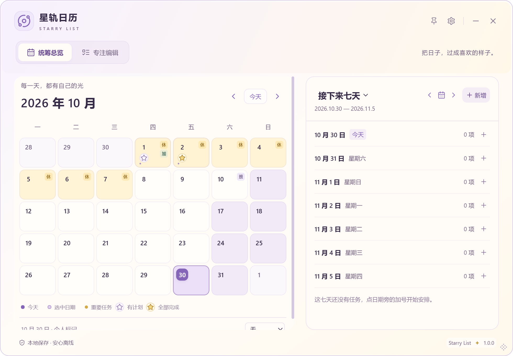
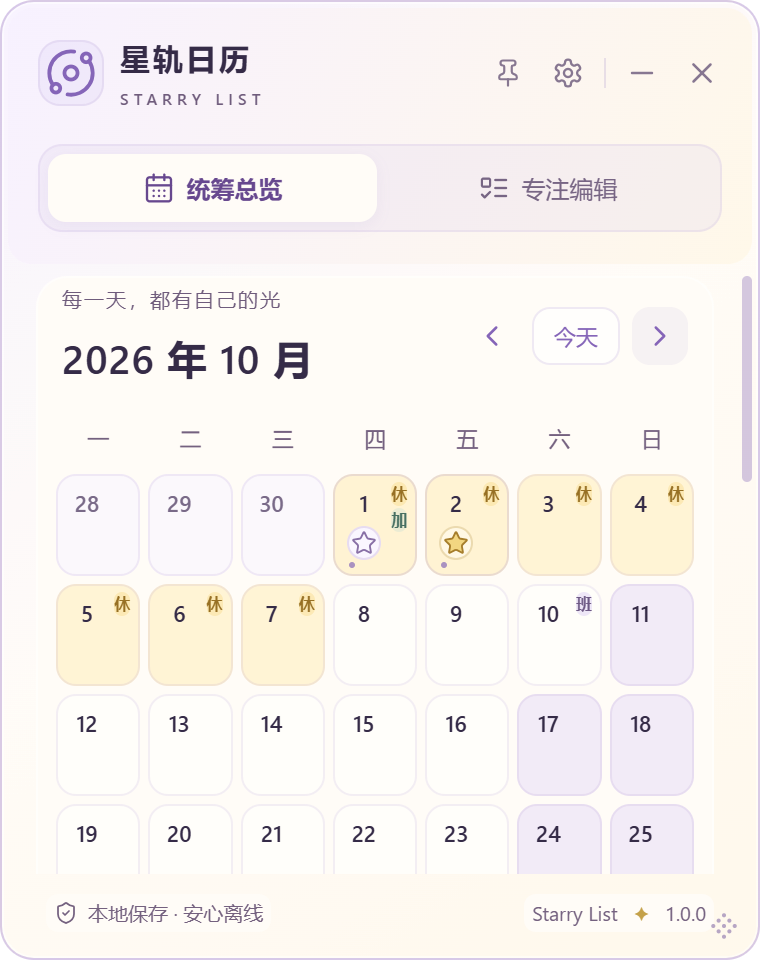

# SL-022-A 每日星星预览验证

2026-10-30。初始main `36f8d2f`，工作区干净；经本机已有代理fetch核对最新origin/main相同。本轮授权开发、测试、独立体验包、Commit与普通Push。无Tag/正式Release，未执行安装器或关闭已运行的正式应用。

## 状态与数据边界

SL-022/A In Review，等待用户安装。SL-024-B/C：用户安装D确认「可以可以，当前改动可以诶，我们继续吧」，结合原逐项认可和B/C/D已有测试，Done；D空态闭合，但完整恢复缺用户独立环境亲自覆盖验收，D/父项继续In Review。SL-020 Done，SL-006 Research。SL-023只完成[三个概念方向](research/SL-023-GALAXY-CONCEPT.md)，仍Idea。

SQLite user_version=2、001/002、Task/WaterEntry和JSON V2、store/IPC写入排序、正式1.0.0及应用标识无变更。纯函数只读当天分组任务，不依赖时钟、updated_at或永久奖励。0/0无星，0/3、1/3、2/3空心柔紫，3/3、1/1实心淡金。历史随当前任务修改而变化。

## 视觉与交互

日期数字下17px圆框中13px星星，空心/填充双重区分。任务行优先级仍为原星星/王冠，底部图例分开说明；星星不在假日徽标序列中。标题与aria-description给日期按钮提供状态解释，图标装饰性、无独立Tab。日期头真实高度参与原有ResizeObserver，空间不足减少预览/显示紧凑数量点，最终保留滚动。无新增动画，因此应用关闭动画/系统减少动态效果不会出现持续渲染。

## 自动化

- TypeScript、ESLint通过；Vite生产构建通过，只有既有Zod注释提示。
- 前端 **208/208，14文件**，原196+12。7种数量组合、无关字段/过去未来跨年、非按钮；真实App实例中完成/取消、新增/删除/恢复/改日期/删最后一项、V1/V2导入快照即时刷新。原草稿/失焦/新增/编辑/排序/备份/补水测试全部保留。
- Rust **27/27**，fmt --check、Clippy --locked -- -D warnings通过，真实SQLite/文件备份原测试不变。
- 初次前端运行207通过、1个既有platform-appearance模块初始化hook超过10秒；原门槛不变，完整默认重跑208全部通过。首轮原生专项误使用旧dist，缺星断言失败；完成前端生产构建并重建隔离debug后重跑，不把失败记作通过。

## Windows实际运行

使用单独test标识 `app.starrylist.desktop.sl020-test`、唯一缓存数据目录与WebView profile；未读取正式数据库/个人备份。下列CDP点击/键盘/布局测量实际运行在Windows WebView2→Tauri→SQLite上，与前端模拟、OS原生输入、用户验收分别记录。

**540/540状态通过**，证据 `.cache/sl022a-1793362835123/results.json`；真实完成/取消不重载即时刷新、点击日期和方向键焦点通过。脚本 `scripts/daily-star-smoke.mjs`；指定4/5/6周月份、五尺寸、三字号、三材质、两顶部与补水开关540状态；检测日期/徽标/星星裁切、星星与日期/徽标/预览重叠、水平溢出及可见状态。

既有回归本轮全部通过：桌面25组；补水360布局及记录/错误/重启；真实OS拖动10组/72布局；原生Save/Open文件异库完整恢复、V1兼容/冲突/SQL故障回滚/两视图即时刷新/36空态。每项缓存证据与精确范围见VALIDATION，本轮不把自动化恢复当用户独立验收。

## 未验证范围

未执行安装器、同版本覆盖安装或卸载；不等于用户安装验收。Windows10、其他GPU/混合DPI/多屏/触屏/读屏与真实IME候选窗仍未认证；材质矩阵验证布局不等于所有硬件毛玻璃质量认证。窗口尺寸是逻辑像素，实际可用尺寸受当前显示器工作区与DPI约束。原生不透明回退沿用且未另建不透明安装包。完整恢复的自动化不代替用户亲自验收。

## 复现与安装

`npm run typecheck`、`npm run lint`、`npm test`、`npm run build`；Rust既有test/fmt/Clippy命令。按VALIDATION中的隔离debug配置构建，再串行运行daily-star、desktop、补水C、拖动与备份冒烟；截图重定向缓存，不覆盖旧截图。

安装前先在D版导出新版JSON V2，正常退出，再复制完整应用数据目录作为额外备份。不删除应用数据，不降级数据库，不自动关闭正式版。旧SL-024-D安装包保留，SHA256仍为 `89c093ce907dc141f8e8fff4aef2bd93b52fa33859d64103109ce22b1e22f870`。新包与SHA256、提交/Push/CI见[验证记录](VALIDATION.md#sl-022-a)。

## 本轮合成界面对照

旧版日期区只有日期与假日/个人徽标；本轮在日期数字下方独立容纳状态，不挤占徽标。下图仅使用合成任务，不含私人壁纸或个人计划。窄窗允许纵向滚动，保留整个日历信息。

实现 [`f25efd8`](https://github.com/YOLIIIIII/starry-list/commit/f25efd845138bc170a5da22939c641c65185d644) 已普通Push main，[代码CI](https://github.com/YOLIIIIII/starry-list/actions/runs/41055792132)全部成功。安装包5343359字节，SHA256 `409d4a08f23a20d34dd0904a63d0d8b2533364941761d0e36da00958a9af987b`。用户安装验收与正式发布尚未发生。
