# SL-022-B / SL-024-E 星光视觉精修

2026-10-31。基线main `3faf7ae`，工作区干净，fetch后与origin/main一致。用户明确授权本轮开发、隔离测试、预览包及普通Push；不发布、不关闭正式应用。

## 月历每日星星：去掉徽章

完全删除daily-star的border、background和border-radius；只保留15px星形（原星形13px、外圈17px），1.6px描边（原1.8）。柔紫描边#8263a6、完成边线#a37a28、淡金填充#f3d580。尺寸略增使去圈后仍清楚，细线减轻厚重感；图形无投影、无动画。月历位置仍在日期数字下，假日/个人徽标和任务摘要不重排，图例复用同一组件。

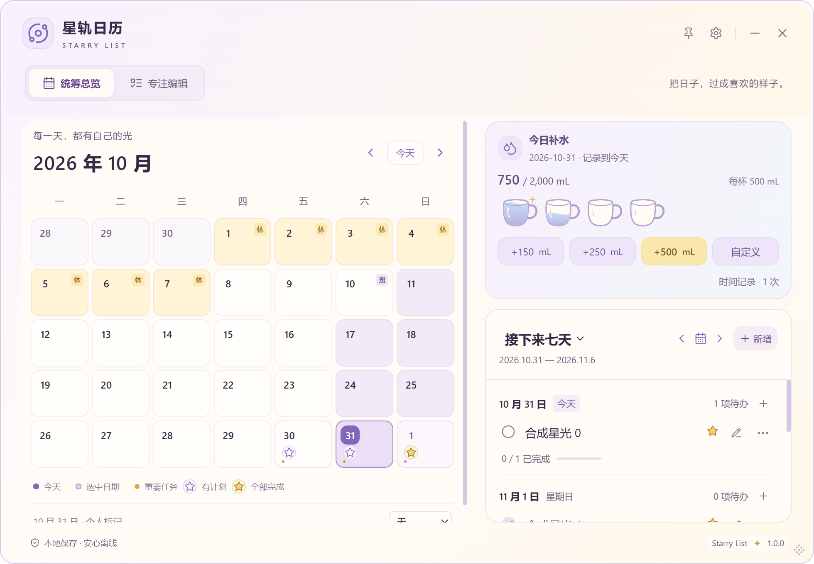
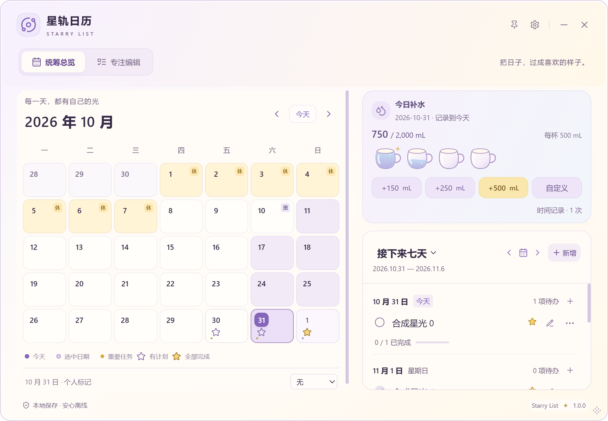

日历任务行星星/王冠继续表示优先级；每日星星位于日期下并由图例解释，避免把任务优先级当完成状态。无任务无星，尚未全完成为空心，至少一条且全完成实心。统计与历史动态语义完全不变，饮水不计入。

## 专注日期条：数字下同步状态

复用DailyStar / dailyStarState / byDate，每个日期只计算一次；删除原i/has-tasks的3px点，用15px固定槽保持数字对齐。选中日期空心星用#f0e4ff，实心用#ffe5a2，与紫底有清楚明暗差；空心/填充仍是状态差异。没有新按钮、Tab、拖放目标或存储状态。

矮窗口原规则会隐藏按钮内所有span，改为仅隐藏focus-weekday，确保星星槽仍显示。数字line-height收至1.2，抵消大部分星星高度增加；≤560px高时仅压缩专注日期导航/标题/新增区域的冗余垂直留白，日期数字用UI字号，星星仍在数字下方，保留60px任务视口和主面板内的固定新增；不重排补水内容、设置或弹窗。七列继续等宽，保留原今天字重/选中背景、草稿保存和点击导航。

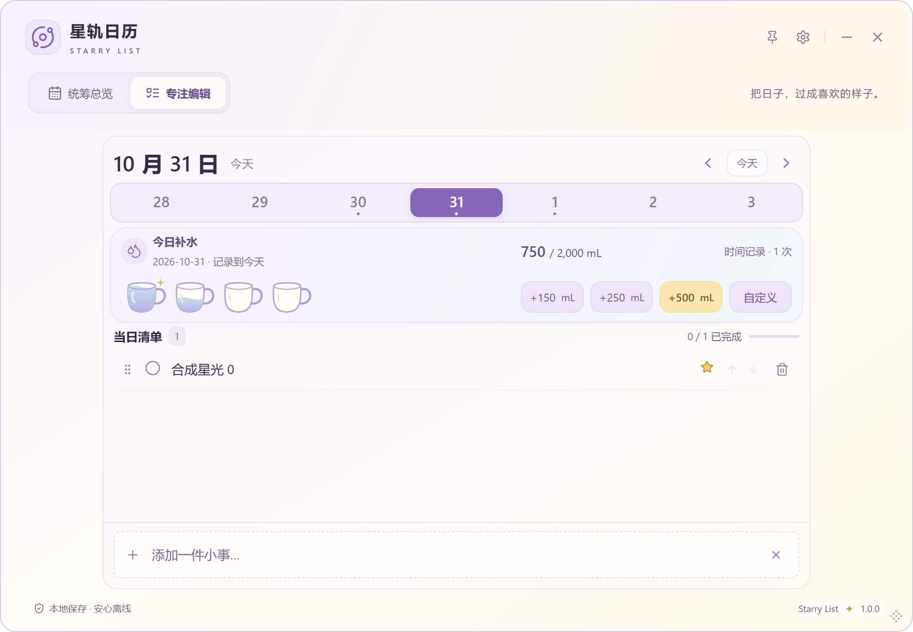

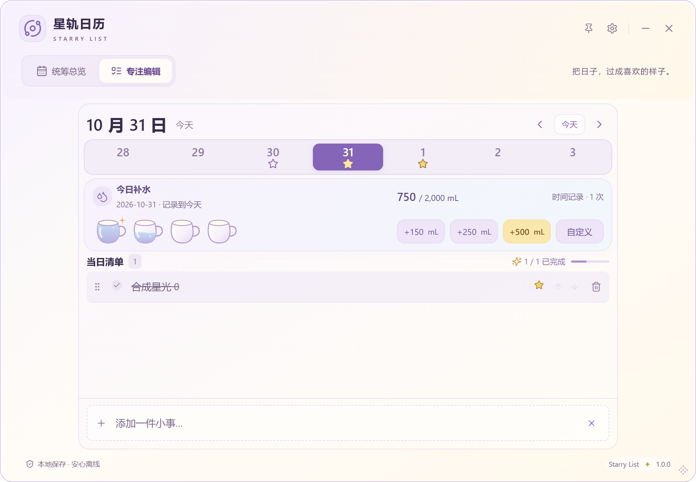
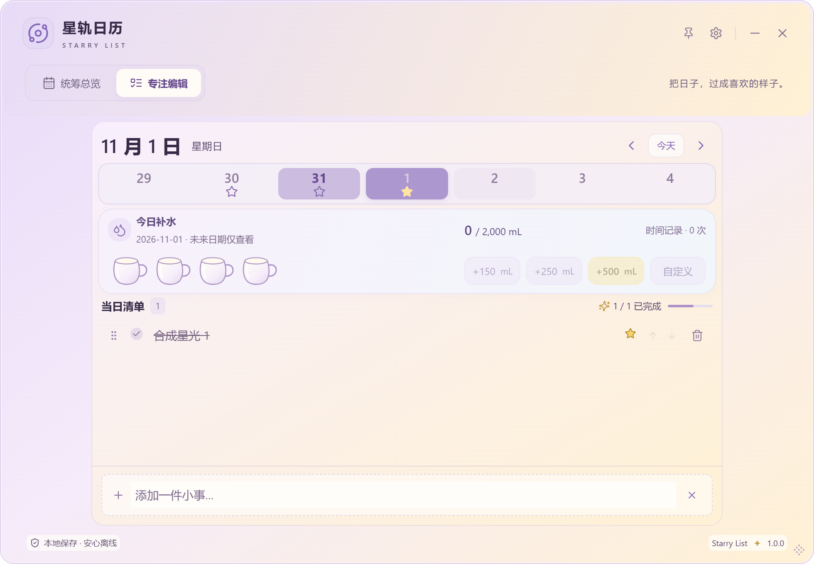
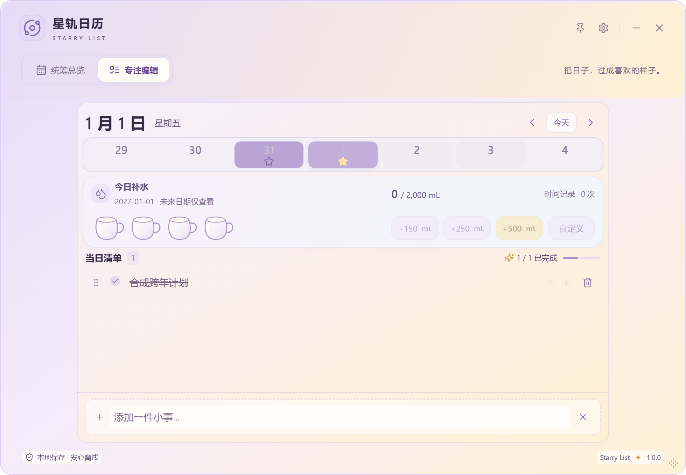

## 原创水杯探索与选择

用户网络插画原图未附在本轮文件中，不声称看过或提取素材。只按用户文字描述吸收“圆润、饱满、柔和高光、轻波浪”的视觉语言。所有SVG路径由本轮代码绘制，不下载/复制/临摹第三方完整杯形，不上传网络插画。下图由实际WaterCup JSX及候选路径渲染，非生成位图替代产品。

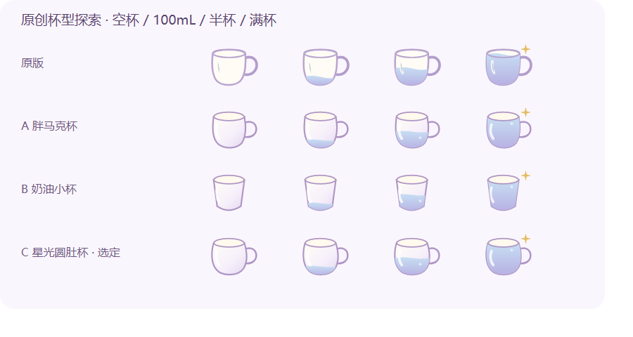

- A胖马克杯：轮廓稳定、贴近旧版，但侧壁仍较直。
- B奶油小杯：无耳且轻巧，但与现有马克杯识别差距大，小尺寸更像普通量杯。
- C星光圆肚杯（选定）：曲线外鼓、圆底和小圆耳，杯口柔椭圆，奶油白到浅紫杯壁渐变使空杯也有体积；高光顺杯壁、只加一颗低对比气泡，水波振幅减半，满杯淡金星仍在杯口外。小尺寸下轮廓清楚，没有用粗黑边或堆满装饰。

原clipPath与杯身使用同一路径；useId分别命名cup/body/water引用，实例互不影响。水位仍46-fill×32、每杯500mL：100mL为20%高度，250mL为半杯，500mL到杯口下沿；曲面杯形是高度比例而非物理容积标定，不把装饰气泡当水量。非整杯目标刻度保持同映射；高目标最多六杯、中间省略、超额真实数字不变。CSS杯宽45/50/60px、44px标准高度等旧比例未改，杯耳/满杯星均在原viewBox内。

## 验收复核与数据保护

SL-022-A用户反馈功能正面但视觉待精修，A/父项继续In Review；B/E开发后同样等待用户安装。SL-024-A/B/C保持Done。用户明确“之前的导入和导出我试过了，没有问题”，结合D/A阶段真实文件A→B完整往返、V1兼容、V2合并/覆盖/冲突/回滚、原生文件与重启证据，D符合原验收条件，复核Done；不声称用户自己执行隔离库覆盖、逐条核对全部饮水或故障回滚。父项因新E仍In Review。SL-023 Idea/Design、SL-006 Research、SL-020 Done保持。

SQLite v2、001/002、Task/WaterEntry、JSON V2与V1兼容、store写入/IPC/导入导出事务、设置字段、正式1.0.0与标识全部不改；正式库/个人备份不参与测试。旧A/D安装包保留且哈希不变。

## 测试、真实Windows与边界

本轮实际数量、Windows布局与功能结果、包哈希、Commit/CI在[验证记录](VALIDATION.md#sl-022-b--sl-024-e)补录。图片来自唯一test标识、隔离SQLite/profile的合成任务与饮水；候选图来自独立Edge无头渲染，不冒充桌面截图。CDP操作/布局测量、真实OS键鼠、前端模拟和用户验收分别记录。

透明版中的opaque_fallback偏好与独立不透明二进制分开：本轮未另构建不透明安装包，不把透明版偏好测试称为不透明二进制认证。未执行安装器或升级/卸载，Windows10、其他GPU/混合DPI/多屏/触屏/读屏、真实IME候选窗仍未认证；三材质布局覆盖不等于所有设备毛玻璃认证。

安装前导出JSON V2，正常退出，复制完整数据目录；不删除应用数据，不直接降级数据库v1软件。B/E及两个父项待用户安装视觉确认，无Tag/正式Release。

## 三字号、玻璃与窄窗实际画面

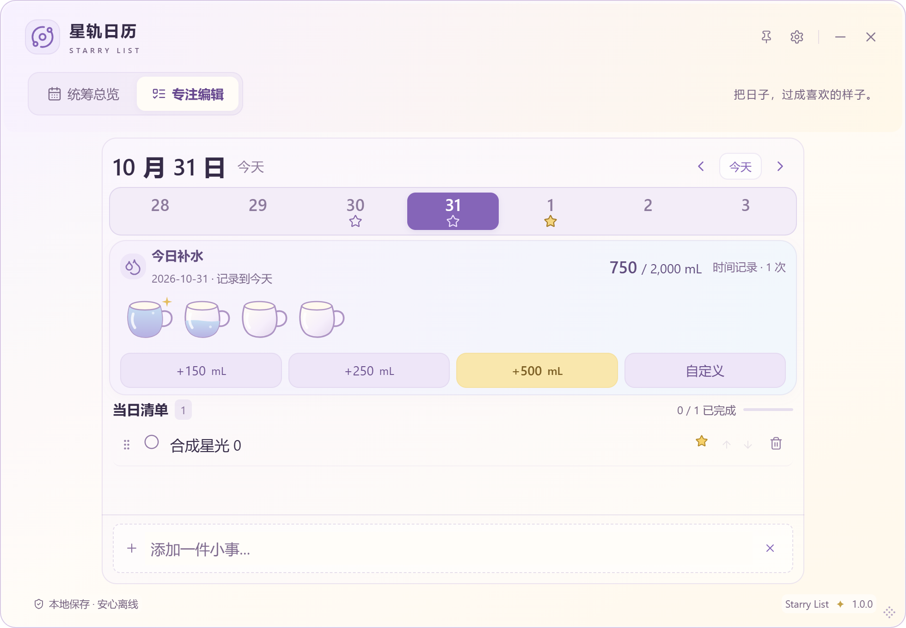
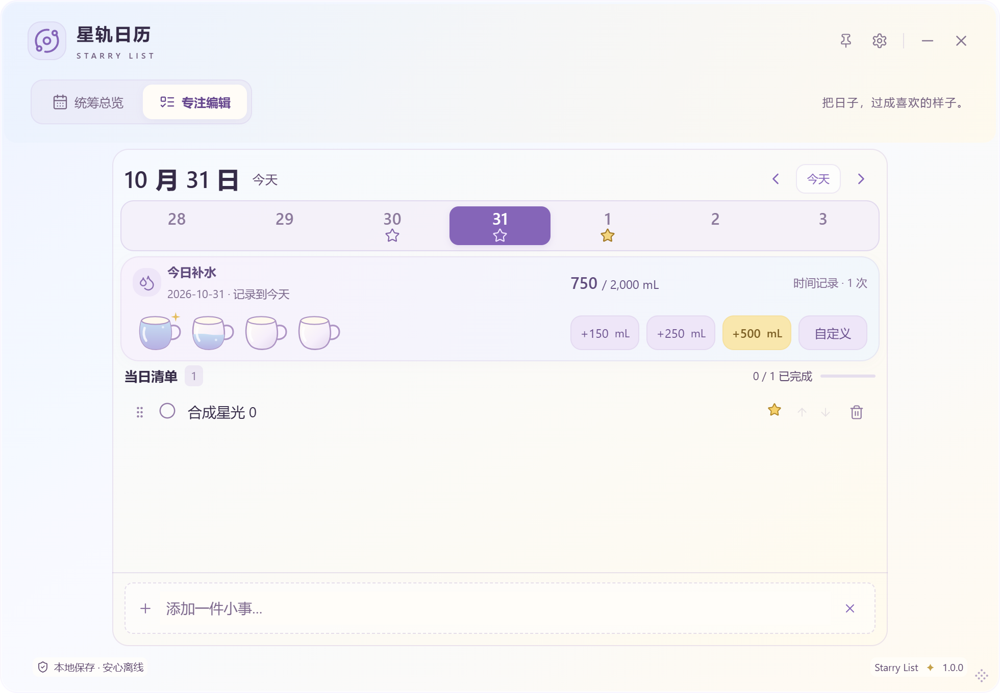
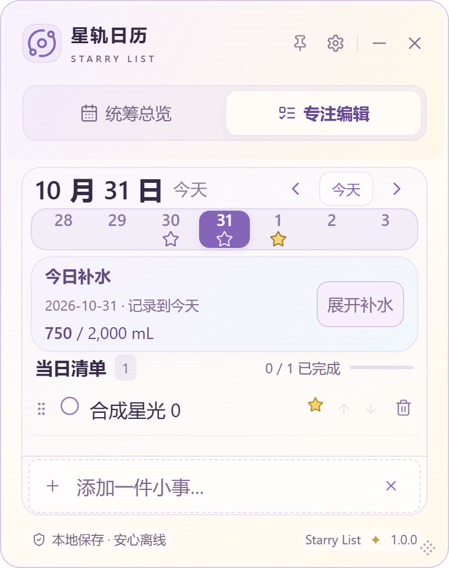

最终星光专项180组合全部通过，任务视口至少60px，固定新增不只在窗口内，还完全在专注主面板内。980×680大字号开启补水直接保留完整杯子与操作，任务视口92.313px，日期条52.594px，未因星星强制收起补水；小/标准/大仍45/50/60px。初测短窗失败和局部留白修正分别记录在VALIDATION。

## 实际水位与精确尺寸

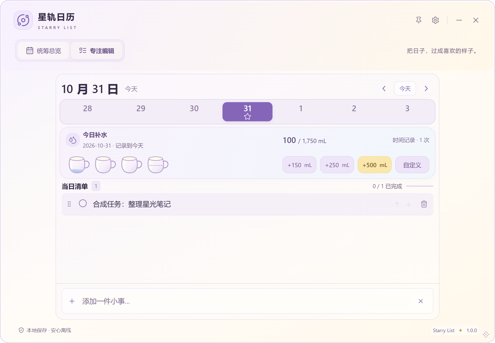
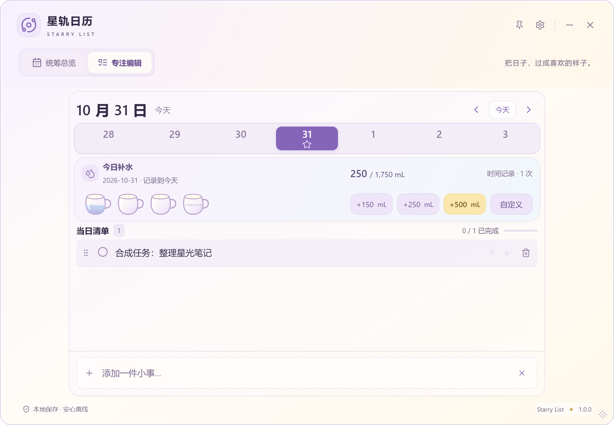
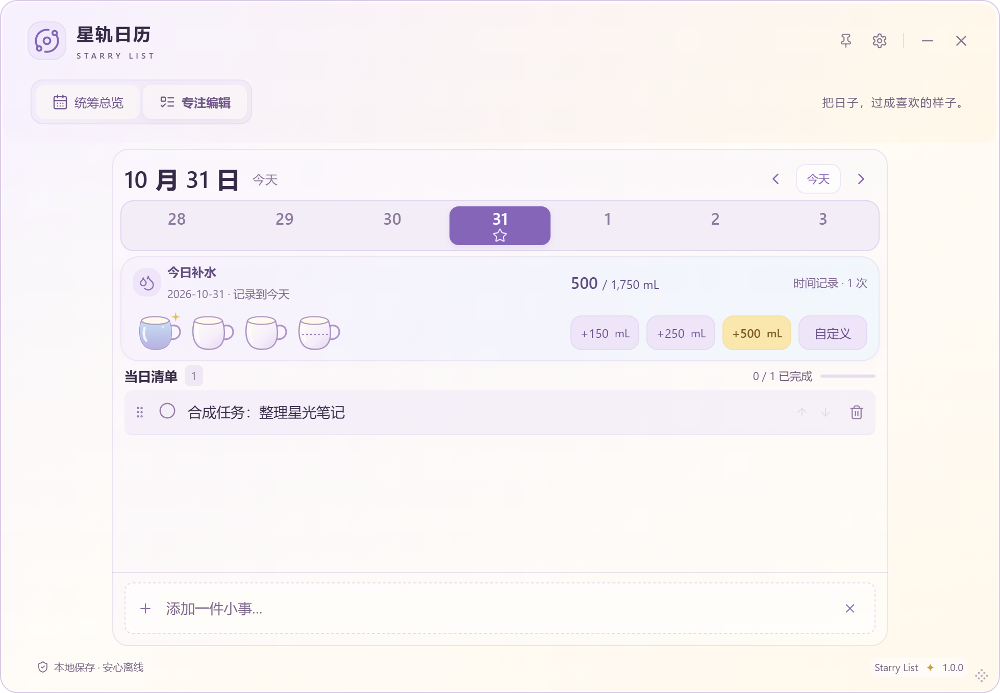

| 980×680 阅读/经典/开启补水 | 杯宽 | 日期条高度 | 任务视口高度 |
| --- | ---: | ---: | ---: |
| 小 | 45px | 49px | 185.203px |
| 标准 | 50px | 50.195px | 172.406px |
| 大 | 60px | 52.594px | 92.313px |

C扩展回归360布局通过；13组累计水位包含0/100/150/250/350/500/750/1500/2000/2500及超额，目标1/1750/2000/2500/20000。每组检查SVG ID唯一且引用存在、可见杯子不碰撞。记录和任务交互不因SVG刷新而改变。
