# SL-024-B 视觉与交互复核

2026-10-30，基于main的SL-024-A；起始工作区干净。只做设置/喝水UI精修，不访问正式数据库。截图来自独立测试标识、独立SQLite和合成任务/饮水，WebView内容截图不采集私人壁纸或真实任务。用户提到的五张体验图不假定存在于工作区。

## A. 设置中心

旧版把顶部、目标、字号、材质、行为、备份及关于串成一个长列表；新版宽窗左分类、右当前面板，600px及以下改顶部双列标签。保留原处理函数、即时预览/失败回滚；面板保持挂载，目标草稿不因换分类丢失。方向键/Home/End切换并保留标签焦点，Tab进入内容；Dialog原焦点环与Escape/关闭保留。

| 分类 | 实际保留内容 |
| --- | --- |
| 外观与布局 | 经典/紧凑、小/标准/大、阅读/轻玻璃/梦幻、不透明度、实色回退 |
| 日历与使用 | 始终置顶、柔和动画、官方节假日、周末底色 |
| 喝水小组件 | 开关、手动目标、关闭保留/非医疗规则 |
| 数据与关于 | JSON导出、导入和原合并/覆盖流程；备份范围、完整目录备份说明、数据位置、版本与MIT关于 |

所有旧入口保留。外观分类在980×680仍可能需要滚动：完整保留可读字号、材质说明和滑块，不靠缩小字来硬塞；只滚当前内容，分类/标题/关闭始终可达。380×480同样滚内容，数据操作在数据分类，无需穿过其他分类。一般确认/抽屉CSS不在本轮作用域。

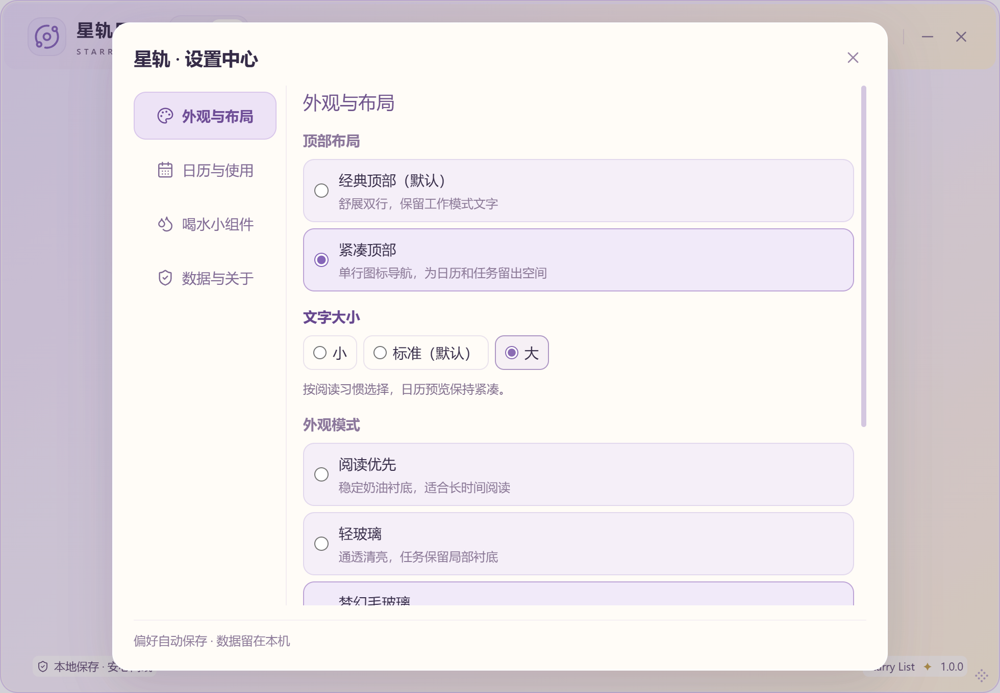
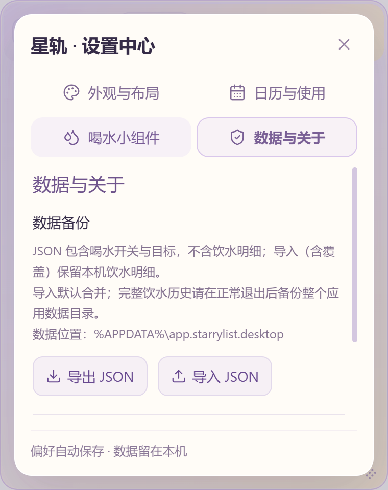

## B. 总览

左月历宽度比例保留，右侧overview-right为独立WaterCard与AgendaPanel；卡片不在agenda-scroll。关闭组件后无占位，日程自然填充。899px以下沿用纵向总览：月历后是独立补水/日程区域；总览页滚动可达，日程自身保留正文滚动，不把卡片塞回任务。

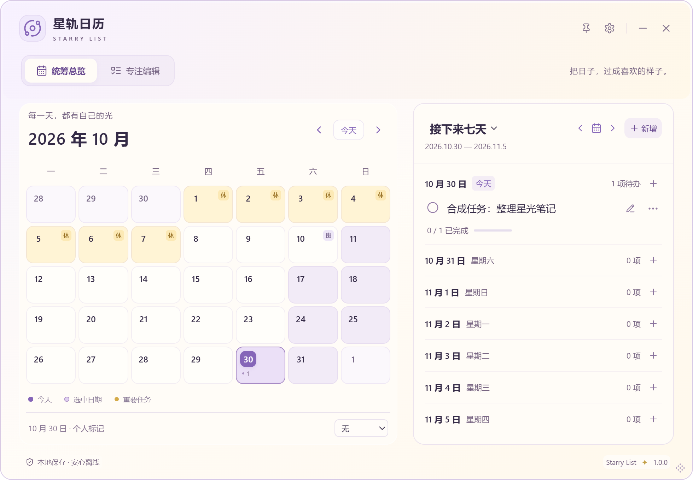
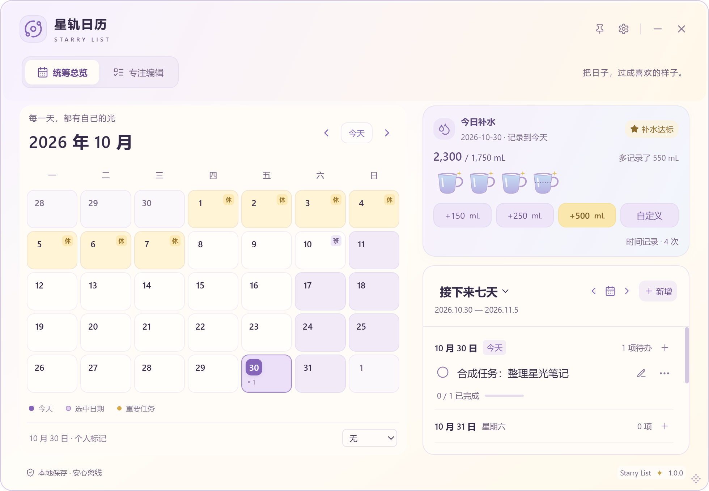
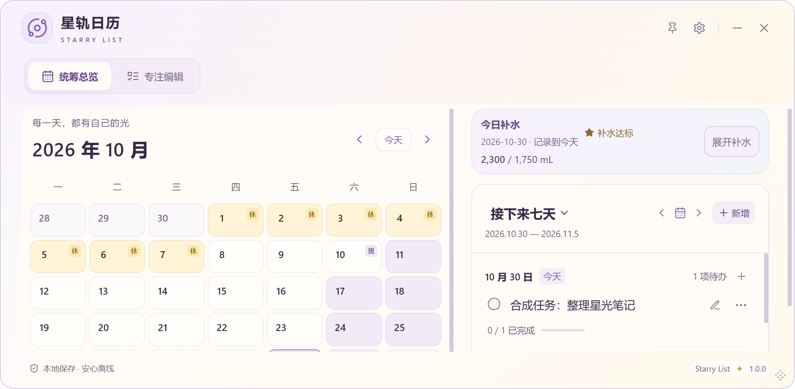
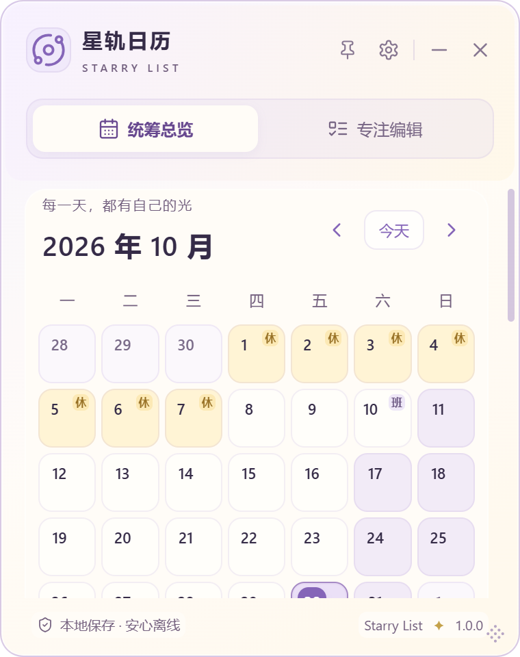

## C. 专注

七天日期条下、清单标题前是独立横向卡片；任务滚动、拖动和固定底部新增不包含卡片。小于541px或高度≤660px显示日期、累计、展开补水；使用既有Dialog展示完整操作，不压缩任务区。短窗收起装饰句/星期文字，保留日期数字与可访问标签。补水操作区关闭后恢复触发器焦点，不引入新弹窗框架。

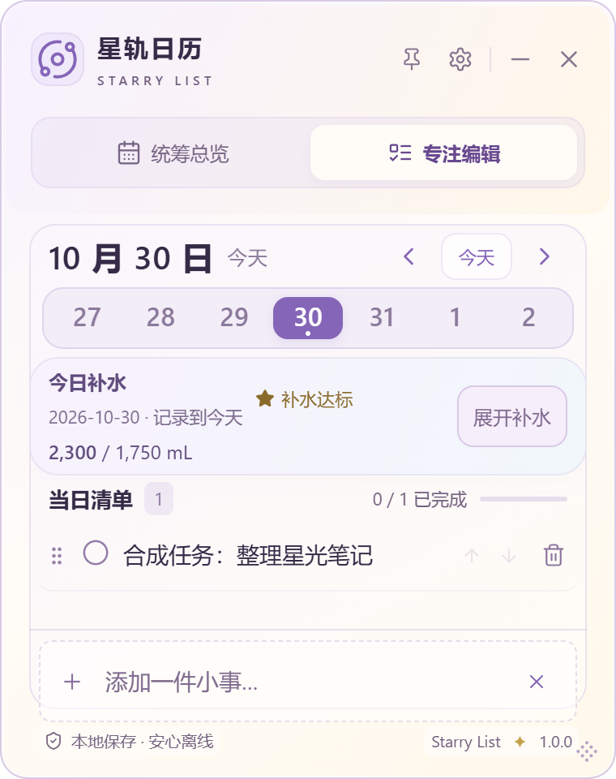
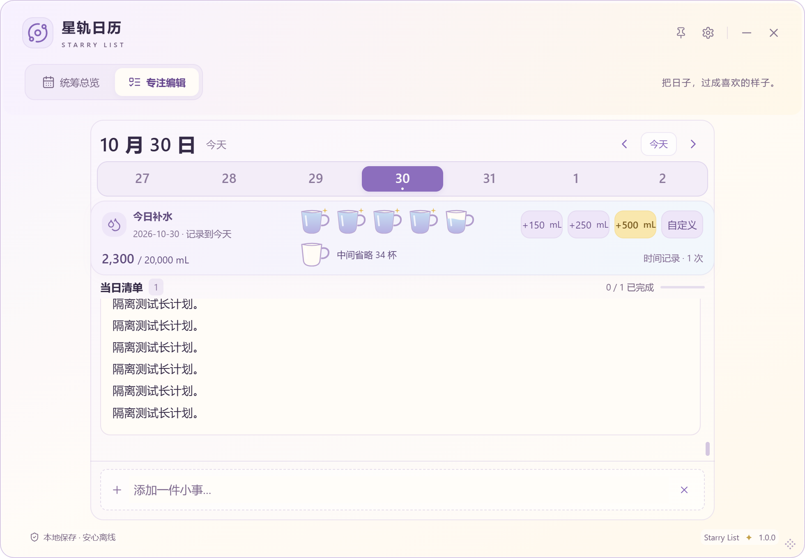

## D. 水杯

原创SVG：杯口略宽、杯底收圆、柔紫轮廓与圆弧杯耳、白色高光、紫蓝水位与轻微波浪、满杯一粒淡金闪光。每杯500mL，按实际比例水位，尾杯虚线刻度；只读，不点击写入。最多六杯（前五与最后），中间省略数量明确，累计真实显示。极端1mL目标仍有刻度，20000mL不会横向挤满。无新增循环动画，减少动态效果沿用系统设置。

标题固定「今日补水」，完整日期说明归属；达标统一「补水达标」避免历史日期的“今天”歧义。淡金小星标与星河无关联，删除后按真实累计消失。

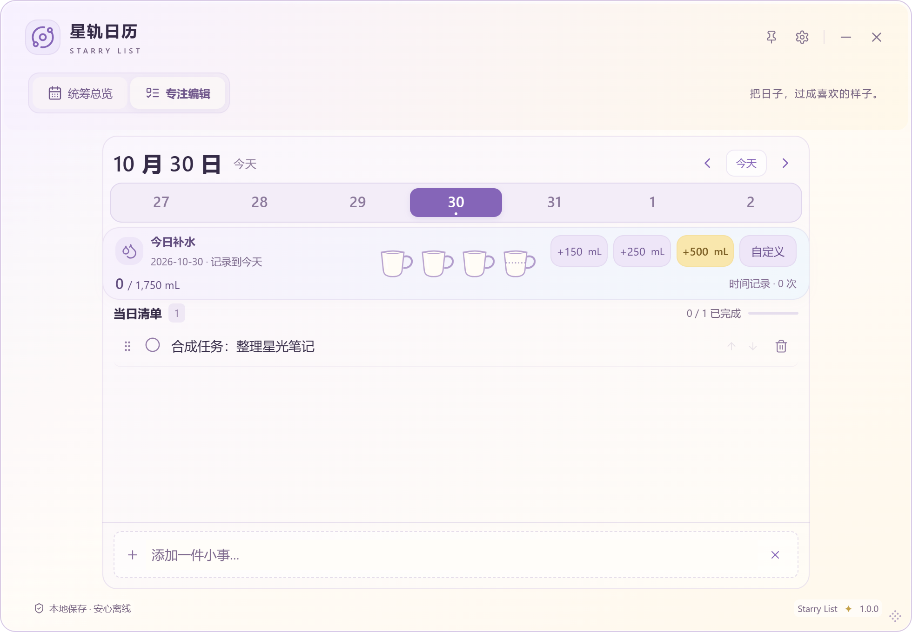

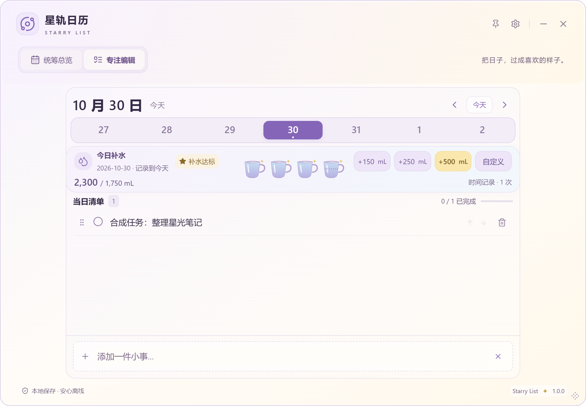
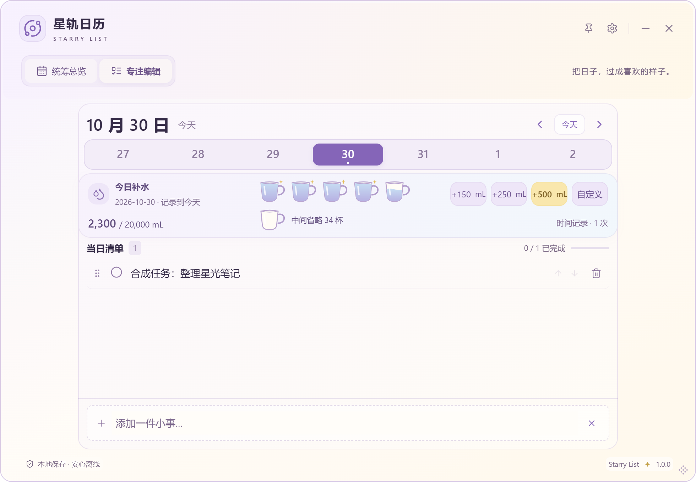

## E. 自定义记录

完整补水操作区内自然分组「记录其他容量」：数字输入、mL单位、范围与日期、取消/记录这杯。低高度窗口使用既有Dialog，避免内联展开挤走任务；这是相对建议内联形式的布局取舍，待用户确认。Enter提交、Escape取消；IME组合不提交，保存中禁重复提交，失败保留输入与真实错误，成功关闭。继续使用store.addWater、原校验及IPC。

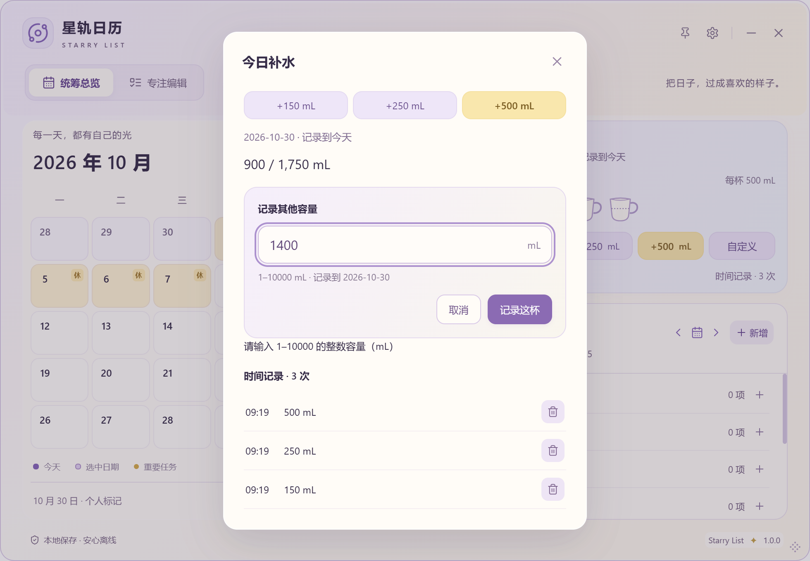
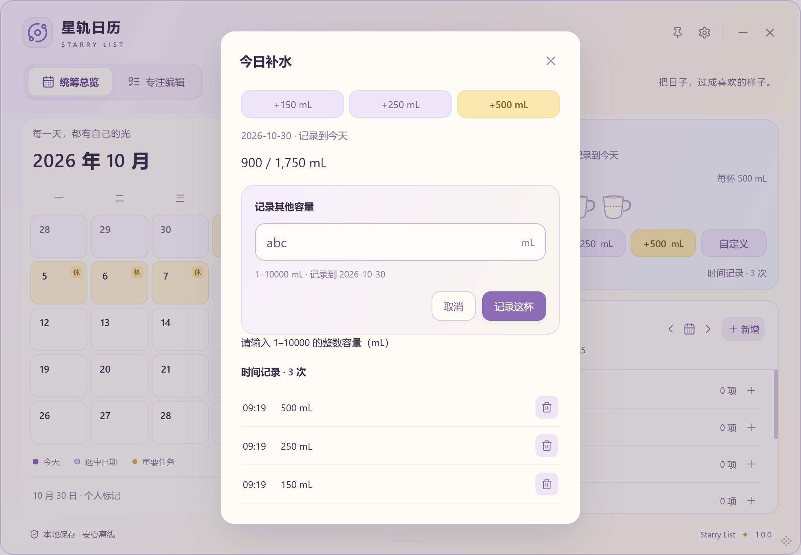
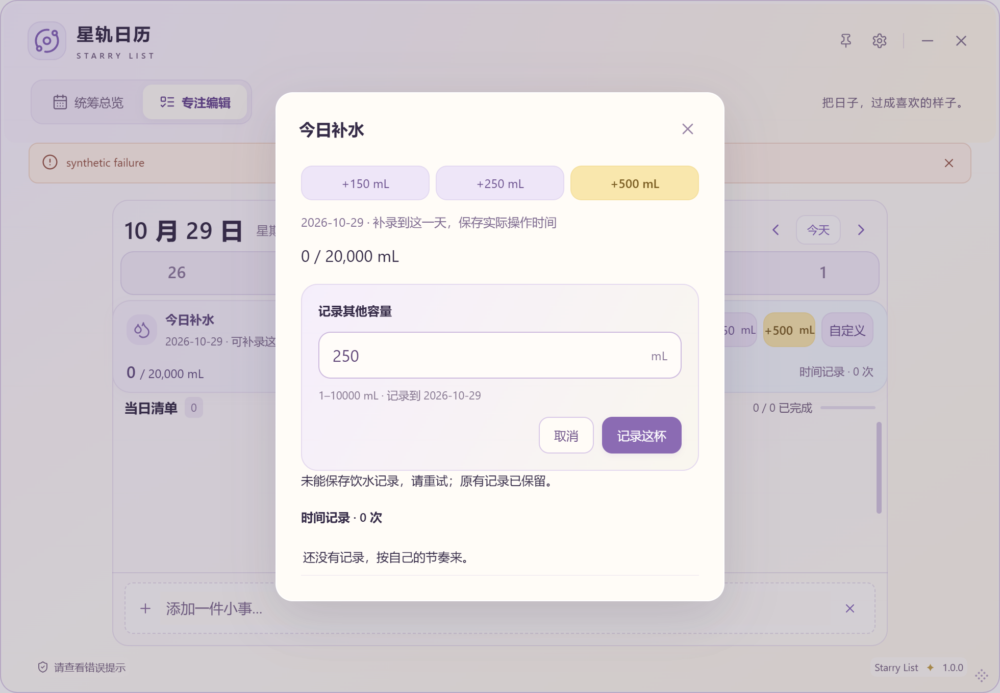

## F. 验证边界与待体验取舍

自动化模拟、真实WebView/SQLite、OS鼠标输入分别记录在[验证记录](VALIDATION.md#sl-024-b)。材质体系没有重设计；设置中心采用较实阅读衬底，不给整卡父级opacity。原生不透明与40%/100%沿用原能力边界；其他GPU/Win10/混合DPI/触屏/读屏/真实IME候选窗、安装升级卸载和长期海量数据未认证。

待用户确认：四分类是否便于寻找、六杯省略是否清楚、窄矮摘要与操作对话框是否顺手，以及水杯/星标的最终可爱程度。SL-024/A/B均保持In Review，不把自动化通过当视觉验收或正式发布。

本轮实际通过179前端、18Rust/fmt/Clippy、360专项布局、开启喝水的10组OS拖动和72布局、25组既有桌面回归；安装器构建成功但未运行。详细缓存证据、SHA256和复现见验证记录。
