# SL-024-C 视觉与响应式复核

2026-10-30。用户认可B设置中心、总览、自定义基本流程，本轮只修专注对齐/大字号、水杯和明细面板，不推翻已认可结构；用户四张截图不假定在本机。本报告截图均来自独立标识、SQLite/profile及合成任务/饮水，WebView截图不采集真实壁纸或个人记录，不能视为用户安装验收。

## 专注旧/新布局

B的三列横排将标题、数值、杯子与窄按钮列并排。C使用water-layout内层Grid：信息层为标题/日期/达标、数值、次级时间入口；下一层为杯组与快捷按钮。large将按钮放独立行，容器≤620px继续分层，≤390px按钮2×2。以实际组件宽度而非只看窗口宽度决定排布，不缩小大字号或zoom/scale整卡。

日期条和卡片外边缘共用 --focus-inline-gap:8px，宽度由同一focus父容器约束，未写死卡片宽度。ResizeObserver读取focus实际高度及日期条/标题/固定新增等区域的占用，完整卡片与任务空间不足时才摘要；不是large一律摘要。最小窗口通过展开入口使用完整记录区，长清单保留原滚动和固定新增。

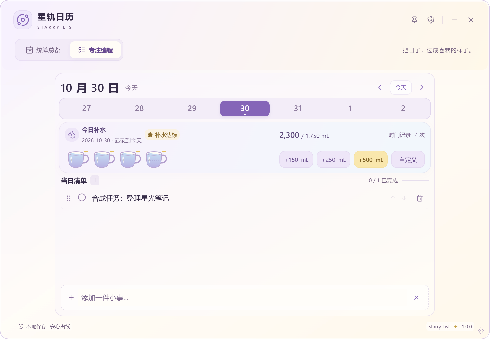
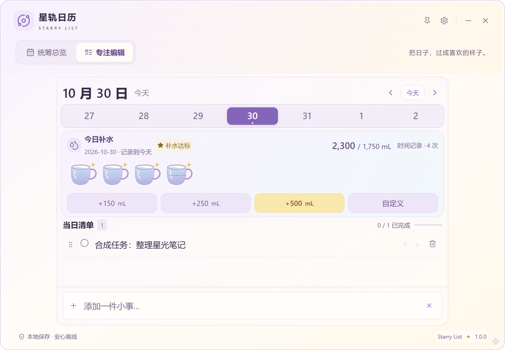
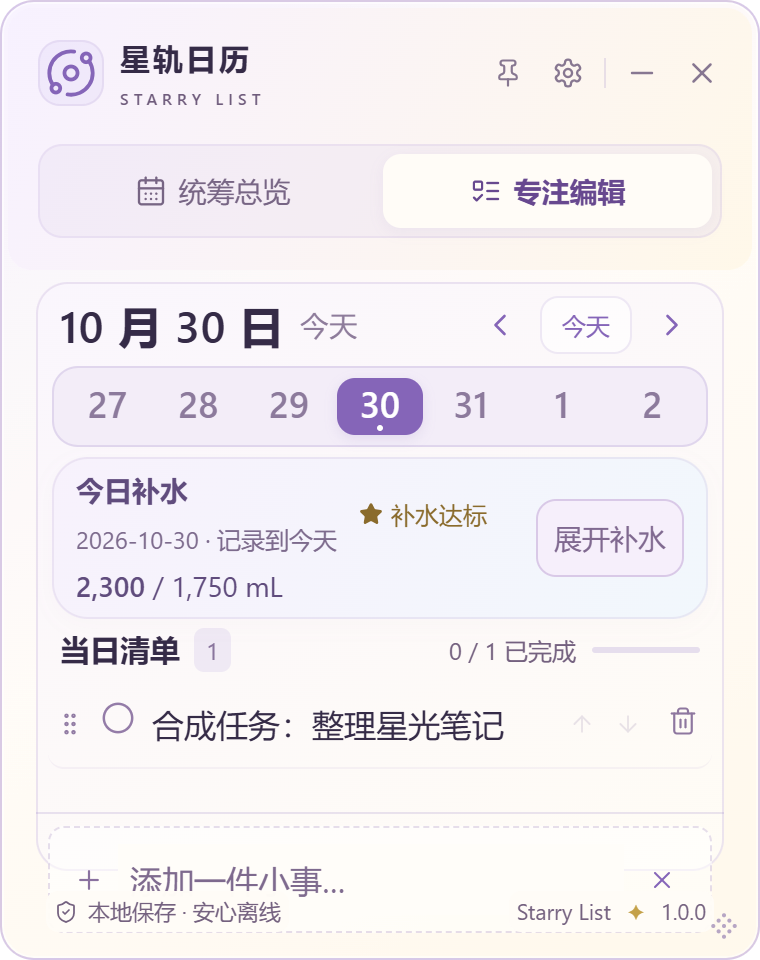

90组开启补水的专注组合实测：左右外边缘差最大均0px（CSS逻辑像素）；所有杯组/按钮交叠检查为false。980×680阅读/经典下，小/标准/大杯宽实测45/50/60px，三档均非摘要。自动测量不是仅凭截图目测。三材质/三字号/两顶部及五尺寸，开启/关闭分别检查。正常980×680保留直接记录，不要求反复打开面板；小窗口可用空间不足时摘要是实际取舍。

## 杯子与星星

C仍是原创SVG：更饱满的圆底马克杯、弯曲杯壁、柔软圆耳与完整椭圆杯口，奶油白杯身、柔紫轮廓、紫蓝水面、白高光；空杯也完整。水位使用46-fill×32的线性映射，满/四分之三/半/四分之一比例和尾杯虚线保留。每杯500mL、最多六杯/中间省略与超额真实数字不变。

标准杯宽50px，小45px（0.9倍）、大60px（1.2倍）；高度随比例，图标/按钮同时协调。SVG满杯星星由10×10到12×12（20%），放在杯口右上方，不盖杯口、不接触相邻杯；无循环动画。大字号星星随杯同比放大。

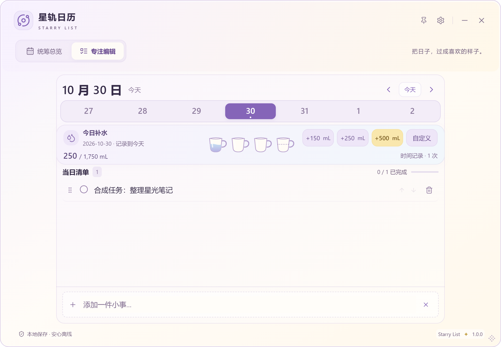
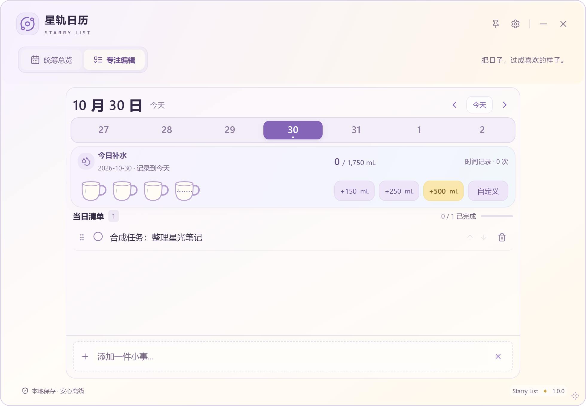
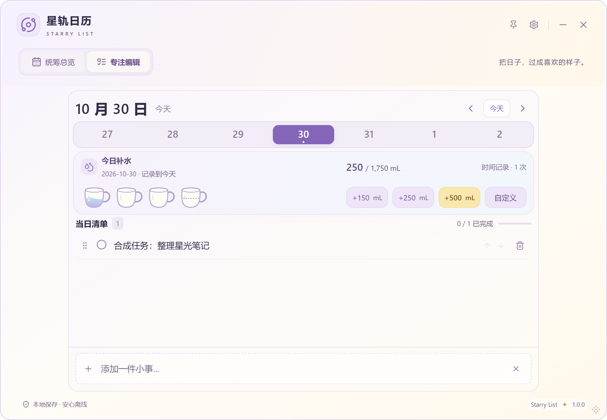
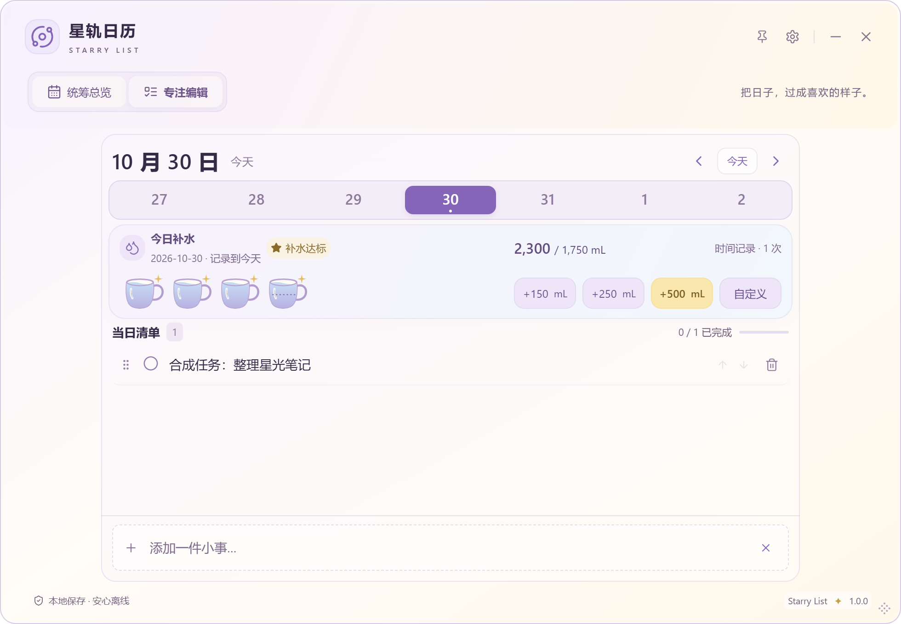

## 补水记录面板

保留Dialog，标题「补水记录」；日期→累计/目标和细进度条→四快捷（自定义自然并列）→时间记录。删除原孤立「记录其他容量」按钮；快捷成功在面板内刷新而不关闭，自定义原流程保留。面板适中420px封顶，少量记录不强撑高度；行采用时间/容量/删除三列、柔底色、统一行高和数字等宽。

列表高度上限min(240px,30vh)，10/30/100条独立滚动、overscroll containment阻止滚动链；标题和关闭固定可达，极矮窗口必要时内容区也能滚动以访问输入。空态仅「还没有饮水记录」。仅补水Dialog启用背景inert与focusin约束，避免背景焦点穿透；通用确认和编辑抽屉默认不启用新行为。Escape、回入口、IME、错误公告、保存状态和失败保留输入均保留。

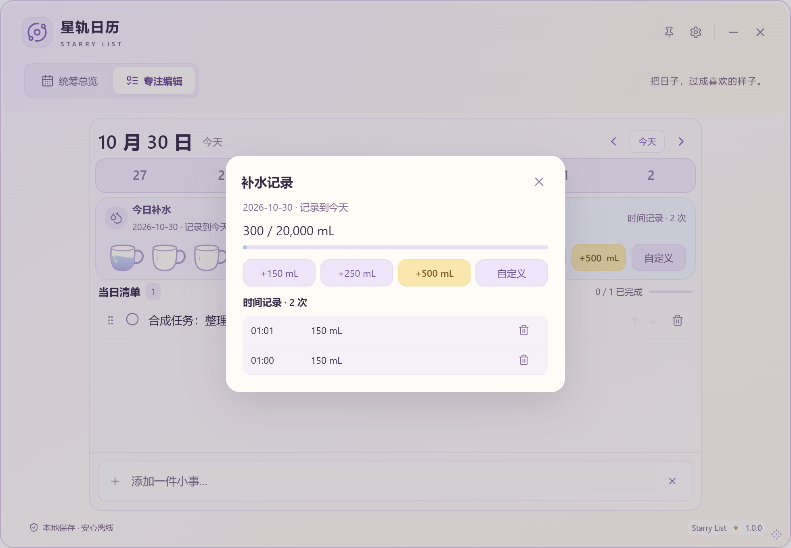
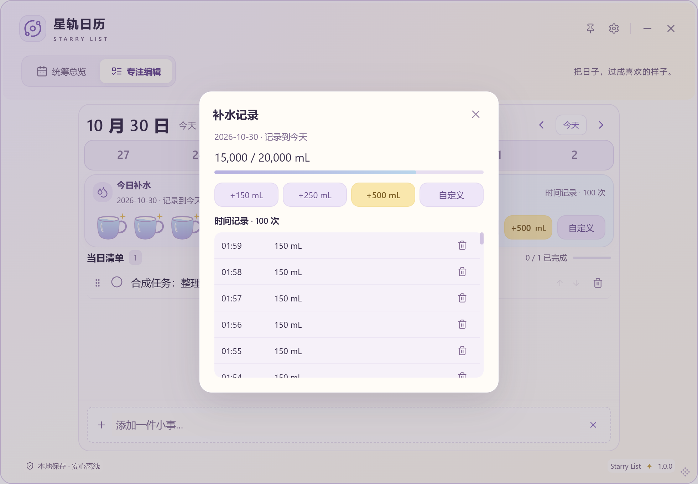
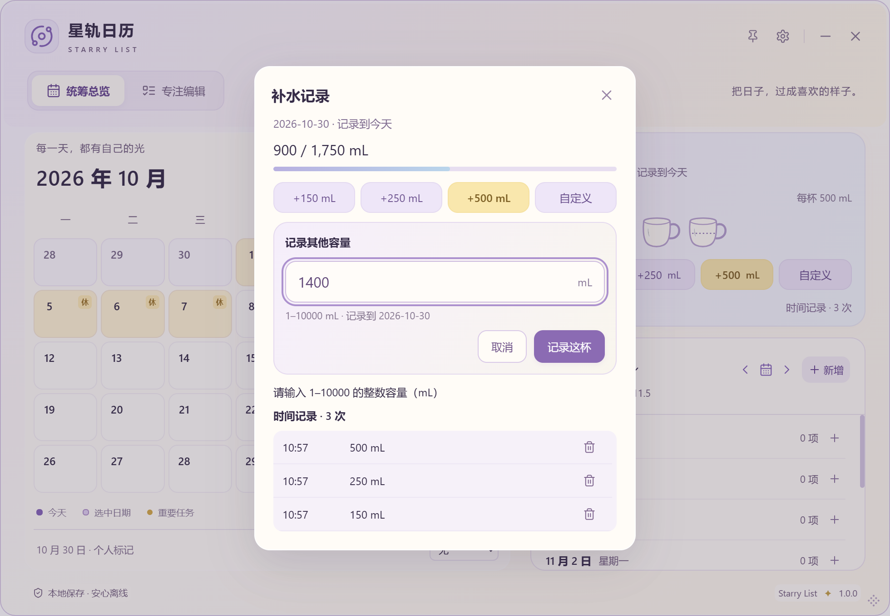
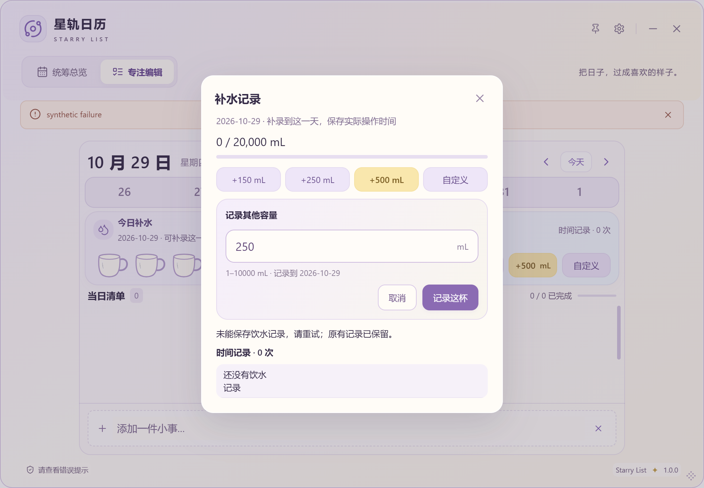

## 稳定范围与限制

四分类设置中心及保存逻辑、总览月历/独立右栏不重排；仅共用水杯与快捷入口升级。数据库v2、迁移002、字段、store/IPC/备份版本、标识与正式版本不变；JSON仍不含单条饮水明细，完整历史需退出后复制完整目录。日期归属、实际时间、历史补录、未来只读、全局目标、删除恢复不变。

测试结果和坐标值见[验证记录](VALIDATION.md#sl-024-c)。CDP布局/输入和真实OS拖动/Escape分列。Win10/其他GPU/混合DPI/触控板/读屏/真实IME候选窗、安装升级卸载、长期海量数据未认证；独立原生不透明二进制本轮不重跑，保留已有降级逻辑与前端边界测试。当前视觉取舍仍需用户安装确认，SL-024/A/B/C均In Review；不扩大为健康功能或全局重设计。

最终默认180项前端、18项Rust/fmt/Clippy、生产构建、360布局、10组OS拖动/72布局、25组桌面回归通过；额外100条大字号明细四尺寸检查通过。历史超时和诊断CLI与最终默认成功结果分列于验证记录，不修改测试超时配置。
