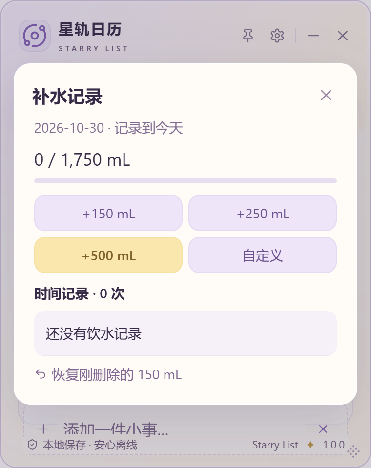
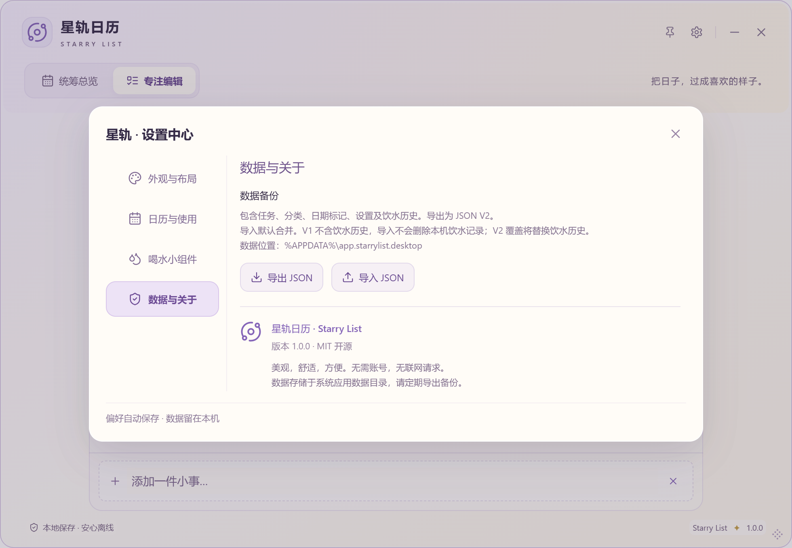
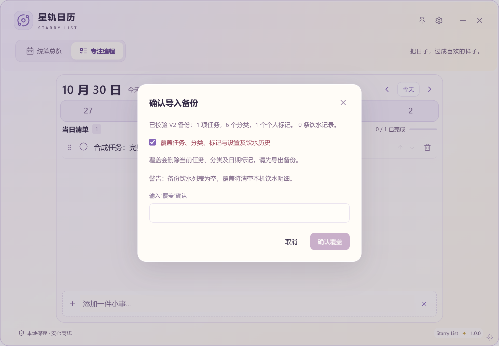

# SL-024-D：完整 JSON 备份与饮水恢复复核

2026-10-30。范围是完整备份及空记录单行小修复；设置四分类、总览/专注结构、水杯、自定义及日常记水规则保持。用户已安装 C 并确认「很好，这次都做得很不错了，还有一点小细节需要改一下」；剩余问题是空记录换行。A 原 MVP 标准结合 A/C 测试及本次确认 Done；B/C 保留空态待安装复核，父项/D In Review。SL-020 Done、SL-006 Research，不代表正式发布。

## 格式和恢复规则

| 项目 | JSON V1（旧文件） | JSON V2（当前导出） |
| --- | --- | --- |
| format | `starry-list` | `starry-list` |
| 原有字段 | exported_at、tasks、categories、day_marks、settings | 相同，原校验和设置默认保留 |
| water_entries | 必须不存在；不把缺失当空列表 | 必须是数组；无记录也明确为 `[]`，缺失/null 拒绝 |
| 合并 | 本机饮水不变 | 新 ID 新增，同 ID 全部内容相同跳过；同 ID 内容不同整笔拒绝 |
| 覆盖 | 覆盖原四类，保留本机饮水明细 | 五类全部替换；`[]` 清空饮水，确认前专门警告 |

每笔饮水仍为 `{id, date, amount, recorded_at}`：非空且最多128 UTF-8字节ID、1900–9999合法日期、1–10000整数mL、带秒及明确时区的RFC3339时间。ID、日期、毫秒/小数精度及UTC偏移原字符串保存；历史/未来记录均完整备份，不按操作时间重新归档，不汇总合并。不同ID即使时间/容量完全相同也保留。未知版本、坏记录、重复ID、非法引用等整份拒绝。

V1 缺 appearance_mode / text_size / header_layout / agenda_range / water_enabled / water_goal 时，仍默认 reading / standard / classic / rolling / false / 2000。导入默认合并，设置仍沿用原合并规则保留本机值。**只有饮水合并保证重复导入不重复累计**；任务沿用旧ID重映射规则，同一文件重复合并可能增加任务副本。分类冲突和同日个人标记处理也保持原规则。

SQLite `PRAGMA user_version=2` 与 JSON `version=2` 是独立概念；本轮只升级后者。001/002迁移、全部表结构/排序、应用标识及正式软件1.0.0均未修改；日常save_water/delete_water与store队列继续复用。

## 事务、快照与文件安全

- 导出由原连接在一致读事务中取得五类完整快照，包含所有日期饮水；先检查数据总数与文本字节，再完整校验和限长序列化。
- 导入复用原store队列、数据库互斥锁和SQLite事务。IMMEDIATE事务中检查饮水冲突、写入五类数据，并在提交前读取完整Snapshot；任何错误都整体回滚。返回成功快照后一次性更新前端，两个视图即刻刷新。恢复成功才清除旧任务/饮水会话撤销入口，避免旧数据复活。
- 文件工作置于blocking worker，命令名/参数不变；import_backup返回Snapshot，避免已提交却因另一次加载失败而停在旧水位。
- 文件最多读取32MiB+1，超限立即拒绝。导出先完整序列化到有界缓冲，再同目录临时写入、sync_all、persist原子替换。达到上限不截断，不声称部分备份成功；失败清理临时文件并保留原有目标文件。
- 导出32MiB（33,554,432字节）上限；每份任务≤50,000、分类≤1,000、日期标记≤50,000、饮水≤100,000，前后端数量一致。源数据或JSON转义开销超限都会明确失败；此时先正常退出后备份完整目录。

## 界面及空状态

数据与关于现在说明「包含任务、分类、日期标记、设置及饮水历史。导出为 JSON V2。」确认框展示版本及各类数量，默认合并；V1明确不删本机饮水，V2说明去重/冲突。覆盖列明五类范围，空列表专门警告清空，仍需勾选并输入「覆盖」。导入中禁重复提交，失败保留确认框，取消无写入。旧的「JSON不含饮水」仅保留在标记为历史的记录中。

空状态独立使用water-history-empty，覆盖普通li的三列Grid为全宽块；只在补水Dialog作用，不改正常记录三列。不写死宽度，不缩字号；浅紫衬底、圆角与恢复入口保留。以下为隔离合成内容，仅WebView截图，非用户任务/记录/壁纸：

[380空记录无恢复](screenshots/sl024d/empty-380-restore-false.png) · [500带恢复](screenshots/sl024d/empty-500-restore-true.png) · [980带恢复](screenshots/sl024d/empty-980-restore-true.png)

## 证据分层

| 层次 | 实际覆盖 | 不代表 |
| --- | --- | --- |
| 前端自动化 | Zod V1/V2、旧设置、必填数组、偏移/ID保留、重复/非法记录、100000边界；确认范围/空数组/取消/双击防重/立即刷新；原任务和设置套件 | 真实文件选择或用户安装验收 |
| Rust/SQLite/文件 | 独立A/B数据库经实际JSON文件往返五类后重开一致；合并幂等/冲突/不同ID、V1两模式、空V2覆盖、最后一步SQL失败整笔回滚；32MiB+1、转义膨胀、100000边界、临时写入失败、旧文件保留/成功替换 | 物理断电与全部磁盘/权限环境 |
| Windows原生文件链路 | 真Tauri/WebView2、独立test App ID/profile/目录；原生保存/打开对话框、实际V2文件、A→B覆盖、两视图即刻更新、进程重启、V1两模式、错误/取消/冲突/SQL触发器失败 | 人手逐项操作；窗口内按钮/输入使用CDP，文件选择用Win32控件填值及OS键鼠提交 |
| 空态真实渲染 | 380×480/500×620/980×680 × 三字号 × 阅读/轻玻璃 × 有/无恢复，共36状态；Range实测1行、scrollWidth≤clientWidth | 所有系统DPI和字体环境 |

Windows D 最终专项结果 `.cache/sl024d-1793345385950/results.json`（早一轮完整通过为 `.cache/sl024d-1793344558451/results.json`）。最终脚本还检查确认按钮未被其他窗口覆盖。仅隔离SQLite，真实用户库和私人备份未读取/修改；已安装应用未退出、卸载或覆盖。自动化原生对话框初测发现WM_SETTEXT只改变可见文字、未通知Shell内部文件名；改为键盘编辑提交且核对隔离路径后才成功。早前超时不计通过。开发中全量前端首次有旧5秒用例超时，后续默认检查全量通过；不调宽仓库门槛冒充通过。

最终数量、回归结果、构建、哈希及Git/CI见 [验证记录 D](VALIDATION.md#sl-024-d)。复现：隔离debug配置构建后串行 `node scripts/backup-smoke.mjs`、`node scripts/water-c-smoke.mjs`、`node scripts/drag-smoke.mjs --water`、`node scripts/desktop-smoke.mjs`，桌面脚本截图目录设为缓存，勿启动正式标识构建测试个人数据。

## 未验证与使用取舍

未认证Windows10、其他GPU/混合DPI、触屏/读屏、真实IME候选窗、网络盘/云同步目录/移动介质、真实只读ACL及物理满盘/断电。磁盘不足为OS错误112故障注入；临时写入失败/无效目录与现有文件保护经过真实本地文件测试，但不保证所有文件系统的持久性。备份未加密，包含私人任务和饮水，勿上传公开仓库。没有远程备份、恢复到旧SQLite版本或自动修复坏文件的能力。文件大小/数量允许完整导出时才成功，超限请备份完整数据目录。

安装器只构建未执行，不自动关闭现用程序。首次升级前须正常退出、导出当前JSON、复制完整数据目录；旧V1本来没有饮水，不能据它恢复历史。升级后才可用V2完整JSON。保留目录备份、不删应用数据、不直接降级数据库v1软件。覆盖前再导出现状，核对版本/范围/数量；V2空数组警告须认真阅读。D与父项待用户亲自安装、导出和恢复确认。
