# UX3.1：舒服的字号与更早出现的内容

范围：[SL-004 / SL-005](PRODUCT_BACKLOG.md#sl-004)，2026-10-23 用户明确授权。UX3.0.4 是稳定视觉基线，保留材质、去底贴、失焦合成与任务行为。本轮两项均 **In Review**，等待安装体验；仍为 1.0.0 体验构建，没有正式发布、Tag 或 Release。实现提交 [`4dd4def`](https://github.com/YOLIIIIII/starry-list/commit/4dd4def953f6e72dc8b184709fcb96a57d968525)；文档与合成截图独立提交。

## 字体角色与实际数值

所有区域从 `.app-shell` 的角色 token 取值，`data-text-size` 只选择角色档位，三种材质不覆盖字号或布局密度。不使用 CSS zoom、整体 transform 或父级 opacity。

| 角色 / CSS token                                                   | 小             | 标准（默认）   | 大             |
| ------------------------------------------------------------------ | -------------- | -------------- | -------------- |
| 任务、快速输入、占位符、行内标题、完整阅读/计划 `--task-text-size` | 13px           | 14px           | 16px           |
| 次级正文 `--text-body`                                             | 12px           | 13px           | 15px           |
| 日期分组、设置主文字、标签与按钮 `--text-ui`                       | 11px           | 12px           | 14px           |
| 状态、数量、星期、说明 `--text-help`                               | 10px           | 11px           | 12px           |
| 分类、页脚等 `--text-caption`                                      | 10px           | 10px           | 11px           |
| 区块标题 `--text-heading`                                          | 15px           | 16px           | 18px           |
| 抽屉标题 `--text-dialog`                                           | 17px           | 18px           | 20px           |
| 月份/日期主标题 `--text-page`                                      | 22px           | 23px           | 25px           |
| 窄窗口主标题 `--text-page-compact`                                 | 19px           | 20px           | 22px           |
| 月历日期（常规 / 窄 / ≥1100px）                                    | 12 / 11 / 14px | 12 / 11 / 14px | 13 / 12 / 15px |
| 月历任务预览（常规 / ≥1100px）                                     | 9 / 11px       | 9 / 11px       | 10 / 12px      |
| 月历休/班/个人角标 `--text-calendar-badge`                         | 8px            | 8px            | 9px            |
| 月历数量 `--text-calendar-count`                                   | 9px            | 9px            | 10px           |

品牌中文宽屏 17px、窄屏 15px，英文识别 8px、窄屏隐藏，不随任务机械放大。月历是密集摘要，继续使用省略和空间预算：常规预览高度 17px，大档 18px；≥1100px 为 20px，大档 21px。空间不足仍完整显示数量或圆点，可访问名称保留真实数量。假期/补班/个人角标参与实际日期栏高度测量。

标准档保留任务 14px、抽屉输入 14px / 标签 12px / 辅助 11px；原先普遍 8–9px 的必要辅助信息提升至 10–11px。长标题保持两行摘要与完整只读详情。长分类在任务行省略，悬停与详情可读完整内容，窄屏详情不隐藏分类。编辑表单独立滚动，保存/取消固定在底部。

## A：顶部实测与比较方法

测量独立原生 WebView2 的 `.app-header.getBoundingClientRect().height`、`main` 的 y/height，单位为 CSS 逻辑像素。固定合成日期与任务、同窗口客户区；旧样式从 main 基线 `2523591` 编译，关闭新样式后完整加载，不只估算 padding。

UX3.0.4 没有大档。下表「旧布局大档对照」只把旧顶部的模式标签从 12px 改成 UX3.1 大档的 14px，是控制变量实验，不声称旧安装包有字号设置。其余旧字号/页脚不变，主体增益据此单独实测，不把顶部节省全部等同为主体增加。

| 窗口             | 档位 / 对照             | 旧顶部  | 新顶部 | 顶部减少 | 旧主区高度 → 新主区高度  |
| ---------------- | ----------------------- | ------- | ------ | -------- | ------------------------ |
| 980×680          | 标准                    | 136px   | 113px  | 23px     | 489.5 → 511px（+21.5px） |
| 980×680          | 旧布局大档对照 / 新大档 | 139px   | 116px  | 23px     | 486.5 → 506.5px（+20px） |
| 980×480          | 标准                    | 119.5px | 107px  | 12.5px   | 306 → 317px（+11px）     |
| 980×480          | 旧布局大档对照 / 新大档 | 122.5px | 110px  | 12.5px   | 303 → 312.5px（+9.5px）  |
| 760×620          | 标准                    | 136px   | 113px  | 23px     | 429.5 → 451px（+21.5px） |
| 760×620          | 旧布局大档对照 / 新大档 | 139px   | 116px  | 23px     | 426.5 → 446.5px（+20px） |
| 500×620、380×620 | 标准                    | 128px   | 105px  | 23px     | 442 → 462px（+20px）     |
| 500×620、380×620 | 旧布局大档对照 / 新大档 | 131px   | 108px  | 23px     | 439 → 457.5px（+18.5px） |

其余窗口及大档完整实测补充在 [验证记录](VALIDATION.md)。标准档主体 y 从 146px 前移到 123px；页脚的辅助文字变大略占高度，所以主区净增加 21.5px。矮窗口原先已有压缩规则，本轮以舒适为限，没有强行追求 16px。

宽屏标题栏最小 65→55px，模式行 padding 9px 26px 18px→5px 26px 9px；窄屏标题栏最小 59→49px，模式行 padding 10px 15px 15px→5px 15px 7px。窗口按钮 29px（窄屏 27px）提升至 30×30px，模式按钮至少 34px 高。保留连续圆角背景，三材质配色、surface 系数和原生合成代码不变。只有独立空白区域用于拖窗。

| UX3.0.4 标准                                             | UX3.1 标准                                                  |
| -------------------------------------------------------- | ----------------------------------------------------------- |
| 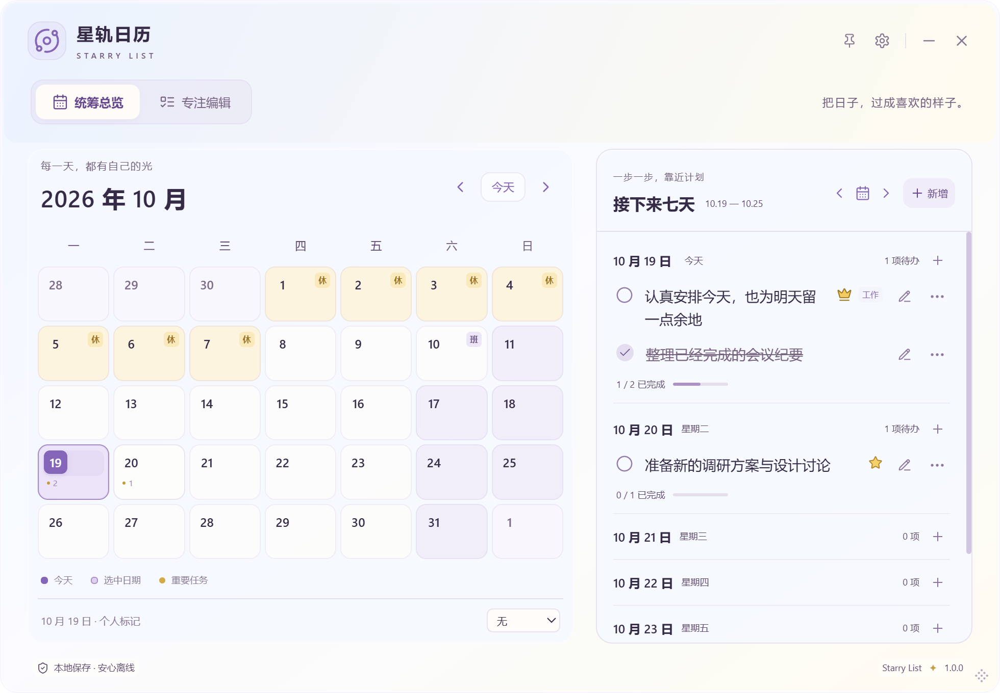 | 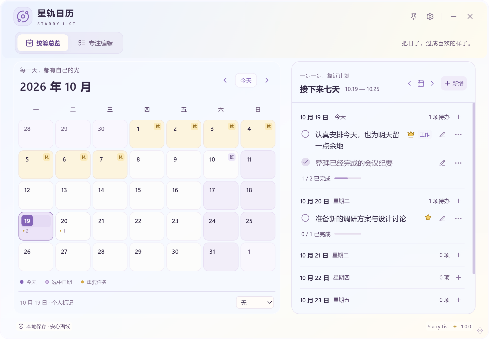 |

## B：同条件三档字号

下图使用同一合成任务、980×680、轻玻璃、70%。截图是 WebView 内容，不包含原生桌面模糊；材料的焦点证据另列。

| 小                                                          | 标准                                                             | 大                                                          |
| ----------------------------------------------------------- | ---------------------------------------------------------------- | ----------------------------------------------------------- |
| 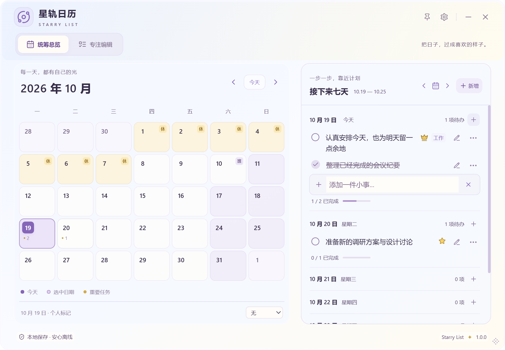 | 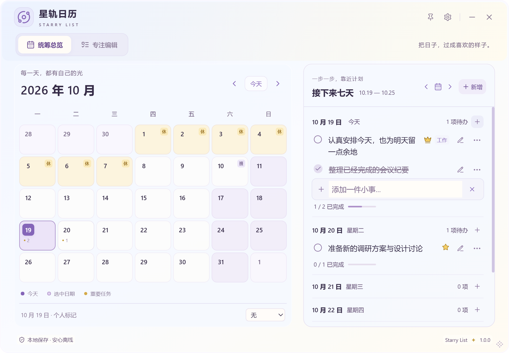 | 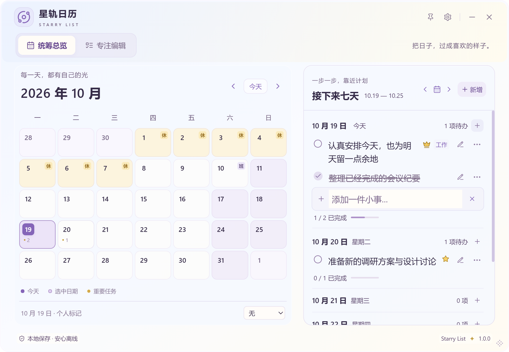 |
| 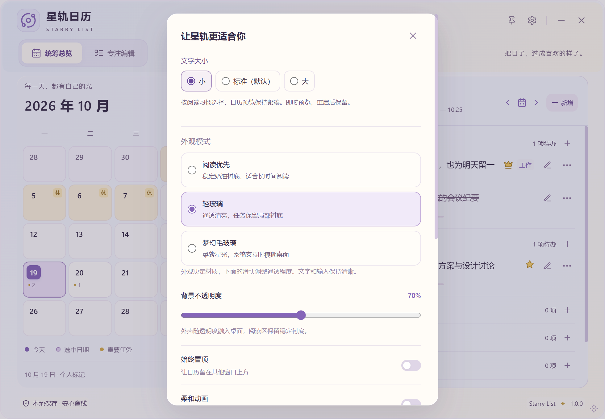   | 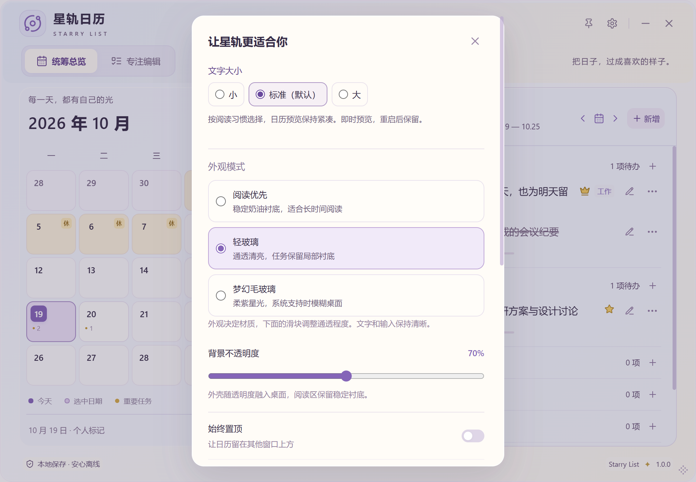   | 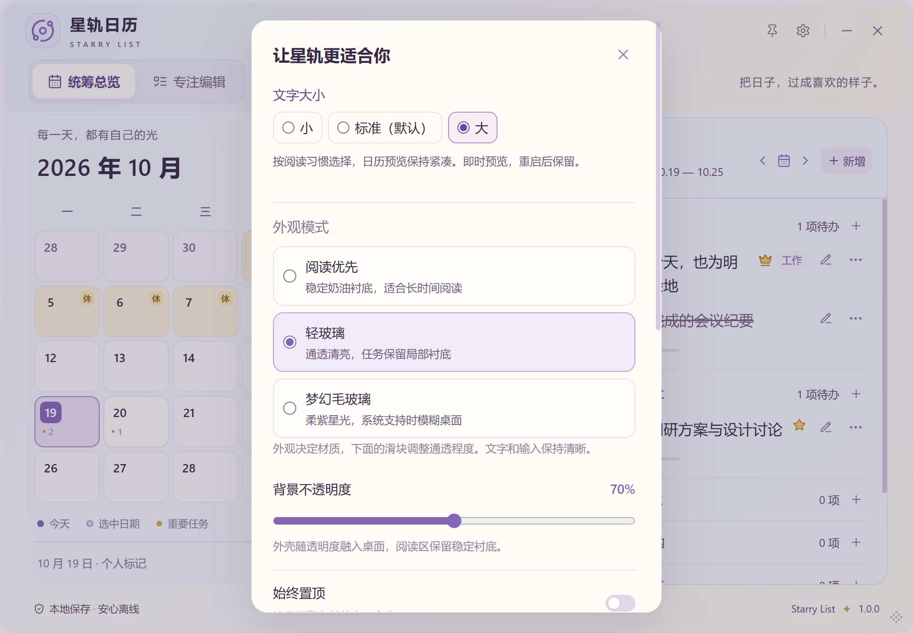   |

## C：同档三材质共用布局

完整阅读的三档对照：[小档](screenshots/ux31/small/ux304-focus-reader.png) · [标准](screenshots/ux31/standard/ux304-focus-reader.png) · [大档](screenshots/ux31/large/ux304-focus-reader.png)。此处 `ux304-` 文件名沿用已有布局脚本，所在 `ux31/` 目录均为本轮新源码/对应字号的截图，不是旧安装包画面。

按每档分别比较阅读优先、轻玻璃、梦幻的任务行、标题、完成圈、分类、排序/删除、日期组、新增及只读区域的实际坐标、宽高和 padding。材质只改变外观，同档几何应一致；不恢复白色任务小底贴。月历另外检查日期/角标/数量 containment、重叠与可访问总数。

| 标准 · 阅读优先                                                  | 标准 · 轻玻璃                                                    | 标准 · 梦幻                                                          |
| ---------------------------------------------------------------- | ---------------------------------------------------------------- | -------------------------------------------------------------------- |
| 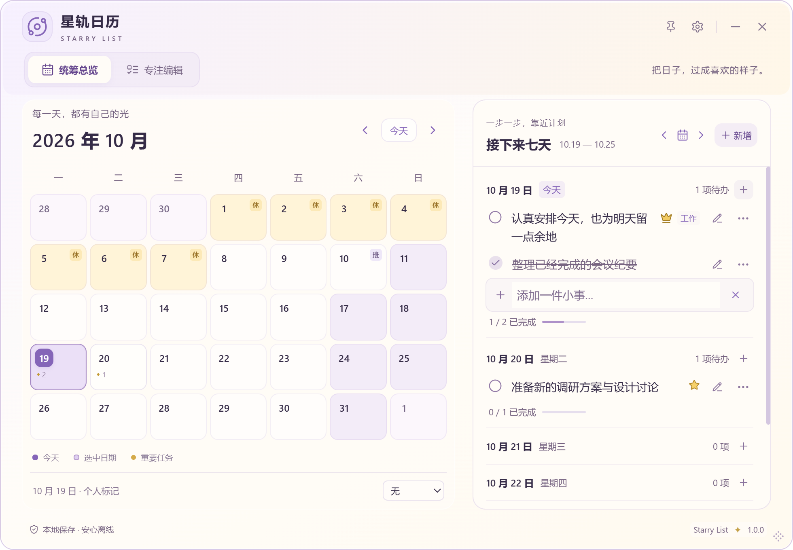 |  | 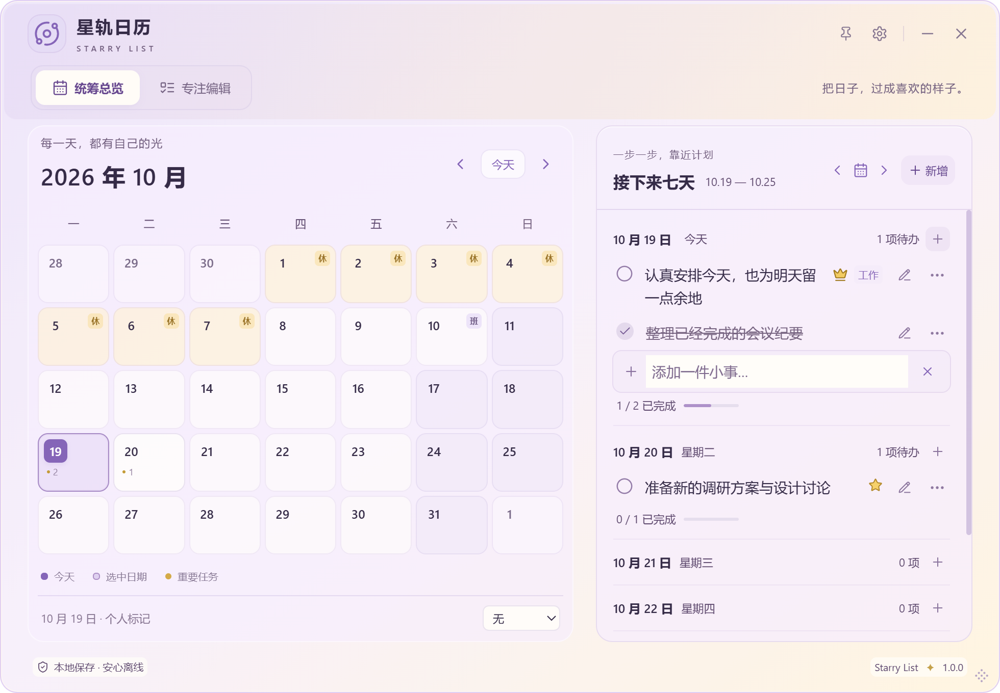 |

## D：矮、窄、长文本

| 标准 · 980×480                                          | 标准 · 380×620                                        | 大档 · 380×480 抽屉                                             |
| ------------------------------------------------------- | ----------------------------------------------------- | --------------------------------------------------------------- |
| 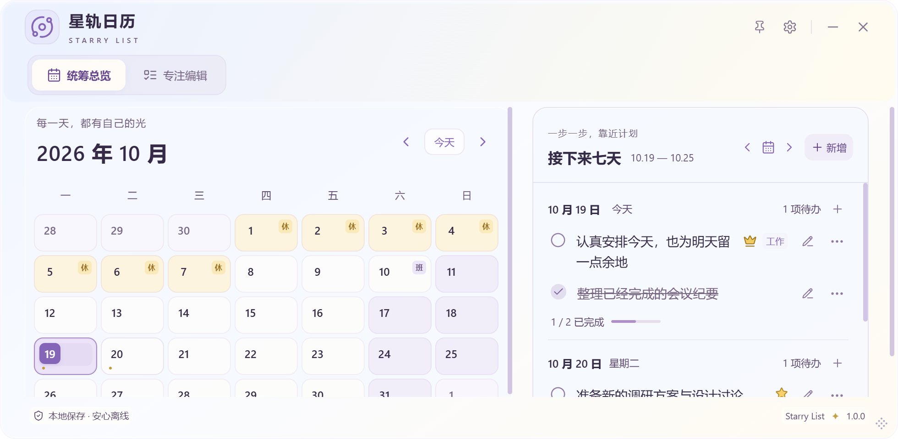 | 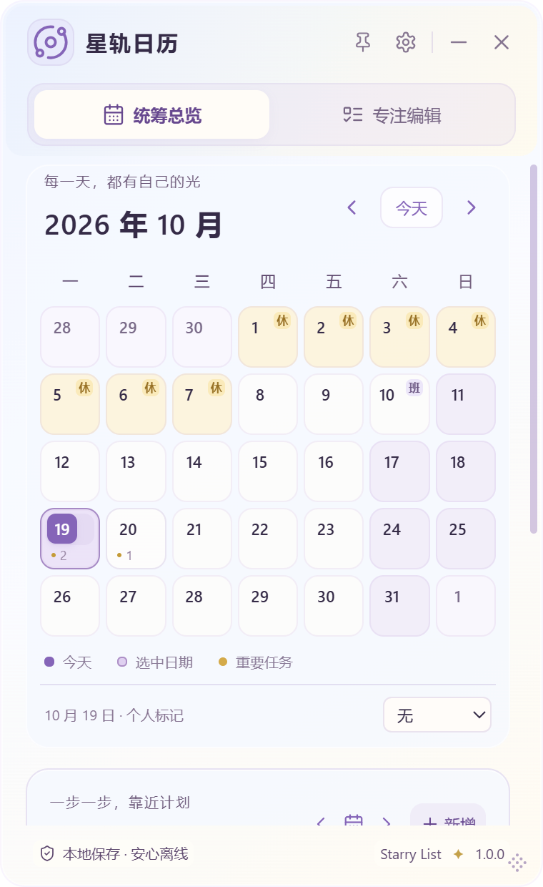 | 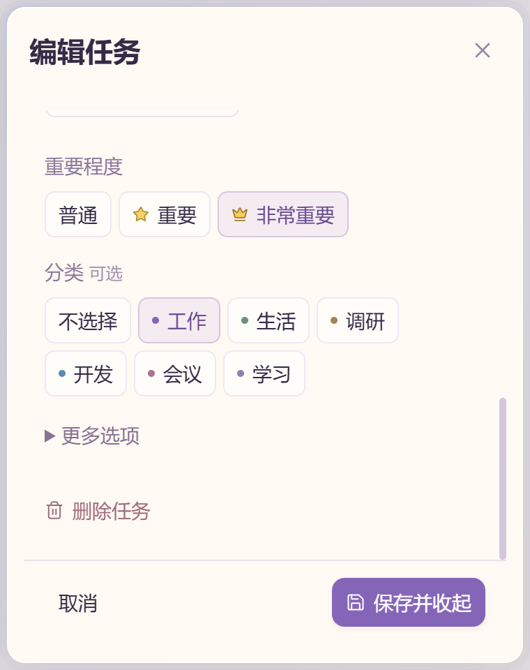 |

抽屉长文本合成输入 100 行，检查实际表单 scrollTop 可移动、保存栏在抽屉内、按钮不裁切；旧 SL-004-A / B 的实现和证据保留。四/五/六周分别使用 2021-02、2026-10、2026-08，同日包含官方假期与个人标记。极矮月历可滚动，数字只整行显示或变圆点。

六周宽矮月历（980×540）：[小档](screenshots/ux31/small/ux304-short-calendar.png) · [标准](screenshots/ux31/standard/ux304-short-calendar.png) · [大档](screenshots/ux31/large/ux304-short-calendar.png)。其他尺寸：[500px](screenshots/ux31/standard/ux31-500x620.png) · [760×620](screenshots/ux31/standard/ux31-760x620.png) · [大档 980×480](screenshots/ux31/standard/ux31-large-980x480.png) · [大档 980×680](screenshots/ux31/standard/ux31-large-980x680.png) · [大档宽矮抽屉](screenshots/ux31/standard/drawer-large-980x480.png) · [大档宽抽屉](screenshots/ux31/standard/drawer-large-980x680.png)。

## 持久化、回归与交付边界

新增独立 `text_size` JSON 字段，两端白名单 small / standard / large；Rust Serde 与前端 Zod 缺失时 default standard。读取不覆写旧 JSON，不改数据库 Schema/迁移或任务。旧备份版本 1 保持；替换导入使用备份设置，合并仍沿用原有设置保留规则。预览状态与已保存状态分开，等待提示明确，失败恢复旧档并显示错误，可重试。

自动化、原生交互、实际构建、哈希、CI 和未验证范围以 [验证记录](VALIDATION.md) 为准。测试只用隔离 SQLite、合成任务与自绘背景；安装包与原始本地日志不提交 GitHub。本轮不执行安装/卸载，不关闭用户实例，不触碰正式数据库。五分钟清单见 [使用手册](USER_GUIDE.md#ux31-文字大小与五分钟体验)。

## 原生材质与焦点

下图是自绘背景完全覆盖、无关窗口遮挡检查通过后捕获的原生屏幕区域，40% / 小档；与前面的 WebView 内容图来源不同。最终 12 组在两透明度、两视图与三档之间切换，指定采样点激活/失焦差均为 0；原生模糊开关的纹理能量对照约 .327 / 9.969。失败或被隐私保护拒绝的尝试不计通过，具体见验证记录。

| 总览激活                                                            | 总览失焦                                                              |
| ------------------------------------------------------------------- | --------------------------------------------------------------------- |
|  | 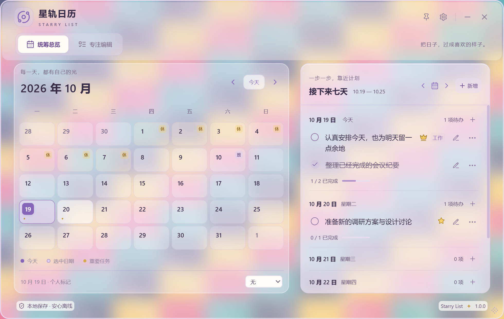 |

## 需求审查

UX3.0.4 的三种外观已获本次用户认可，结合历史证据，SL-003-A / C Done，B 沿用 Done。D 的原环境长时间反复切换、E 的明确失焦/再激活最终体验仍缺针对性用户确认，D / E / 父项保留 In Review。不会以整体正面反馈代替所有历史验收。SL-004 / SL-005 和 A / B、SL-001 保持 In Review；SL-002 / SL-019 / SL-021 沿用 Done。详见唯一权威 [需求池](PRODUCT_BACKLOG.md)。
