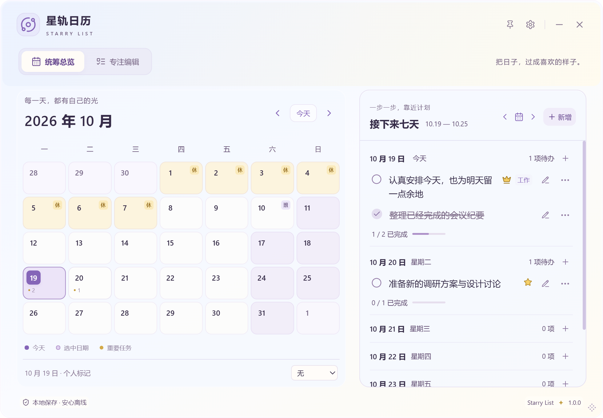
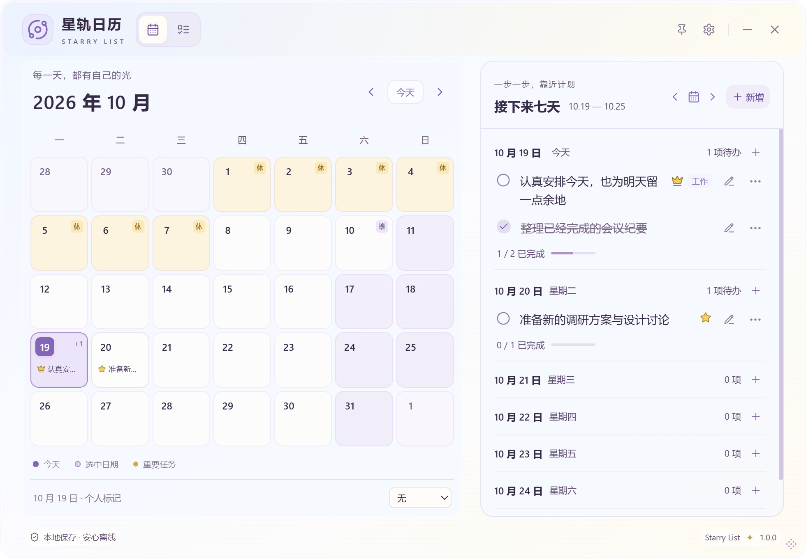

# UX3.2：两种顶部与专注底部新增

2026-10-26。基于 main `63451ff` 的 UX3.1 继续，授权仅 SL-005-A / SL-001-A。实现 [`4586f33`](https://github.com/YOLIIIIII/starry-list/commit/4586f33e062714dd255c4645bf521efaad47a4e3)。三档字号、三种材质、正式版本 1.0.0 和任务数据结构保留。实现与测试不代表用户验收或正式发布。

同日后续验收：用户已安装 UX3.2，确认「功能都还不错，已经可以了，我们接下来看下一项任务」。核对本页及 VALIDATION 的对应验收后，SL-005-A / SL-001-A **Done**；父项与历史子项分别保留缺口，见 [逐项复核](research/SL-006-WINDOWS-DESKTOP-RESIDENCY.md#ux32-验收复核)。下文“待体验”是交付时的历史状态；没有正式发布。

## 布局选择

经典顶部（默认）恢复 UX3.0 系列的舒展双行：星球与双语品牌、窗口控制在上，带文字的工作模式在下；宽且足够高时保留装饰句。紧凑顶部将品牌、图标导航、独立拖动空白、窗口控制放在同一行；日历/清单图标都有可访问名称、悬停提示与选中状态。380px 仍保留双语名称，窗口按钮 30×30px、模式按钮 34×34px。

| 标准字号 · 980×680 | 经典顶部                                                         | 紧凑顶部                                                         |
| ------------------ | ---------------------------------------------------------------- | ---------------------------------------------------------------- |
| 总览               |                |                |
| 长任务             |  |  |

图为真实 Windows WebView2 视口、隔离合成任务；不包含原生桌面模糊。专注图保留测试撤销后的通知，可检查其与导航的避让。没有私人壁纸、照片、正式任务或备份。

## 顶部与主体实测

固定 UX3.1 `63451ff` 的完整 CSS 编译对照，同一客户区、同一字号；恢复新样式后等待样式表重新生效，避免把暂时无样式的测量计入结果。下表单位为 CSS px，主区为 `main` 的实际可用外框高度，不把整个主区等同于可见任务列表。

| 窗口 / 字号  | UX3.1 顶部 | 经典顶部 | 紧凑顶部 |  经典主区 → 紧凑主区 |
| ------------ | ---------: | -------: | -------: | -------------------: |
| 980×680 标准 |        113 |      136 |       64 |     488 → 560（+72） |
| 980×680 大   |        116 |      139 |       64 | 483.5 → 558.5（+75） |
| 980×480 标准 |        107 |      124 |       64 |     300 → 360（+60） |
| 980×480 大   |        110 |      127 |       64 | 295.5 → 358.5（+63） |
| 760×620 标准 |        113 |      136 |       64 |     428 → 500（+72） |
| 760×620 大   |        116 |      139 |       64 | 423.5 → 498.5（+75） |
| 500×620 标准 |        105 |      128 |       56 |     439 → 511（+72） |
| 500×620 大   |        108 |      131 |       56 | 434.5 → 509.5（+75） |
| 380×480 标准 |        105 |      128 |       56 |     299 → 371（+72） |
| 380×480 大   |        108 |      131 |       56 | 294.5 → 369.5（+75） |

经典有意恢复留白；紧凑为需要更多内容空间的人提供选择。宽屏通知放在单行中间空白；窄屏下方预留通知通道，正文标题上边距 28px，不随通知出现/消失跳动。因此窄屏专注的列表净增益比顶部差值少约 24px，例如 380×480 标准列表 77.91→125.91px，大档 60.12→111.12px。经典 980×480 大档列表仍有 48.12px，可滚动阅读全文。

## 固定新增与完整阅读

专注面板由日期导航、可滚动任务列表、底部新增区组成。新增区参与布局并占据空间，不覆盖列表；滚动到长计划中段/末尾时，其位置保持一致。详情不再另设内部高度上限，标题和正文完整随同一列表滚动，避免嵌套详情滚动条。编辑、收起、删除留在原任务位置，可随列表滚回访问；编辑抽屉仍有独立表单滚动与固定保存栏。

矮窗口（≤560px）收紧日期导航的间距和内边距；不缩小字号或按钮命中。新增区整体实测约 66–76px（按窗口/字号变化），输入、占位符和任务仍为 13 / 14 / 16px。取消草稿确认正常展开，不把确认层覆盖到输入框上。Enter、点击外部/原生失焦、异步失败、取消与重试复用原有单一 QuickAdd / guard；没有第二套新增表单。

| 980×480 标准                                                     | 380×480 大档                                                  |
| ---------------------------------------------------------------- | ------------------------------------------------------------- |
|  |  |
|  |  |

## 设置与验收

设置 → 顶部布局，独立 `header_layout: classic | compact`。立即预览，真实写入前显示保存中；失败恢复旧布局并显示错误，允许重试。前端 Zod / Rust Serde 缺字段默认 classic，旧设置读取不回写；旧备份版本 1 兼容，合并/替换沿用原有策略，不改任务 Schema/迁移。两种顶部各自完成真实关闭/重启验证。

完整测试、安装包校验、CI、原生材质焦点证据与环境限制见 [验证记录](VALIDATION.md)。本轮子项 In Review，待用户安装体验；不 Tag、不创建 Release、不关闭用户实例或操作正式数据。[五分钟体验](USER_GUIDE.md#ux32-五分钟体验)。
