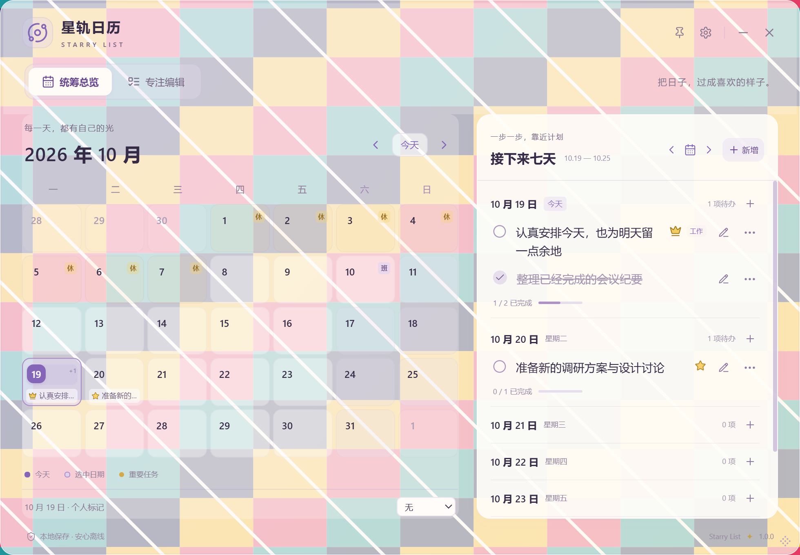
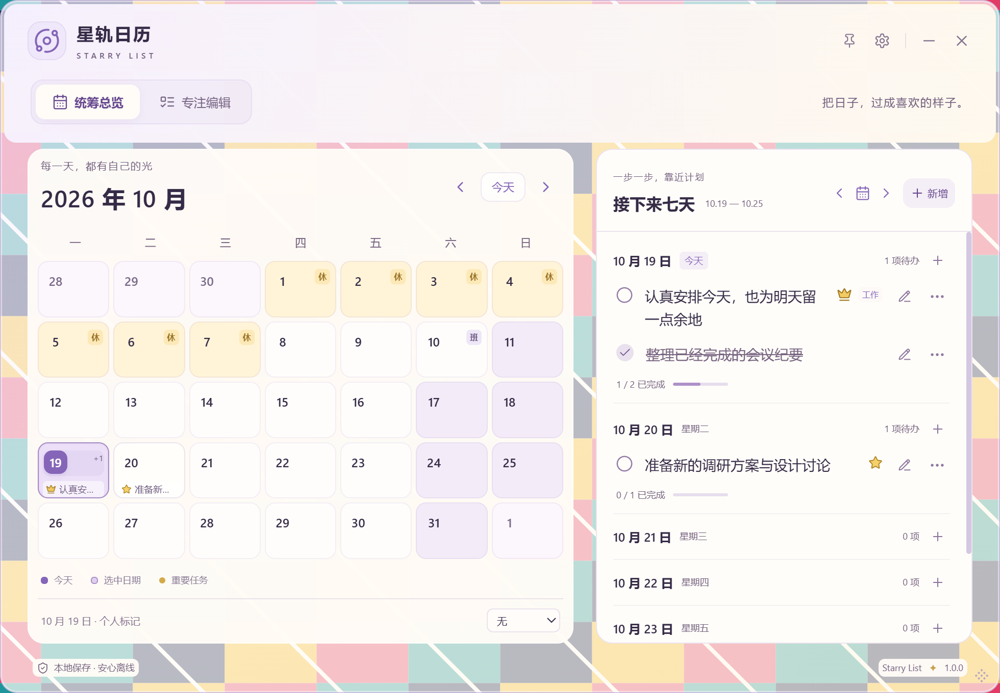

# UX3.0 透明视觉对比

本轮仅对应 [SL-003](PRODUCT_BACKLOG.md#sl-003)，视觉仍待用户最终确认。字号保持 14px，顶部高度、双视图、月历日期/排序和已有任务交互不重做。

本文保留 UX3.0 历史基线。UX3.0.1 根据用户反馈增加外观选择并修正通知关闭位置，最新规则与对比见 [UX3.0.1 外观说明](UX3_0_1_VISUAL_REVIEW.md)；阅读优先继续保留本页的默认保护方案。

## 对比条件

- Windows 11、真实透明 Tauri / WebView2 窗口；四种背景均由项目测试脚本自制：浅色几何、深色圆环、高对比色块与斜线、密集测试文字/图标。没有使用私人壁纸、照片或实际个人窗口内容。
- 旧版为 `d50af11` 的 UX2.3 编译样式与旧 alpha 公式，在同一测试应用、示例任务、窗口尺寸和背景上复现；这是**样式基线对比**，不是重新运行旧安装包。新旧交互代码相同，避免将内容差异误当视觉改善。
- 截图的前端日历固定为 2026-10-19，以便跨日复现；计时器与原生窗口操作仍使用真实时间，最终检查和安装包日期为 2026-10-20。
- 矩阵检查 980 × 680 逻辑像素、40% / 70% / 100%、两种主视图；前景与宽窄回归覆盖 980 / 760 / 500 / 380px。截图为 Windows 实际合成后的物理像素，不是把壁纸贴在网页根背景上模拟。
- 截图助手只截取测试应用的矩形；要求自制背景完整覆盖该区域，且没有无关窗口位于其上方。截取前后均检查测试前台和覆盖条件，条件改变即拒绝保存。未采用 Windows Explorer 嵌入或改动用户桌面配置。

## 原因与方案

旧补色 `max(0, (0.85 − alpha) × 1.6)` 分别应用于标题栏、模式区、月历和专注区。它制造了独立色块；在阅读底层与外壳叠加后，40% / 70% 的有效背景 alpha 约为 0.832 / 0.772，中间档位反而保护更弱。日期半透明底色和浅色辅助文字进一步受复杂背景干扰。

新层级：

| 层级           | 设计                                                                                      |
| -------------- | ----------------------------------------------------------------------------------------- |
| 外壳           | 连续薰衣草紫—奶油色渐变、柔和边缘；滑块仍真正改变外壳 alpha                               |
| 顶部与主阅读区 | 标题/模式共用圆角背景；月历、七天与专注区各有稳定衬底，以明度、细描边和小间距区分         |
| 日期与任务     | 周末浅紫、假期浅金、补班常规底色；今天/选中和重要标记保留；任务保持紧凑，辅助文字增强对比 |
| 前景           | 输入框、只读详情、抽屉、弹窗、菜单与通知保持清晰；没有整棵 DOM opacity，没有模糊滤镜依赖  |

## 新旧截图

下列图片都来自隔离示例数据与自制背景。点击可看完整尺寸。

| 条件                    | UX2.3 样式基线                                         | UX3.0                                                  |
| ----------------------- | ------------------------------------------------------ | ------------------------------------------------------ |
| 高对比背景 / 70% / 总览 | [旧图](screenshots/ux30/ux23-colorful-70-overview.png) | [新图](screenshots/ux30/ux30-colorful-70-overview.png) |
| 密集文字 / 40% / 专注   | [旧图](screenshots/ux30/ux23-text-40-focus.png)        | [新图](screenshots/ux30/ux30-text-40-focus.png)        |

外层空隙仍能透视背景；月历日期与七天任务不再与强烈色块争夺注意力。专注衬底抑制背后文字，已完成任务仍以紫灰删除线区分。100% 和原生不透明回退使用实色衬底，不靠滤镜制造灰雾。

## 透明度语义

| 设置     | 外壳             | 内容保护                                                              |
| -------- | ---------------- | --------------------------------------------------------------------- |
| 40%      | 空隙与边缘最通透 | 阅读面板至少约 99.4% 的合成背景覆盖，日期格至少约 99%；标题栏约 97.8% |
| 70%      | 外壳透视减弱     | 阅读面板约 99.9%，日期格保护进一步增强                                |
| 100%     | 不透底层背景     | 所有基础衬底 alpha 为 1，保留紫黄层级而无模糊                         |
| 实色回退 | 不透视           | 原偏好保留；关闭实色开关可恢复。原生不透明构建仍不能透视，滑块禁用    |

上述百分比为多层背景的理论合成覆盖，不是文字 opacity，也不代替实际桌面观察。真实像素采样、交互回归、构建结果和未验证范围见 [验证记录](VALIDATION.md)。

同一阅读区采样点在四种背景之间的最大 RGB 通道变化如下（数值越小，越不受背后内容干扰）：

| 不透明度 | UX2.3 总览 / 专注 | UX3.0 总览 / 专注 | 新版外壳采样变化 |
| -------- | ----------------- | ----------------- | ---------------- |
| 40%      | 26 / 39           | 2 / 1             | 131              |
| 70%      | 35 / 52           | 0 / 0             | 66               |
| 100%     | 0 / 0             | 0 / 0             | 0                |

这证明阅读区更稳定，同时外壳仍保留真实透明度差异。新版采样底色与主文字颜色的计算对比度最低约 12.63:1；这是指定采样点的检查，不是全界面所有文字的无障碍认证。补充查看 [380px 抽屉](screenshots/ux30/drawer-380.png) 与 [380px 顶部通知](screenshots/ux30/notification-380.png)。

## 复现

按 [验证记录](VALIDATION.md) 创建独立调试标识配置，构建后执行 `npm run test:visual`。脚本从固定历史提交编译旧样式至忽略目录（不切换/改写 Git）；需要完整 Git 历史和已安装依赖。所有测试数据库、完整矩阵和结果 JSON 保存在 `.cache/visual-*`，仅自制对比图纳入公开文档。

测试期间请让自制背景与测试窗口保持前台；无关窗口出现会使截图保护拒绝保存。脚本只关闭自己创建的窗口，不关闭安装版、不写正式数据库。原生不透明调试构建可用 `npm run test:visual -- --opaque` 验证。

## 用户体验清单

1. 切换 40%、70%、100%，观察外壳确实变化，而日期与任务保持清楚。
2. 在复杂壁纸前查看总览、专注和只读长计划，判断奶油色衬底和紫黄层级是否舒服。
3. 缩到窄窗口，打开菜单、设置和编辑抽屉，确认按钮、滚动和文本不裁切。
4. 连续 Enter 新增、失焦保存、完成任务、行内改标题、删除撤销，确认 UX2.3 交互保持。
5. 检查顶部通知约 5 秒及暂停、实色回退，记录尚有干扰或过厚重的位置。
