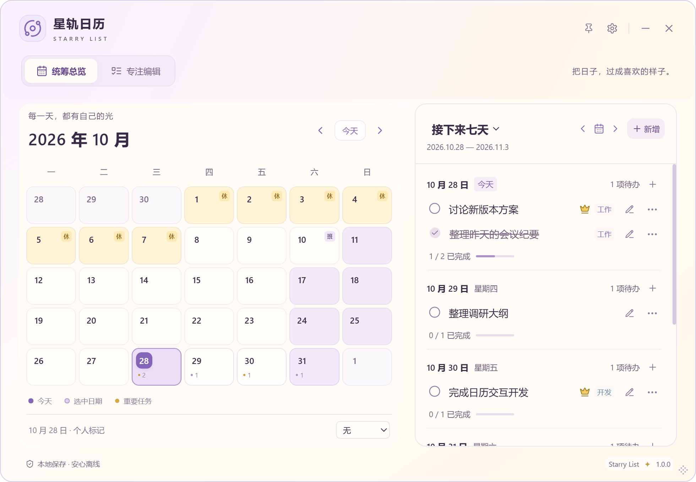
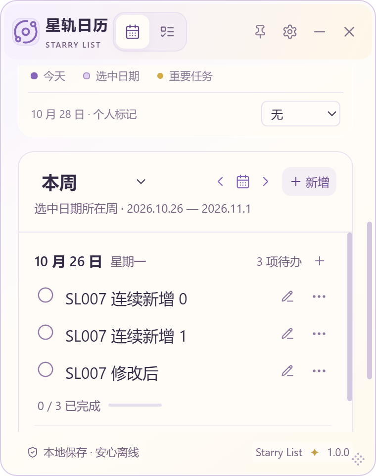

# V1.0 验证记录

## SL-022-A

2026-10-30。详细规则、验收复核、自动化/Windows证据及限制见 [本轮报告](SL_022_A_REVIEW.md)。SL-022/A In Review，SL-024-B/C Done、D/父项完整恢复仍In Review；SL-023仅概念初稿仍Idea。

- TypeScript、ESLint、Vite生产构建通过；默认前端 **208/208，14文件**；Rust **27/27**、fmt --check及Clippy --locked -- -D warnings通过。
- 首次前端207通过、既有材质模块hook超时1项；完整默认重跑全部208通过，未修改超时。原生首轮旧dist未显示星星，重建前端资源与隔离debug后重跑；失败不算通过。
- 本轮不改Rust/SQLite v2/001/002/Task/WaterEntry/JSON V2/store写入排序/应用标识或正式版本，未接触正式库、个人备份或旧安装包。

- Windows每日星星专项 **540/540布局通过**，`.cache/sl022a-1793362835123/results.json`：4/5/6周×980×680、980×480、760×620、500×620、380×480×三字号×三材质×两顶部×补水开关；日期/徽标/星星无裁切与交叠、无水平溢出。真实WebView2→Tauri→SQLite完成/取消即时刷新、日期点击与方向键焦点通过。布局由CDP测量，不冒充物理鼠标测试。
- Windows x64默认透明NSIS构建通过，正式标识 `app.starrylist.desktop`、版本1.0.0；独立包 `artifacts/Starry-List_1.0.0_x64-sl022-a-preview-20261030-setup.exe`，**5343359字节**，SHA256 `409d4a08f23a20d34dd0904a63d0d8b2533364941761d0e36da00958a9af987b`；校验文件 `artifacts/SL022-A-PREVIEW-20261030-SHA256SUMS.txt`。旧D包SHA256保持不变。

- 原有桌面冒烟 **25/25**，`.cache/desktop-smoke-1793363120034/results.json`：连续新增、真实Edge失焦、SQLite故障保护/重试、草稿/抽屉/删除撤销、JSON、字号/两顶部与正常重启。
- 补水C专项 **360布局**与记录/目标/历史未来/失败重试/100条列表/键盘/重启全部通过，`.cache/sl024c-1793363172364/results.json`。
- 真实OS鼠标拖动 **10组、72布局**通过，`.cache/sl020-1793363260296/results.json`；跨组阻止、箭头、长详情、45任务边缘滚动、SQL失败/重试、Escape及重启通过。

- D原生备份回归通过，`.cache/sl024d-1793363306967/results.json`：实际Save/Open对话框和JSON文件异库完整覆盖往返、五类Snapshot相等、两视图即时刷新、重复合并饮水幂等、冲突/最后SQL失败整笔回滚、V1两模式保留饮水、36空态布局及正常重启。备份恢复自动化不等于用户亲自验收。
- Markdown本地链接、格式与暂存差异检查通过；18文件明确暂存，仅新增两张合成界面截图，不包含数据库、私人JSON、安装器或私人壁纸。每次Commit前核对实际作者/提交者为原有GitHub noreply身份，不改本地/全局身份。

Commit/Push和CI结果在交付前补录。自动化、真实原生交互、用户安装验收与正式发布分别记录；没有Tag/Release。


## SL-024-D

2026-10-30。起始main=`4771198`，工作区干净，与最新origin/main一致；收尾再次fetch仍相同。用户安装C确认整体良好，空记录换行是剩余缺口；本轮正式授权JSON完整备份及恢复。A原MVP标准结合历史测试及最新安装确认Done；B/C空态、父项/D恢复继续In Review。SL-020 Done、SL-006 Research保持，无正式发布。

| 验证 | 最终结果与范围 |
| --- | --- |
| TypeScript / ESLint / Vite | 默认 `npm run check` 通过，生产静态构建；只有既有Zod PURE注释提示 |
| 全部前端 | **196/196**、13文件（原180+16）；75个App回归含版本/范围/空数组/确认词/取消/待写防重复/完整Snapshot即时更新；饮水/旧任务/设置/草稿/失焦不变 |
| Rust / fmt / Clippy | **27/27**（原18+9），fmt --check、Clippy --locked -- -D warnings通过 |
| 真实文件与SQLite单元 | 独立A/B文件数据库→实际JSON→B→重开五类完整一致；原始ID/日期/毫秒/+08:00与-05:00/未来记录不改写；V1两模式、V2重复/冲突/空替换及最后一步SQL失败全回滚 |
| 文件错误/资源限制 | 100000/100001记录、32MiB+1真实文件、JSON转义超限、无效目标/缺目录、旧文件成功替换与失败保留；OS错误112模拟部分写入磁盘满，不截断 |
| D Windows专项 | 原生Save/Open对话框与真实文件A→B导入、完整Snapshot相等、两视图即时更新、正常进程重启；V1两模式、V2空覆盖警告、冲突/SQL故障/损坏JSON/取消全部通过。最终 `.cache/sl024d-1793345385950/results.json`，含按钮遮挡保护；此前一轮亦完整通过 |
| 空记录真实WebView2 | 380×480/500×620/980×680 × 三字号 × 阅读/轻玻璃 × 无/有恢复，**36状态**；Range行数1、无水平溢出；最后一条删除/恢复入口正常 |
| 原补水C专项 | **360布局**（两视图×开关×三材质×三字号×两顶部×五尺寸），水位/目标/历史未来/失败重试/100条列表/设置键盘/重启通过。`.cache/sl024c-1793344841963/results.json` |
| 真实OS拖动 | **10组、72布局**，开启补水，跨组阻止/原箭头/长详情/45任务边缘滚动/真实SQL失败及重启通过。`.cache/sl020-1793345015661/results.json` |
| desktop-smoke | **25/25**，连续新增、真实Edge失焦、草稿/抽屉固定保存、删除撤销、实际导出合并/坏版本拒绝、字号/两顶部/设置及重启通过。`.cache/desktop-smoke-1793345102363/results.json` |

证据层次：前端模拟、CDP点击/键盘/布局测量、真实Windows原生文件对话框/Win32键鼠与文件I/O、真实隔离SQLite、用户安装验收分别记录；上述自动化不等于用户亲自安装恢复确认。所有桌面进程使用独立test App ID、数据目录和profile，运行中的正式安装版不关闭，不读取正式库/私人备份。

初测默认前端193项有1个旧5秒用例超时，其余192通过；修正测试资源/等待后默认195全通过，补充分钟精度非法时间案例后最终**196默认全通过**，未修改5000ms门槛。C专项初测删除后立即数徽标遇异步IPC竞态，加入等待实际消失后原断言及完整360矩阵通过。原生文件脚本初测WM_SETTEXT未通知Shell文件名缓存，出现超时；改为键盘编辑提交并回读核对隔离路径后完整链路成功，失败不计通过。

安全边界：SQLite user_version保持2、001/002和表结构、应用标识/软件1.0.0不变；仅JSON格式升2。导入IMMEDIATE事务内五类恢复并取得完整Snapshot后提交，UI成功才替换；同目录临时写入/sync_all/persist原子导出。JSON上限32MiB、任务50000/分类1000/标记50000/饮水100000，超限明确拒绝，不截断。规则见 [DEC-022](DECISIONS.md#dec-022) / [D备份报告](SL_024_D_BACKUP_REVIEW.md)。

未验证：Windows10、其他GPU/混合DPI/触屏/读屏、真实IME候选窗、网络/云目录/可移动介质、真实只读ACL/物理满盘/断电；安装器未执行安装/升级/卸载。磁盘满为故障注入，不能当物理环境认证。JSON未加密，超过限制时先退出后备份完整目录。首次升级前旧V1不含饮水，必须退出后完整目录备份；不删除数据、不直接降级v1。历史章节中旧JSON限制仅对应当时阶段，现行V2以D为准。

复现：`npm run check`；Rust原test/fmt/Clippy命令；按B/C隔离debug配置构建后串行执行 `node scripts/backup-smoke.mjs`、`node scripts/water-c-smoke.mjs`、`node scripts/drag-smoke.mjs --water`、`node scripts/desktop-smoke.mjs`。C/desktop的 `STARRY_LIST_SCREENSHOT_DIR` 指向缓存，避免重写历史截图；D合成图见 `docs/screenshots/sl024d/`，无私人图片/数据库。安装器/哈希和提交/CI在下方补录。

### D 预览安装包

默认透明Windows x64 NSIS构建通过，生成脚本BUNDLEID=`app.starrylist.desktop`、版本1.0.0，无测试标识/额外focus权限。仅构建，未执行安装器，不关闭已运行的正式版。

| artifacts/ 文件 | 字节 | SHA256 |
| --- | ---: | --- |
| `Starry-List_1.0.0_x64-sl024-d-preview-20261030-setup.exe` | 5344513 | `89c093ce907dc141f8e8fff4aef2bd93b52fa33859d64103109ce22b1e22f870` |

校验文件 `SL024-D-PREVIEW-20261030-SHA256SUMS.txt`。C包保留且SHA256仍为 `a4de00fa16121c626b2cb0fdccafdf9a52c4ccbd699a57b2b8c4076f27ffdf33`；A/B/SL-020旧包未覆盖。安装前自行正常退出、导出当前JSON、复制完整本地数据目录，首次升级前旧V1没有饮水，不能替代目录备份。安装后新版V2才能完整导出饮水，不删应用数据、不直接降级数据库v1软件。无Tag/正式Release，安装器和校验文件只留本地忽略的artifacts。

实现/测试/文档/合成截图提交 [`b7c488a`](https://github.com/YOLIIIIII/starry-list/commit/b7c488a518ea993f83dc33edde92c6ab29939f3d) 已普通Push main；[代码CI](https://github.com/YOLIIIIII/starry-list/actions/runs/41020764638)记录时运行中，最终状态以运行页及交付报告为准。每次Commit前实际作者/提交者均核实为维护者既有GitHub noreply配置，未改全局/本地身份；暂存31文件不含数据库、个人备份、安装器、私人壁纸/照片。Git只在命令级使用系统本机代理，无force push/历史重写/Tag/Release。

## SL-024-C

2026-10-30，初始main与origin/main一致、工作区干净；用户已认可B设置/总览/自定义基本流程，只做专注/大字号/杯子/明细精修。SL-024/A/B/C保持In Review，待安装；SL-020 Done、SL-006 Research不变，不新增健康功能。

- C专项在真实隔离Tauri/WebView2/SQLite通过360布局（两视图×开关×三材质×三字号×两顶部×五尺寸）；C由B套件扩展，保留旧核心断言。90个开启补水的专注组合左右边缘差最大0/0px，杯组/按钮无交叠，固定新增在窗内、任务滚动区≥60px。正常980×680三档均保留直接记录，杯宽实测45/50/60px。原结果 `.cache/sl024c-1793329033389/results.json`（含alignment数组）。
- 水位0/125/150/250/375/500/750/1500/2000/2300，目标1/1750/2500/20000；六杯省略/尾杯刻度/真实累计保留。记录0/1/2/10/30/100有界列表，10以上独立滚动；快捷记录面板内刷新、删除恢复、输入错误/IME/失败保留和真实SQLite触发器重试、历史/未来、正常进程重启通过。
- 开启喝水的真实OS鼠标/Escape拖动10组和72布局通过，含跨组阻止、长计划、45任务边缘滚动、SQLite失败/重试和重启，证据 `.cache/sl020-1793329116526/results.json`。
- 既有desktop-smoke 25组全部通过：连续新增/真实Edge失焦/草稿保护/抽屉固定保存/删除撤销/备份合并覆盖/设置与重启等，结果 `.cache/desktop-smoke-1793329157231/results.json`。
- Rust18/18、fmt --check、Clippy --locked -- -D warnings通过；Rust/迁移/数据库模型/平台IPC/store/App设置布局源码相对基线无差异，v2/备份版本/标识/正式版本不变。通用Dialog只新增默认false的补水专用背景隔离选项，其余调用保持原行为。

初测发现large网格优先级覆盖摘要，导致新增栏溢出，修正后完整矩阵通过。前端首次并行编译时旧草稿测试超时，其余179通过；普通模式第二轮3个旧用例超时、177通过。仓库默认5000ms未修改；单worker重跑仍有4个旧用例墙钟超时（176通过）。额外CLI `--testTimeout=20000 --maxWorkers=1 --no-file-parallelism` 用于诊断全部断言，和默认门槛结果分列；最终CI仍运行原默认配置。初测和最终结果分开，不把失败算成功。

截图见 [C视觉报告](SL_024_C_VISUAL_REVIEW.md)，均合成任务/记录、仅WebView内容，无私人壁纸/数据库。CDP点击/输入/媒体模拟/尺寸测量与OS鼠标/Escape分别登记；未宣称用户安装验收或全设备认证。

未认证：Win10/其他GPU/混合DPI/触控板/读屏/触屏/真实IME候选窗、安装升级卸载、长期海量饮水/跨时区午夜挂机；原生不透明独立二进制本轮未重跑，已有后端/前端降级测试保留。最小窗采用摘要与列表滚动，不承诺同时显示很多任务行。完整明细仍需正常退出后备份整个本地数据目录，JSON不含明细且合并/覆盖保留本机明细；不直接降级v1。

复现：按B的隔离debug配置构建（保留正式标识/权限不变），串行执行 `node scripts/water-c-smoke.mjs`、`node scripts/drag-smoke.mjs --water`、截图目录指向缓存的 `node scripts/desktop-smoke.mjs`；前端用 `npm run check`，Rust用原18测试/fmt/Clippy命令。正式数据库/安装版进程不访问、不关闭。


### C 最终检查与预览包

最终原默认 `npm run check`：TypeScript/ESLint、180/180前端（原179+1；全部73项App回归）、Vite生产构建通过；默认5000ms不变。独立20秒CLI诊断也180通过，App约34秒；最终默认App约35秒，早前超时记录保留，不将CLI诊断替代默认检查。Rust18/fmt/Clippy、10组真实OS拖动/72布局及25组桌面回归同样通过。

补充 `node scripts/water-c-smoke.mjs --panel-sizes`：大字号100条记录在380×480、500×620、760×620、980×680均通过列表独立滚动、关闭可达、Tab焦点留在面板、Escape关闭、无横向溢出；证据 `.cache/sl024c-1793329975681/panel-results.json`。默认补水专项与此前360布局证据一起覆盖功能及结构，OS键盘/鼠标和CDP模拟仍按各自范围区分。

默认透明 Windows x64 NSIS构建成功，正式标识 `app.starrylist.desktop` / 版本1.0.0不变；只跳过重复前端构建的打包配置，不带测试标识/权限，安装器未执行。

| artifacts/ 文件 | 字节 | SHA256 |
| --- | ---: | --- |
| `Starry-List_1.0.0_x64-sl024-c-preview-20261030-setup.exe` | 5280926 | `a4de00fa16121c626b2cb0fdccafdf9a52c4ccbd699a57b2b8c4076f27ffdf33` |

校验文件 `SL024-C-PREVIEW-20261030-SHA256SUMS.txt`。旧A哈希仍 `7537d2b99ec7caa8a1f9a9a3111594fec2033d81672a91ebd6f5fcec6f95aefd`，旧B仍 `7c2660f9cd6bc8e33458074f2e668127a6ebc5db4d26387f091ba9728274941b`，复核未覆盖。正常退出、导出JSON任务备份、备份完整本地数据目录后再安装；不删除原数据、不直接降级v1，无Tag/Release。


C实现 [`f9c0d5f`](https://github.com/YOLIIIIII/starry-list/commit/f9c0d5f7f5547d6387f9263675c245c4870e0225) 已普通Push main；[代码CI](https://github.com/YOLIIIIII/starry-list/actions/runs/40996515098) 在交付记录时运行中，最终状态以Actions及交付报告为准。作者/提交者已核实维护者既有GitHub noreply身份，暂存不含数据库、安装器、私人资料；仅命令级使用系统本机代理，没有改Git配置，无force push/Tag/Release。

## SL-024-B

2026-10-30，起始main与origin/main一致、工作区干净。正式授权UI/UX精修；SL-020核对全部必要标准、既有170前端/16Rust/10组真实OS/72布局/25回归及A开启喝水后的回归，结合用户安装后「这个功能还不错」的确认，标记Done（未发布）；未认证系统硬件范围仍保留。SL-024/A/B继续In Review，等待视觉与交互验收；SL-006保持Research，不开发驻留。

- TypeScript、ESLint：通过。前端179/179（原174、新增5），包含四分类键盘与草稿保留、自定义IME/Escape/失败重试/边界值、高目标杯数上限；原73项App回归全部通过。
- Rust：18/18；cargo fmt --check、Clippy --locked -- -D warnings通过。Rust源码、001/002迁移、tauri.conf、domain、platform、store相对基线无差异；数据库user_version=2、water_entries字段、备份版本1及合并/覆盖保留饮水明细规则不变。
- 正式前端构建通过，内置静态资源；Zod上游PURE注释提示沿用，无新增在线字体/图片/依赖。
- Windows专项结果与安装器校验在下方交付记录补录。原生验证仅独立测试标识/数据库/profile，无正式用户SQLite操作，不关闭用户已安装的软件。

初次检查发现经典顶部的480高，以及760×620双行补水布局会压缩任务区，修正为高度≤660或宽度≤540使用摘要，700高以下进一步收紧专注装饰与星期条。保留失败记录，最终重跑才计成功。首次跨天恢复时旧工具会话已失效，重新核实进程路径并构建隔离debug；未以旧会话结果冒充本轮通过。

复现（本地Node24/Rust1.90；先使用下方SL-020隔离配置构建debug，桌面脚本串行）：

```powershell
npm run check
cargo fmt --manifest-path src-tauri/Cargo.toml --check
cargo test --manifest-path src-tauri/Cargo.toml --locked
cargo clippy --manifest-path src-tauri/Cargo.toml --locked -- -D warnings
npm run tauri build -- --debug --no-bundle --config .cache/sl020-test.conf.json
node scripts/water-b-smoke.mjs
node scripts/drag-smoke.mjs --water
$env:STARRY_LIST_SCREENSHOT_DIR = '.cache/sl024b-regression'
node scripts/desktop-smoke.mjs
```

旧water-smoke入口转发到B套件，继续验证A记录能力。设置重排只调整旧desktop脚本进入分类的步骤，原断言不删除。截图和布局说明见 [视觉报告](SL_024_B_VISUAL_REVIEW.md)，均为合成内容。CDP点击/输入/布局和真实OS拖动/Escape分别记录，不宣称物理键盘验证了所有设置分类。

边界：本机Windows11/WebView2/200%缩放；Win10/其他GPU/混合DPI/触控板/读屏/触屏/真实IME候选窗、安装升级卸载、长期海量记录和跨时区/午夜挂机未认证。原生不透明回退的独立二进制未在B重跑，沿用已有后端且保留前端降级测试；三材质矩阵不冒充全部硬件毛玻璃像素认证。JSON不含饮水明细的重要提示在数据分类显式保留，完整历史需退出后备份完整目录；不直接降级到v1、不删除应用数据。


最终串行回归通过：开启喝水的10组真实OS鼠标/Escape/SQLite失败重试/长计划/45任务边缘滚动/重启 + 72布局，结果 `.cache/sl020-1793323249587/results.json`；既有25组桌面回归（独立Edge失焦、连续新增、行内修改、抽屉/保存/草稿、删除撤销、备份和窗口/字号/材质/顶部重启）结果 `.cache/desktop-smoke-1793323293131/results.json`。相应合成截图在缓存，B视觉截图46张在仓库文档目录；安装器未执行。

### B 原生专项与体验包

`water-b-smoke` 完整通过：360状态（两视图×开关×三材质×三字号×两顶部×980×680 / 980×480 / 760×620 / 500×620 / 380×480），页面无横向溢出；喝水不在任务滚动区；固定新增在窗内、任务正文至少60px（最小窗依靠滚动访问长清单，不宣称能同时显示很多行）。四分类/目标草稿/关闭键盘焦点；0/150/250/500/750/1500/2000/2300、1750非整杯目标、目标1/20000；容量1/10000、自定义错误、删除恢复、过去/未来、真实SQLite触发器拒绝后输入保留及重试、长任务新增坐标不变、减少动态效果模拟、退出重启记录一致。结果 `.cache/sl024b-1793323177001/results.json`；截图 `docs/screenshots/sl024b/`，逐项说明在视觉报告。

首次SQLite失败断言同时匹配全局/局部错误，改为检查输入区错误；删除断言增加等待持久化后UI更新，避免把异步点击当作写入完成。未放宽业务数据正确性断言。

Windows x64 默认透明 NSIS构建成功，正式标识 `app.starrylist.desktop` / 版本1.0.0不变，测试配置未带入；安装器未执行。

| artifacts/ 文件 | 字节 | SHA256 |
| --- | ---: | --- |
| `Starry-List_1.0.0_x64-sl024-b-preview-20261030-setup.exe` | 5282048 | `7c2660f9cd6bc8e33458074f2e668127a6ebc5db4d26387f091ba9728274941b` |

校验文件 `SL024-B-PREVIEW-20261030-SHA256SUMS.txt`。旧A包SHA256仍 `7537d2b99ec7caa8a1f9a9a3111594fec2033d81672a91ebd6f5fcec6f95aefd`；旧SL-020仍 `f933bb7933df5bc0d649824a9f8563dc9f4056bb738ada555e772cc7577db605`，均复核未覆盖。安装前退出、导出JSON任务备份、复制完整数据目录；升级后不直接降级v1、不删除应用数据，保留旧库完整备份。源码与六份管理文档及视觉报告一并交付，无Tag/Release；Push/最终CI以交付报告与Actions实际状态为准。


B实现 [`5a290b3`](https://github.com/YOLIIIIII/starry-list/commit/5a290b3968328d0e6578c07767f42e54b063d054) 已普通Push main，[对应CI](https://github.com/YOLIIIIII/starry-list/actions/runs/40985706607) 在交付记录时运行中，最终状态以Actions和交付报告为准。直连GitHub连续连接失败后，仅本次命令复用系统已启用的本机代理成功推送，无全局/仓库Git配置变更，无force push。作者和提交者均已核对为维护者既有GitHub noreply身份，暂存审查未含数据库、安装器或个人资料。

## SL-024-A

2026-10-29：喝水模块 MVP；用户授权开发/构建/Push main，无 Tag / Release。SL-024 / A **In Review**，待用户体验；SL-020 没有新增针对性验收确认，继续 In Review。开发、自动测试、真实桌面、用户验收和发布分开。

| 检查 | 结果与实际范围 |
| --- | --- |
| TypeScript / ESLint / Vite | 通过；沿用本地 Node24；没有新增在线依赖或资源 |
| 前端 | 174/174（原170 + 新4）；快记/自定义/本地偏移时间、历史日期、未来限制、删除恢复、达标/超额、旧设置默认、目标/开关和失败保留；既有73项App交互回归通过 |
| Rust | 18/18（原16 + 新2）；真实文件v1→v2、重复迁移、任务保留、记录幂等/非法容量日期拒绝、设置及记录重开、导出排除明细、覆盖导入保留明细、删除与任务隔离 |
| Rust格式 / Clippy | cargo fmt --check、cargo clippy --locked -- -D warnings 通过 |
| Windows饮水专项 | 真实 Tauri/WebView2→IPC→Rust→SQLite，设置UI开关/1750目标、三快捷+自定义、时间明细、删除/恢复/星标、2300超额、昨天补录/未来禁用、隐藏保留、进程退出重启保留 |
| 视觉布局 | 两视图×三材质×三字号×两顶部×380/980宽，480高，共72状态，无页面/卡片横向溢出，专注新增在窗内；长计划滚动前后新增框纵坐标不变。另查看380×680的大字紧凑真实截图，杯子/按钮/达标标志清晰 |
| 开启喝水的拖动回归 | 10组真实OS鼠标检查+72布局：组内/跨组、箭头、Escape、长计划、45任务边缘滚动、真实SQLite失败/重试、重启顺序 |
| 既有桌面回归 | 25组通过：任务新增/真实失焦、行内编辑、抽屉固定保存、失败保留、删除撤销、备份、窗口状态及重启等。此套默认关闭喝水，与开启专项分开 |

证据（均为隔离合成数据，缓存不提交）：饮水 `.cache/sl024-1793266933340/results.json` / `focus-380.png`；开启喝水拖动 `.cache/sl020-1793266840750/results.json`；原回归 `.cache/desktop-smoke-1793266660667`。截图是WebView内容，不是用户桌面/个人数据。所有脚本只关闭自己创建的测试进程。

初次测试修正：三个旧Rust测试的数据库版本断言随独立迁移更新为2，旧设置读取不改写的断言保留；未来按钮的jsdom断言改为检查fieldset继承禁用。原生checkbox等待持久化完成再断言。一次并发测试被OS遮挡检查阻止，改串行；拖动坐标初次受新增卡片/边缘滚动影响，夹具先将源/目标滚入安全区域后再采集OS坐标，最终完整10组通过，未改业务拖动逻辑。

复现：先按下方 SL-020 隔离配置构建debug（同一测试identifier、不同目录/profile）；不要并发运行桌面脚本：

```powershell
npm run check
cargo fmt --manifest-path src-tauri/Cargo.toml --check
cargo test --manifest-path src-tauri/Cargo.toml --locked
cargo clippy --manifest-path src-tauri/Cargo.toml --locked -- -D warnings
npm run tauri build -- --debug --no-bundle --config .cache/sl020-test.conf.json
node scripts/water-smoke.mjs
node scripts/drag-smoke.mjs --water
$env:STARRY_LIST_SCREENSHOT_DIR = '.cache/sl024-regression'
node scripts/desktop-smoke.mjs
```

边界：本机Windows11/WebView2、200%缩放；CDP点击/输入/尺寸及真实OS拖动分别记录。未执行安装器安装/升级/卸载、全新设备、Win10/其他GPU/混合DPI/触控板/读屏/真实IME候选窗、长年海量饮水性能、跨时区/系统时钟跳变或午夜长时间挂机的物理体验。当前记录跟随选中日，跨午夜请点「今天」；目标改变按新目标重算历史，不是历史目标快照。无正式用户数据库读写、不关闭用户应用。

JSON备份版本1只含开关/目标，**不含饮水明细**，合并与覆盖都保留本机明细。完整历史备份需正常退出后复制数据目录。数据库迁移v2与旧体验版不兼容，不直接降级，安装前备份完整目录。

### SL-024-A 安装包与交付

默认透明 Windows x64 NSIS 构建成功，正式 identifier `app.starrylist.desktop`、版本1.0.0不变；打包配置只跳过已通过的前端重复构建，不含测试identifier/额外测试权限。安装器未执行。

| artifacts/ 文件 | 字节 | SHA256 |
| --- | ---: | --- |
| `Starry-List_1.0.0_x64-sl024-a-preview-20261029-setup.exe` | 5281288 | `7537d2b99ec7caa8a1f9a9a3111594fec2033d81672a91ebd6f5fcec6f95aefd` |

校验文件 `SL024-A-PREVIEW-20261029-SHA256SUMS.txt`。旧 SL-020 仍5258119字节，SHA256 `f933bb7933df5bc0d649824a9f8563dc9f4056bb738ada555e772cc7577db605`，复核未覆盖。安装器/缓存不提交Git，无Tag/Release，不自动关闭用户应用或删除正式数据库。升级前正常退出并备份完整目录，安装与人工体验尚未执行。

源码、测试与六份文档实现提交 [`0275420`](https://github.com/YOLIIIIII/starry-list/commit/02754201875a2257f9bd7b4793fb290d504b084e)，已 Push main；[对应 CI](https://github.com/YOLIIIIII/starry-list/actions/runs/40852270628) 已触发，交付记录提交时运行中，最终结果以该运行及 main 最新提交的 Actions 为准。没有 Tag / Release；工作树检查无敏感文件，作者/提交者均核实为维护者现有 GitHub noreply 本地身份。


## 2026-10-29：SL-020 同日组内拖动 / SL-007 验收 / SL-024 登记

基于最新 main `086811e` 开发，起始工作区干净。SL-007 用户已安装并确认「两种日期模式、前后导航与跨月、正在输入时切换范围、字号和布局、重启偏好」均体验良好。逐项核对原验收标准、实现 [`203cd42`](https://github.com/YOLIIIIII/starry-list/commit/203cd424213c09f4eda17084a3ad64b06564bdf4) 及下方 155 前端 / 15 Rust / 25 桌面回归 / 8 专项与 180 布局证据，无明确未满足条件，记录 **2026-10-29 Done**。下方 SL-007 的 In Review 是历史交付状态，现已收到确认；未进行的环境认证仍保留，Done 不代表正式发布。

SL-020 **In Review**，等待用户安装体验；SL-024 查重后按下一编号登记为 P2 / Backlog，仅产品设想和未决问题，无功能/Schema/公式/最终资产。SL-006 保持 Research、结论 C、暂停正式实现，研究原型未修改。其他需求状态不变。

### 实现与数据保护

仅专注清单任务最左侧把手启用 HTML5 拖放；标题、完成、删除与上下箭头保留各自入口。插入线标明行前/后，展开长计划只生成标题紧凑拖影，清单边缘自动滚动。Escape、拖到非目标区域或列表签名/日期/视图/忙碌状态改变均取消，不保存取消结果。减少动态效果遵守系统偏好。键盘通过原箭头 Tab / Enter 排序，把手可访问名称明确，点击把手显示备用操作说明。

未完成在前、已完成在后；只允许同日同完成组内移动，跨组禁止光标/无落点，不改变 completed。编辑抽屉或非空新增草稿存在时阻止开始拖动，先处理已有草稿，未增加第二套新增保存逻辑。拖动与箭头共用 App → store.reorder → repository → Rust SQLite；store 队列真正执行时重新验证完整、无重复 ID 与任务签名。保存中只接受一个排序，非乐观更新，事务成功才更新界面；失败提示并保留原序，可重试。

Rust 在同一事务内读取、验证日期成员和完成分组、更新 sort_order/既有 updated_at，任一步失败整体回滚。任务的日期、标题、长计划、优先级、分类和完成状态不因排序改动；无 Schema/迁移/排序表、备份结构或第三方依赖变化。Windows 必须设置 `dragDropEnabled=false`，关闭 Tauri 原生文件拖入接管才能使用 HTML5 拖放；原 JSON 文件选择导入保留，不影响标题拖窗/边缘缩放的实现。依据见 DEC-018。

### 已执行检查与实际边界

| 检查 | 实际结果 | 证据与边界 |
| --- | --- | --- |
| TypeScript、Lint、前端构建 | 通过 | `npm run check`，170 项前端测试；包含原 SL-007、草稿、Enter、失焦、IME 事件、抽屉、删除撤销回归 |
| 新排序自动化 | 通过 | 首末/中间/空/单项/100 项；同组/跨组跨日、完整成员/重复/遗漏；Escape；删除/完成/日期/视图/重载/忙碌失效；保存失败保留字段、队列旧签名拒绝、重复提交与后续重试 |
| Rust / SQLite | 通过 | 16 项测试，fmt 与 Clippy `-D warnings`；真实触发器在事务中途拒绝，验证全部任务字段回滚，移除后重试；原备份/导入等继续通过 |
| Windows 11 真实鼠标拖放 | 通过 | 10 组专项记录：未完成末到首、首到末、已完成组、跨组拒绝、真实 SQLite UPDATE 失败后重试、拖后箭头、真实 OS Escape、展开 150 行长计划且拖影高度 <80px、45 项清单边缘滚动后取消、正常进程退出重启保持 |
| Windows WebView2 布局 | 通过 | 3 材质 × 3 字号 × 2 顶部 × 380/500/760/980px，共 72 状态，高480px；检查横向溢出与把手边界；不冒充每一状态都做了真实鼠标拖动或毛玻璃像素认证 |
| 原生既有回归 | 通过 | 25 组 `desktop-smoke`：新增 Enter、应用内/独立 Edge 失焦、真实 SQLite 失败重试、编辑/撤销/导入、设置与重启等；当前原生 HTML5 配置下执行 |
| 任务变更时拖动失效、草稿/抽屉阻止 | 前端自动化与源码核对通过 | 不冒充真实 OS 同时删除/换日/切视图/候选窗输入的全部组合 |
| 窄窗操作与键盘/减少动态效果 | 补充 WebView2 检查通过，部分原生输入未认证 | 380×480、大字号、紧凑顶部、长中文/最高优先级任务：首行6个操作按钮在窗内且两两无重叠；CDP 聚焦箭头并 Enter 后真实 SQLite 排序正确；模拟 reduced-motion 后拖动行 transition=0s。未认证读屏器、物理键盘/触控板与所有窗口八边缩放 |
| Win10、多显示器/混合 DPI、其他 GPU、触屏 | 未验证 | 本机 Windows 11 build 26200、scale=2、WebView2；无额外设备认证 |
| 安装/升级/卸载、真实 IME 候选窗 | 未验证 | 仅构建安装器，不执行；正式数据库不读写，未运行会访问正式数据的 release-smoke |

专项 `scripts/drag-smoke.mjs` 在真实 Tauri WebView2 中通过 CDP 设置合成数据和检查 UI；拖动和 Escape 使用 `scripts/drag-input.ps1` 发出真实 OS 输入，并校验测试 PID、窗口及起点命中，防止向用户窗口输入。不是纯 jsdom 或 fireEvent 拖放。辅助脚本的 10 条 records、72 条 layouts、截图保存在忽略的 `.cache/sl020-*`；本轮成功记录为 `.cache/sl020-1793259269343/results.json`。旧回归记录 `.cache/desktop-smoke-1793258728511`。截图仅测试 WebView 内容，原始数据库、个人桌面截图均不上传。

补充窄窗证据在 `.cache/sl020-narrow-1793259885300/results.json` 与 `focus-380.png`，已查看真实渲染。复现时在相同隔离 debug 实例设置380×480、紧凑顶部/大字号，种入3条长中文和最高优先级任务，检查按钮边界与横向溢出；Tab/Enter 使用箭头后核对重载排序；DevTools 模拟 reduced-motion 并核对行 transition。CDP 键盘/媒体模拟与真实 OS 鼠标输入分别记录。

初次原生尝试发现 Tauri 默认接管导致 HTML5 拖放不生效，修正官方要求的窗口配置后重测。另一尝试中目标行被滚动区域裁切，未计成功；夹具改为860px高窗口完成基础拖动，矮窗另测滚动和布局。前端检查曾与 Rust 编译竞争导致材质 hook 超时，单独完整重跑通过，没有放宽超时或跳过断言。

### 隔离复现

先完成 npm ci 和前端构建。建立忽略的 `.cache/sl020-test.conf.json`：

```json
{"identifier":"app.starrylist.desktop.sl020-test","build":{"beforeBuildCommand":null},"app":{"security":{"capabilities":["main-capability",{"identifier":"sl020-focus-test","windows":["main"],"permissions":["core:window:allow-set-focus"]}]}}}
```

```powershell
npm run check
cargo fmt --manifest-path src-tauri/Cargo.toml --check
cargo test --manifest-path src-tauri/Cargo.toml --locked
cargo clippy --manifest-path src-tauri/Cargo.toml --locked -- -D warnings
npm run tauri build -- --debug --no-bundle --config .cache/sl020-test.conf.json
node scripts/drag-smoke.mjs
# 原回归脚本，使用同一个隔离 debug 二进制；截图只存缓存
$env:STARRY_LIST_SCREENSHOT_DIR = '.cache/sl020-regression'
npm run test:desktop
```

Node 24、Rust 1.90 MSVC；测试专用 identifier、独立 `.cache/sl020-*` SQLite / window-state / WebView2 profile，脚本在种入数据前核验精确测试 identifier。不能把正式构建用于此测试；不自动安装、关闭或卸载用户实例，不触及正式数据。正式 capability、标识、默认窗口模式、SL-006 原型均未改变；只有窗口 HTML5 拖放必要配置变化。

### Windows x64 体验包

默认透明 NSIS 构建成功，正式 identifier `app.starrylist.desktop`、版本1.0.0保留；NSIS 脚本与 release exe 已检查，不含 SL-020 测试 identifier / capability。使用已通过检查的 dist，打包配置仅跳过重复前端构建。安装器没有执行，无 Tag / Release。

| 本地文件（artifacts/） | 字节 | SHA256 |
| --- | ---: | --- |
| `Starry-List_1.0.0_x64-sl020-preview-20261029-setup.exe` | 5,258,119 | `f933bb7933df5bc0d649824a9f8563dc9f4056bb738ada555e772cc7577db605` |

校验文件 `SL020-PREVIEW-20261029-SHA256SUMS.txt`。旧 SL-007 包仍为5,259,459字节、SHA256 `f04d5a69263000b2748d2d28720aba72427c9b7786f6d235b032179baebdc64d`，已复核未覆盖；UX3.2 等旧包保留。安装包、校验文件与缓存不提交 GitHub。安装前导出 JSON、正常退出旧版本，按同版本覆盖流程操作；五分钟验收见 [手册](USER_GUIDE.md#五分钟验收)。等待安装体验期间 SL-020 保持 In Review，发布版本字段不填。

### Git 与交付

源码与测试已提交并 Push 到 main：[`f486262`](https://github.com/YOLIIIIII/starry-list/commit/f486262f0d0112114b8f781360454624b8db8002)，[对应源码 CI](https://github.com/YOLIIIIII/starry-list/actions/runs/40837152412)。文档为后续独立提交，最终 CI 按交付时最新 SHA 再核对，不能用早先提交的结果代替。

每次提交前核实实际作者/提交者匹配本仓库原有 GitHub noreply 身份，不修改配置；明确暂存范围并检查差异与敏感信息，不提交数据库/私人备份/安装器/本机绝对路径。源码、测试与文档按实际提交分别记录，Push main 后按精确 SHA 查询 CI；CI 不替代本机原生交互。无强制推送、历史改写、Tag 或正式 Release。

## 2026-10-28：SL-007 接下来七天 / 本周范围

本轮仅实施 SL-007，基于 main `07ab098`。SL-006-A 结论 C 已由用户确认，暂停正式实现，SL-006 保持 Research；原型和研究报告不改动。SL-007 完成后 **In Review**，等待用户安装验收，不代表正式发布。

### 规则与数据保护

- 默认 rolling：从选中日开始连续七个自然日。week：包含选中日的周一至周日，包括过去或未来日期；前后均对选中日增减 7 天，保留星期位置。回到今天保留模式，重启保留模式并按原逻辑回到当天。
- 标题内原生选择框「日程范围」，Tab/方向键可操作；用完整年份的真实首尾范围替代装饰句，不增加独立工具栏。「本周」标明“选中日期所在周”，避免误解为总是今天所在周。
- 只有设置 JSON 新增 `agenda_range: rolling | week`；前端 Zod 与 Rust Serde 缺字段默认 rolling，两端拒绝非法值；备份版本仍为 1，任务表和迁移不变。读取旧 JSON 不回写；选择预览、真实保存、错误回滚与重试分别验证。
- 范围切换直接复用 guard → QuickAdd.save / InlineTitleEditor.save → store 队列；非空草稿先保存到原日期，失败不导航，多个保存来源共享原 Promise。只打开下拉但不改选项也保留既有外部失焦保存，不为选择框豁免普通失焦行为。任务已保存、随后仅设置失败时，任务保留，范围回退。

### 实际验证

- TypeScript、ESLint、**155 项前端测试**和生产前端构建通过。新增覆盖跨月/跨年、闰年、周日/周一、非今天锚点与前后周、草稿先保存/等待/重复操作/失败重试、IME 组合保护、行内编辑失败阻止切换、仅打开选择也保存、设置预览/失败回滚/重载、旧设置和旧备份。
- Rust fmt、**15 项 Rust/SQLite 测试**、Clippy `-D warnings` 通过。新增旧 JSON/备份兼容、读取不回写、2 范围 × 3 材质 × 3 字号 × 2 顶部共 36 组设置/导出/替换导入、非法值拒绝、真实设置 UPDATE 失败/重试；任务全部字段保持，user_version=1。
- **8 组 SL-007 原生桌面检查通过（含下述布局矩阵）**，使用真实 Windows WebView2 → Tauri → 独立 SQLite：五组边界日期及自然周导航；纯范围切换前后任务/分类/个人标记全部字段和 Schema 版本一致；打开但不改选项仍保存；真实 INSERT 拒绝保留草稿/阻止切换、移除触发器后保存到原日期且只一次；真实设置 UPDATE 拒绝回滚与重试；本周 Enter 连续新增三条及焦点返回、行内修改和删除撤销；真实 OS 前台转到独立 Edge 后保存到原日期、不抢焦点并可撤销；旧 JSON 不回写、选择框键盘与进程重启保留。
- **180 个原生布局状态通过**：3 材质 × 3 字号 × 2 顶部 × 2 范围 × 5 尺寸（980×680、980×480、760×620、500×480、380×480）。范围/按钮边界、横向溢出、操作重叠和七个实际日期均检查；纯偏好/尺寸变化前后任务、分类、标记与 Schema 版本不变。相同配置下两种范围标题高度相同：小 78–83px、标准 79.5–84.5px、大 81–86px，差异来自宽窄内边距；不是旧版本安装包的高度对照。截图为隔离合成任务的 WebView 内容，不含私人桌面背景。
- **25 组既有 Windows 桌面回归通过**：连续 Enter/焦点返回、应用内和真实跨软件失焦保存、SQLite INSERT/UPDATE/DELETE 失败重试、行内编辑、草稿/正常关闭保护、删除/新增撤销与通知计时、长计划/抽屉、JSON 事务导入、三材质/字号/两顶部偏好重启、置顶/透明度/窗口几何/最小化等均保留。此轮没有调整这些业务逻辑来迁就测试。

| 连续七天 · 经典顶部 | 本周 · 380×480 · 大字号 · 紧凑顶部 |
| --- | --- |
|  |  |

### 复现、失败尝试与边界

前端检查初次存在错误的测试按钮名称/选项，以及与 Rust 并行编译时的材质测试 hook 超时，修正测试查询并单独完整重跑通过，没有放宽超时或跳过断言。原生测试曾因 CDP 输入焦点与系统前台不一致而中止；现紧邻 Enter 验证 DOM/原生两种焦点。独立 Edge 最初被其他窗口遮挡、原生激活观察过早，均未计通过；夹具仅对精确测试 profile 的窗口临时提升，保留 PID/命中保护，观察真实前台进程后恢复原置顶状态。正式窗口/材质/失焦保存逻辑未为测试修改。

```powershell
# Node 24 / Rust 1.90 MSVC；根目录，先完成 npm ci
npm run check
cargo test --manifest-path src-tauri/Cargo.toml --locked
cargo clippy --manifest-path src-tauri/Cargo.toml --locked -- -D warnings
# 按历史章节创建独立 debug 配置，identifier 改为 app.starrylist.desktop.sl007-test，
# 仅测试 capability 加 core:window:allow-set-focus；不要用于正式打包。
npm run tauri build -- --debug --no-bundle --config .cache/sl007-desktop.conf.json
npm run test:agenda
$env:STARRY_LIST_SCREENSHOT_DIR = '.cache/sl007-regression-images'
npm run test:desktop
```

`test:agenda` 会在写入测试任务前校验精确的 SL-007 测试标识及 SQLite 文件头；使用唯一 `.cache/sl007-desktop-*`，任务/窗口状态和 WebView/Edge profile 全部隔离。范围测试不读取或改写正式用户数据库，不结束用户实例。截图、触发器与原始 results.json 只在忽略的缓存；原型目录、生产 capability、App ID、版本号和迁移均无改动。

本轮实际输入由 CDP 在真实 WebView2 中执行；IME 组合由前端事件模拟，**未认证真实中文候选窗/物理键盘、独立 Windows 10、多显示器/混合 DPI 或其他 GPU**。三材质下验证布局与原有操作，没有重新认证原生毛玻璃的所有像素/电源策略。没有运行安装器、升级/卸载或正式用户数据的 release-smoke；安装包构建与用户验收分开记录。

### 体验安装包与验收

默认透明 Windows x64 NSIS 构建成功，正式标识仍为 `app.starrylist.desktop`、版本仍为 1.0.0；核对生成的 NSIS 脚本以及 release exe，不含 `sl007-test` 应用标识或测试 capability 标记。构建使用已通过检查的内置前端资源，无安装器执行、Tag 或 Release。

| 本地文件（artifacts/） | 字节 | SHA256 |
| --- | ---: | --- |
| `Starry-List_1.0.0_x64-sl007-preview-20261028-setup.exe` | 5,259,459 | `f04d5a69263000b2748d2d28720aba72427c9b7786f6d235b032179baebdc64d` |

校验文件为 `SL007-PREVIEW-20261028-SHA256SUMS.txt`。旧 UX3.2 透明/不透明两个独立安装包均保留，构建前后 SHA256 一致；本轮没有重建新的原生不透明安装包。产物/校验文件和原始缓存不提交 GitHub，公开两张图片仅含测试数据。

用户安装前导出 JSON、正常退出旧版，按 [手册](USER_GUIDE.md#安装-sl-007-体验版) 同版本覆盖，不卸载或清空数据。重点体验：非今天日期的本周范围与前后周、输入草稿后直接切换范围并回原日期检查、真实中文 IME、三字号/三材质/两顶部的窄矮布局、正常重启保留模式。等待确认期间 SL-007 保持 In Review，发布版本字段不填。

### Git 与交付边界

源码与测试已提交并 Push 至 main：[`203cd42`](https://github.com/YOLIIIIII/starry-list/commit/203cd424213c09f4eda17084a3ad64b06564bdf4)，对应 [GitHub CI](https://github.com/YOLIIIIII/starry-list/actions/runs/40669099985)。文档、截图与引用为后续独立提交，最终 CI 按交付消息的最新 SHA 查询，不能用先前提交通过代替。远程 CI 检查前端与 Rust；本页真实桌面数据来自本机，不把 CI 当作原生交互认证。

每次提交前检查实际 Git 作者/提交者与仓库本地 GitHub noreply 配置一致，未改全局或本地身份。暂存文件经范围、差异、敏感信息检查；未提交缓存数据库、个人备份、安装器、完整邮箱或本机绝对路径。生产窗口配置/capability、任务迁移、依赖 lockfile、SL-006 原型及研究报告差异为空；无强制推送、历史改写、Tag 或 Release。

## 2026-10-26：SL-006-A 隔离研究与 UX3.2 用户确认

用户已安装 UX3.2 并确认「功能都还不错，已经可以了，我们接下来看下一项任务」。核对下方历史测试及 UX3.2 对比，SL-005-A / SL-001-A **Done**；父项和历史子项逐项核对见 [研究报告](research/SL-006-WINDOWS-DESKTOP-RESIDENCY.md#ux32-验收复核)，不以此次反馈批量关闭。以下 UX3.2 章节“待体验”保留为交付当时状态，不代表仍未收到本次确认；未正式发布。

本轮新授权仅 SL-006-A。独立 Rust/Tauri 研究 crate、App ID、exe、WebView2/Edge profile；没有 SQLite、任务/备份或窗口设置插件，不启动正式应用。`src-tauri` 正式源码/配置/capability/lockfile 与正式前端均无修改；已运行的正式 Starry List 实例保留，未关闭或重启。研究标识不会替换正式标识，没有执行安装器、Tag 或 Release。

真实环境 Windows 11 build 26200、scale=2、WebView2 UA Edg/155，Intel Iris Xe 32.0.101.5542。独立原型 `cargo build --locked --offline`、Rust fmt、Clippy `-D warnings`、仓库 JS ESLint 通过；正式 UI/数据库未改，不重新构建正式软件。CI 不等于桌面测试，其结果须按本轮提交 SHA 查询。

已实际执行 Rust/JS bottom、Win32 单次置底、原生顺序/前台/WS_EX_TOPMOST/IsIconic 观测、真实 OS 按钮/标题拖动/东南角缩放、三模式协调、独立 recovery IPC、合成无边框全屏、毛玻璃启停与内容事件、真实 Win+D/再次恢复和研究进程正常重启。关键结果：**A 在 Win+D 后被最小化；B 在激活后上浮；直接同时 top/bottom 会出现 API top 标志与原生 WS_EX_TOPMOST 不一致。** 报告结论 C，暂不推荐进入 SL-006-B，父项 Research。

OS 输入采用子进程 PID / 根窗命中保护；早期被其他窗口遮挡的点拒绝点击，保留未验证。缩放先最小化自己的 cover，露出角落后完成；除授权的成对 Win+D 外，不主动最小化用户应用，也不结束用户应用。输入英文与中文 Unicode 使用 CDP，不冒充真实物理键盘或 IME；HostBackdropBrush 创建成功不冒充视觉像素稳定。Explorer 重启/WorkerW/SetParent、锁屏、Alt+Tab、Win10、混合 DPI/显示器热插拔、其他 GPU 与独占全屏均未验证。没有执行 Explorer 重启或上传桌面截图。

完整 20 项矩阵、复现、失败尝试及限制见 [研究报告](research/SL-006-WINDOWS-DESKTOP-RESIDENCY.md) 和 [原型说明](../research/sl006-desktop-probe/README.md)。原始 evidence.json 仅保留在忽略的本地缓存；公开文档不包含个人壁纸/照片、数据备份、真实数据库、完整邮箱或本机绝对路径。

后续独立 `--watchdog-only` 等待 125 秒，实际确认 120 秒的 bottom 约束解除；180 秒自动退出与 UI 彻底挂死未验证。独立 Edge 的内容页已打开，原生命中仍不能确认其覆盖原型，明确记为未验证。已完成正常退出/重启及 watchdog 两次设施运行，保留产品行为失败（Win+D、单次置底激活），不把 runner 退出码 0 当作产品通过。公开 [归一化 JSON](../research/sl006-desktop-probe/evidence-2026-10-26.json) 删除 HWND 和本机路径，仅含研究窗状态。

研究提交 [`0065d1a`](https://github.com/YOLIIIIII/starry-list/commit/0065d1abd144c159fb89568a93c903bd94a9bb5c) 已 Push 至 main，对应 [CI 运行](https://github.com/YOLIIIIII/starry-list/actions/runs/40324170432)。本轮引用补充属于后续独立文档提交；最新 SHA 的 CI 以 GitHub 和最终交付记录为准。暂存审查 19 个文本文件、敏感文件检查、104 个本地 Markdown 目标及 diff --check 通过；未修改 Git 身份配置或历史。

## 2026-10-26：UX3.2 顶部双模式与专注固定新增

本轮授权 SL-005-A / SL-001-A；基于 main `63451ff`，保留 UX3.1 字号、三种材质、原生失焦合成与任务保存状态机。子项及父项 In Review，等待用户安装体验；记录「UX3.1 字号切换体验良好」，不以局部反馈关闭全部历史验收。SL-002 / SL-019 / SL-021 保持 Done。无任务表、Schema/迁移、正式版本号或应用 ID 变化，无 Tag / Release。

### 实现与证据

- 设置 → 顶部布局：经典顶部（默认）恢复舒展双行与导航文字；紧凑顶部将双语品牌、图标导航、独立拖动空白与窗口控制放在同一行。图标保留 aria-label / title / aria-pressed，窗口按钮至少 30×30px、模式按钮至少 34px。只在空白区拖窗，Logo/模式/控制不作拖动区域。
- 独立 `header_layout: classic | compact` 复用 AppStore 串行队列与 SQLite 设置 JSON；即时预览、保存中、失败回滚和真实错误、重试；重启保留。Zod / Serde 缺字段默认 classic，旧 JSON/备份版本 1 兼容，读取不改写旧文档。18 种顶部/字号/材质设置导出/替换导入仍保持任务内容及 user_version=1。
- 专注新增区移到列表外、面板底部，不覆盖正文；长标题/详情完整随任务列表滚动，去掉详情嵌套滚动条，抽屉继续独立滚动并固定保存栏。矮窗口只收紧日期导航间距；取消草稿使用更短提示与并排按钮，避免窄矮窗口确认区越过页脚。
- 真实高度及合成截图见 [UX3.2 对比](UX3_2_VISUAL_REVIEW.md)。980×680 标准：UX3.1 顶部 113px，经典 136px，紧凑 64px；大档 116 / 139 / 64px。经典→紧凑主体净增 72 / 75px。980×480 标准顶部 107 / 124 / 64px，大档 110 / 127 / 64px；主体增 60 / 63px。窄屏为通知预留固定通道，不能将全部顶部差值冒充任务列表净增益。

### 执行结果

- TypeScript、ESLint、生产前端构建通过；**141 项前端测试**通过。新增顶部即时预览/失败回滚/重试/重载/独立性、可访问名称与长任务固定新增的连续提交/取消保护。Rust fmt、**14 项 Rust/SQLite 测试**与 Clippy `-D warnings` 通过；扩展旧设置/备份不回写、两顶部×三字号×三材质、非法值拒绝与 Schema 不变的测试。
- **25 组真实 Windows / WebView2 功能回归通过**：三日期连续 Enter、真实独立 Edge 窗口失焦保存且不抢焦点、输入/更新/删除 SQLite 故障与重试、七天行内编辑、完成、详情/长计划/抽屉固定保存、草稿、删除确认/撤销与计时、JSON 事务导入、置顶/透明度、原生最小化、正常关闭保存与进程重启。经典/紧凑两种偏好各自实际关闭/重启后保留，字号/材质/任务/分类/窗口几何同时保持。
- 透明窗口 **180 个布局状态**：两顶部×三字号×三材质×五组尺寸×两视图（980×680、980×480、760×620、500×480、380×480）。逐项检查品牌/按钮/导航/拖动空白、横向溢出、长详情单列表滚动、输入位置不随列表滚动、实际新增/撤销及通知不与操作重叠；同一字号/顶部/窗口下三材质几何完全一致。
- 大字号下两顶部另跑 **216 个日历组合、144 个清单状态、36 次原生快速缩放请求**：每顶部为 108 / 72 / 18；三材质×四/五/六周（2021-02 / 2026-10 / 2026-08）×12 个宽高。日期、节假日/补班/个人标记、预览/完整数量/圆点、宽窄任务及底部新增的共用布局通过；无新增裁切。
- 梦幻原生材质两顶部各 **12 组**，合计 **24 组**：40% / 70% × 两视图 × 三字号。真实激活→自绘背景窗口失焦→再激活，切换字号/视图；所有指定采样点激活/失焦最大 RGB 差为 **0**。原生模糊开关纹理能量约 **0.327 / 9.969**，确认不是单纯染色。示例：[经典激活](screenshots/ux32/focus-classic/ux31-0.4-overview-active.png) / [失焦](screenshots/ux32/focus-classic/ux31-0.4-overview-inactive.png)、[紧凑激活](screenshots/ux32/focus-compact/ux31-0.4-overview-active.png) / [失焦](screenshots/ux32/focus-compact/ux31-0.4-overview-inactive.png)。这些图片保留测试工具的 `ux31` 文件前缀，目录与本次源码为 UX3.2；自绘背景与遮挡拒绝保护保留。
- 两顶部各做一次真实 OS 鼠标检查：Logo/模式按钮不会拖窗，空白区域可拖动，右边/下边拖动可缩放，日期标记不裁切；其余边缘元素/API 保留，没有逐方向人工认证。Tab 导航与通知/抽屉焦点保护沿用前端和桌面回归。
- 原生不透明窗口同样 **180 个布局状态通过**，两顶部、三字号、三材质、五尺寸、两视图；每个材质组合原生毛玻璃均保持关闭，设置中的透明度滑块禁用。真实 SQLite 设置 UPDATE 失败、旧布局回滚、重试、两模式重载通过。透明/不透明各 **6 组 380×480 草稿确认**（两顶部×三字号）通过：确认区及输入在页脚之上，继续填写保留文字，放弃不创建任务。失败尝试不计通过。

初次真实短窗验证发现任务视口偏少，调整短窗日期导航间距；紧凑窄屏通知碰到日期按钮后改为固定通知通道。草稿确认测试又发现经典 380×480 下提示越过页脚，改为短提示/并排按钮并保留 30px 命中。材料几何测试曾未等待异步切换视图、旧样式还原测量曾未等待样式表生效，均修正测试等待后重跑；没有以放宽断言掩盖问题。并行构建中的前端五秒超时不计通过，构建结束后完整重跑 141 项通过；没有扩大超时或跳过断言。

### 复现与边界

使用历史章节的独立 debug 标识、测试专用焦点权限和 `STARRY_LIST_TEST_DATA_DIR`；确认隔离 SQLite 文件头再写入合成数据。正式构建不接受测试目录，不能拿正式 exe 跑写入测试。同标识的原生脚本顺序执行，不能并发。

```powershell
npm run check
cargo fmt --manifest-path src-tauri/Cargo.toml --check
cargo test --manifest-path src-tauri/Cargo.toml --locked
cargo clippy --manifest-path src-tauri/Cargo.toml --locked -- -D warnings
# 构建独立透明 debug 配置后：
$env:STARRY_LIST_SCREENSHOT_DIR = '.cache/ux32-desktop-images'
npm run test:desktop
$env:STARRY_LIST_SCREENSHOT_DIR = 'docs/screenshots/ux32'
npm run test:appearance -- --ux32-only
foreach ($layout in @('classic', 'compact')) {
  $env:STARRY_LIST_SCREENSHOT_DIR = ".cache/ux32-layout-$layout"
  npm run test:appearance -- --layout-only --text-size=large --header-layout=$layout
  $env:STARRY_LIST_SCREENSHOT_DIR = ".cache/ux32-focus-$layout"
  npm run test:appearance -- --focus-only --ux31 --header-layout=$layout
  npm run test:appearance -- --pointer-only --text-size=large --header-layout=$layout
}
# 单独构建独立原生不透明 debug 配置后：
$env:STARRY_LIST_SCREENSHOT_DIR = '.cache/ux32-opaque-images'
npm run test:appearance -- --opaque --ux32-only
```

`--ux32-only --measure-only` 只生成顶部对照高度；`--ux32-only --draft-only` 定向检查窄矮草稿和设置失败/重载。图片输出环境变量隔离本轮与历史证据，原始日志/SQLite/测试 WebView 配置仅在忽略的缓存。公开图片只来自合成任务与自绘背景，没有个人照片、壁纸、真实任务或备份；未关闭用户正在运行的实例。

本机 Windows 11 build 26200、Intel Iris Xe 32.0.101.5542（另有 Sharing Monitor）、WebView2，原生约 200%。桌面回归含 WebView 倍率 1 / 1.5 / 2 模拟；不等于实际系统文字缩放、物理混合 DPI 或多显示器认证。Windows 10、其他 GPU/驱动、实际 IME 候选窗、节能/电池、远程桌面和高对比策略没有重新认证；本轮没有执行安装器、升级/卸载或人工最终体验，NSIS 构建与真实安装分开记录。

### 体验构建与 Git

默认透明与原生不透明 Windows x64 NSIS 体验包均构建成功，最终 CSS / JS 资源指纹相同；分别使用独立 UX3.2 文件名，不覆盖 UX3.1/UX3.0.4，不提升正式版本号。安装包与校验文件 `UX3.2-PREVIEW-20261026-SHA256SUMS.txt` 留在本地忽略的 `artifacts/`，不提交 GitHub。

| 安装包 | SHA256 |
| --- | --- |
| `Starry-List_1.0.0_x64-ux3.2-preview-20261026-setup.exe` | `f0fcf83ab23e73008f96be4dd7dd73eb8ed696173bb504f9ee2a7f92c35111c2` |
| `Starry-List_1.0.0_x64-ux3.2-opaque-preview-20261026-setup.exe` | `8970f576723a37aeb8667b8c3c87ffc720995be4aae2e423d41f4a1bb3470eca` |

实现提交 [`4586f33`](https://github.com/YOLIIIIII/starry-list/commit/4586f33e062714dd255c4645bf521efaad47a4e3)，源码/文档分开提交。Push 后的 [main CI](https://github.com/YOLIIIIII/starry-list/actions?query=branch%3Amain) 由最终交付报告核对具体 run；本节不把 UX3.1 的旧 CI 冒充新结果。构建、测试、用户验收和正式发布分开。

## 2026-10-23：UX3.1 全局字号与顶部空间

范围只含正式授权的 SL-004 / SL-005；保留 UX3.0.4 视觉基线、原生合成与任务行为。实现后两项 In Review，等待安装确认。SL-003 审查：A / C 结合本次安装反馈及既有证据 Done，B 沿用 Done；D / E 尚缺原环境长时间切换及失焦的针对性用户确认，D / E / 父项继续 In Review。SL-004-A / B 与 SL-001 仍 In Review，SL-002 / SL-019 / SL-021 保持 Done。未正式发布，版本仍 1.0.0。

### 实现与测量

- 字号独立 `text_size`，小 / 标准 / 大的任务、输入、完整阅读和长计划分别为 13 / 14 / 16px；设置/标签 11 / 12 / 14px，必要辅助 10 / 11 / 12px，分类等 10 / 10 / 11px。密集月历单独采用日期/角标/预览角色和空间降级，具体 token、截图与完整高度表见 [UX3.1 对比](UX3_1_VISUAL_REVIEW.md)。不使用 zoom / 整页 transform / 父级 opacity；三材质无字体或密度覆盖。
- 沿用现有设置 JSON、AppStore 写入队列及备份版本 1；前端 Zod / Rust Serde 缺字段默认 standard，加载不回写旧 JSON。白名单拒绝无效值，字号即时预览，显示保存中；失败回滚到已保存档并显示错误，可重试。无数据库表、迁移、任务字段、应用 ID 或数据目录变化。
- 旧样式固定到 main `2523591` 编译，并在相同原生客户区替换完整样式测量。980×680 标准顶部 **136→113px**，主区 **489.5→511px**（+21.5）；980×480 标准 **119.5→107px**，主区 **306→317px**（+11）。大档顶部控制对照 **139→116px**、宽矮 **122.5→110px**；主区分别 **486.5→506.5px**（+20）、**303→312.5px**（+9.5）。旧版无大档，其「大档对照」只将旧模式标签改为 14px，不能描述为旧版真实设置。760×620 标准 / 大档同样减少 23px；500/380×620 标准 **128→105px**，大档对照 **131→108px**。辅助页脚变大占用少量空间，未将顶部差值冒充主区净增益。
- 仍为两行；窗口控制 30×30px、模式按钮至少 34px 高；窄屏隐藏英文品牌，矮屏隐藏装饰句。仅空白拖窗，Logo/模式按钮移除 drag 属性。通知原固定偏移在 760px 暴露遮挡，现按按钮真实边界避让并观察其字号变化。

### 已执行的源码与桌面检查

- 最终 TypeScript、ESLint、生产前端构建通过；**139 项前端测试**通过（原 136 + 2 项设置交互/异步失败 + 1 项旧配置/备份兼容）。Rust fmt、**14 项 Rust/SQLite 测试**、Clippy `-D warnings` 通过；新增一项覆盖缺字段不回写、旧备份替换、三字号×三材质导出/导入、非法值拒绝及 user_version 不变。
- **24 组 Windows 11 / WebView2 桌面回归通过**：三日期各三次 Enter、真实独立 Edge 失焦写入原日期且不抢焦点、新增撤销、七天行内编辑、完成/取消、删除确认/撤销、五秒与暂停/抽屉隐藏、长计划、固定保存栏、草稿保护、SQLite INSERT/UPDATE/DELETE 拒绝与重试、备份/事务导入、原生最小化、正常关闭及进程重启。新增大档与梦幻偏好共同写入、重启后均保留并实际显示 16px；任务、分类、视图、透明度和窗口几何恢复。
- 连续新增测试初次失败不计通过：事件追踪确认 CDP 的 DOM focus=true、原生 is_focused=false，输入定位 API 影响了原生焦点前提。现紧邻提交检查原生焦点及当前输入，用活动页键盘 Enter，保留应用原有防抢焦点逻辑，再完整跑过。另一次并发同标识测试复用 WebView 调试端口、一次构建时测试进程占用自身 debug exe，均失败并纠正为顺序构建/测试；未关闭用户实例来规避。
- **透明窗口三档共 324 个日历组合、216 个清单状态、54 次原生快速尺寸请求通过**。每档：108 / 72 / 18；日历为三材质×四/五/六周×12 个宽高。日期/假期/补班/个人角标/完整数量或圆点位于格内，日期与角标不重叠，可访问数量匹配隔离 SQLite，无横向溢出；同档三材质任务/标题/完成圈/分类/排序/删除/日期组/新增/阅读几何逐项一致，无密度振荡。
- 宽高：980×480/540/620/680/860；760×480/620/680；500×480/860；380×480/860。另字号表单/顶部测量含 500/380×620。月份为 2021-02（4周）、2026-10（5周）、2026-08（6周）。请求与实际客户区及原生边框/工作区钳制分别核对，未将大于工作区的请求值宣称为已测高度。
- **字号专用 83 个记录状态及 90 个通知状态通过**：包含旧/新顶部对照，三档×三材质的输入、完整阅读、980×680/480、760×620、500×620、380×480 抽屉；长计划 100 行、真实 scrollTop、固定保存栏、按钮无裁切。另实际导入 40 字合成分类，任务行保留标题空间、完整分类可在 380px 详情读取。真实 SQLite 设置触发器拒绝写入后预览回滚、错误可见、重试及重新加载保持正确。三档×三材质×两视图×980/860/760/500/380px 共 90 个通知状态不遮挡品牌、窗口按钮、视图按钮、日期导航、主标题或新增，实际新增后撤销删除隔离任务。

### 原生补充与不透明回退

- **梦幻焦点 12 组最终通过**：40/70%×总览/专注×小/标准/大，实际打开设置切字号、关闭设置、激活→外部合成窗口失焦→重新激活，原生材质仍有效；指定外壳/阅读采样点的最大 RGB 通道差均为 0。模糊开关对照纹理能量约 .327 / 9.969，确认原生背景模糊仍存在。它不是所有像素、壁纸或硬件的保证。此前一次原生页面检查被中断、另一次被前台/覆盖变化隐私保护拒绝，未计通过；最终完整重跑，保留原保护，不关闭无关用户窗口。
- **大档真实 OS 鼠标事件通过**：星球 Logo 与当前模式按钮拖拽均不移动窗口；空白标题区拖动原生位置改变，右/下边缘改变真实宽高，缩矮后日期/角标/数量仍在格内。沿用原八方向边缘元素/API；本轮不把 API 请求或截图等同于八方向各自的真实鼠标验收。Tab/焦点陷阱与窗口按钮由桌面回归覆盖。
- **原生不透明回退通过**：独立不透明调试标识确认 native_transparency=false；三档×三材质均可切换/保存，透明度滑块禁用，原生材质始终未激活，解释正确。字号专用同样 **83 个状态 + 90 个通知状态**通过，包括真实 SQLite 失败回滚/重试、长分类、抽屉及重载。另大档三材质×四/五/六周×12 宽高 **108 个日历组合、72 个清单状态、18 次尺寸请求**通过。它是原生不透明配置检查，不把它伪称为桌面模糊；小/标准没有再重复完整月历组合，其字号/表单/通知及顶部由专用矩阵覆盖。

### 复现

使用下方历史章节所述独立调试标识、测试数据目录和测试专用焦点权限；正式构建不接受测试目录，不能直接拿正式程序跑写入测试。所有原生脚本须顺序执行，不同时打开另一份同标识测试窗口。

```powershell
npm run check
cargo fmt --manifest-path src-tauri/Cargo.toml --check
cargo test --manifest-path src-tauri/Cargo.toml --locked
cargo clippy --manifest-path src-tauri/Cargo.toml --locked -- -D warnings
# 独立调试配置构建完毕之后：
$env:STARRY_LIST_SCREENSHOT_DIR = '.cache/ux31-desktop-screenshots'
npm run test:desktop
npm run test:appearance -- --typography-only --ux31
npm run test:appearance -- --layout-only --text-size=small
npm run test:appearance -- --layout-only --text-size=standard
npm run test:appearance -- --layout-only --text-size=large
npm run test:appearance -- --focus-only --ux31
npm run test:appearance -- --pointer-only --text-size=large
# 然后单独构建原生不透明调试配置，再顺序执行：
npm run test:appearance -- --opaque --typography-only --ux31
npm run test:appearance -- --opaque --layout-only --text-size=large
```

`--ux31` / `--text-size` 将本轮图片隔离到 `docs/screenshots/ux31/`，不覆盖 UX3.0.4。对比图是 WebView 视口，原生材质焦点图片使用自绘背景和已有遮挡隐私拒绝检查。原始日志和测试数据库仅存本地缓存，不提交。

### 环境与未验证范围

本机 Windows 11 build 26200 / WebView2，原生约 200% 缩放，Intel Iris Xe（驱动 32.0.101.5542，另有 Sharing Monitor）。桌面回归另做 WebView 设备倍率 1 / 1.5 / 2 模拟；它不等于物理多显示器/混合 DPI 或 Windows 系统文字缩放认证。Windows 10、其他 GPU/驱动、真实混合 DPI、系统文字缩放、实际 IME 候选窗、节能/电池、远程桌面及高对比策略没有重新认证。保留系统限制和清晰降级，不泛称所有设备通过。

本轮不执行安装、升级或卸载验证；不关闭用户正在运行的软件，不删除正式任务或备份。安装构建与真实安装分别记录。两套 Windows x64 NSIS 构建成功，无 Tag / 正式 Release。未提升正式版本号，独立产物留在 Git 忽略的 `artifacts/`，没有覆盖 UX3.0.4：

| 安装包                                                          | SHA256                                                             |
| --------------------------------------------------------------- | ------------------------------------------------------------------ |
| `Starry-List_1.0.0_x64-ux3.1-preview-20261023-setup.exe`        | `2fe9a2a283498e896e891e6c375e7fd74a0b10725751d232de2008d07ed493f8` |
| `Starry-List_1.0.0_x64-ux3.1-opaque-preview-20261023-setup.exe` | `a9a78e4e4c52550f43f45daf9605532430bdbc7671ae051885c0f1741ea4b185` |

校验文件 `UX3.1-PREVIEW-20261023-SHA256SUMS.txt`；透明包 5,255,296 字节，不透明包 5,258,464 字节。NSIS 构建日志分别确认最终 release 配置，正式版本号/应用标识保持；安装器没有运行。正式主数据库文件 SHA256 与开始相同，未对用户原实例执行关闭操作。实现提交 [`4dd4def`](https://github.com/YOLIIIIII/starry-list/commit/4dd4def953f6e72dc8b184709fcb96a57d968525)；文档与截图独立提交，PR / Issue 未创建。[main CI](https://github.com/YOLIIIIII/starry-list/actions/workflows/ci.yml) 的远程结果与本地检查分别核对，不将构建/源码 Push 当作用户验收或发布。

## 2026-10-23：UX3.0.4 共用清单布局与矮月历

范围只续修 SL-003-C：三材质清单布局统一、月历数量裁切；用户认可 UX3.0.3 的整体材质，本轮不重设计材质，不改原生合成、surface 系数、任务字体/编辑抽屉、数据结构或迁移。父需求及本轮 C 保持 In Review，待安装确认；其他已验收/待验收项不批量改变。UX3.0.3 的 [CI](https://github.com/YOLIIIIII/starry-list/actions/runs/39793473684) 已核实成功，这不是本轮 CI 结果。

### 根因与实现

- 玻璃作用域有 3px 任务外间距、左右 5px 内边距、专注新增额外 3px；专注取消底边框、今日日期胶囊 padding 不同，扩大了材质之外的几何差异。本轮以阅读优先为共用规则：任务外间距 0，七天最小行高 33px / padding 5px 0，专注最小 43px / padding 9px 6px（窄屏 8px 2px），玻璃只将共同 1px 分隔改为透明；展开卡片 margin 上 5px / 下 10px、新增 margin 9px 共用。实际样例七天单行 35px、双行 56.8px，专注单行 44px；内容可以增高，不是固定裁切行。
- 原月历阈值仅看第一格外部高 54/86px，未扣日期栏、内边距/边框和角标换行；数量行无收缩/整行保护，overflow:hidden 截掉数字。本轮按实测内容剩余空间及预览行高选择密度；观察日期栏、按帧合并，保持同几何尺寸只降级，避免 +N 换行反馈振荡。数量区 3–12px：完整容纳 12px 才显示文字，否则圆点；可访问名称/日期描述保留总数。日期/角标有限最小行高实测 41px，有官方+个人角标时 48px；极矮时月历面板滚动，不为数量无限撑高。滚动边界上部分可移入的行与格子内部裁切分别处理。见 [布局对比](UX3_0_4_VISUAL_REVIEW.md)。

### 自动化与真实 Windows 检查

- TypeScript、Lint、前端构建通过，**136 项前端测试**（原 126 + 10 项空间预算/观察器测试）；覆盖宽度/高度边界、1px 安全空间、角标变化后只降级、真正尺寸变化恢复、卸载清理。Rust fmt、**13 项 Rust/SQLite 测试**、Clippy `-D warnings` 通过；未修改 Rust/数据库逻辑。
- **旧版基线**：UX3.0.3 隔离原生窗口先跑相同 99 个请求组合，39 个有数量裁切，其中 12 个日期也被裁；四/五/六周分别 6/21/12 个问题组合。60 个清单状态中，40 个玻璃状态与阅读优先位置不同。原始记录保留于本地测试缓存，不将基线复现当作通过。
- **新版透明及原生不透明各 99 个日历组合通过**：三材质 × 三个月份 × 下表 11 个宽高；日期数字、官方假期/补班/个人角标、圆点、可见数量均在日期格内，可访问总数与真实隔离 SQLite 一致，无文档横向溢出；明确检查实际客户区及现有工作区/边框钳制，不仅记录请求尺寸。

| 请求宽度 | 请求高度                    | 说明            |
| -------- | --------------------------- | --------------- |
| 980      | 480 / 540 / 620 / 680 / 860 | 宽矮到正常/较高 |
| 760      | 480 / 680                   | 中宽上下布局    |
| 500      | 480 / 860                   | 紧凑与窄高      |
| 380      | 480 / 860                   | 最小宽度与窄高  |

月份：2021-02（4 周）、2026-10（5 周）、2026-08（6 周）。10 月同日有官方假期与个人加班，多个任务含长中文、完成状态、分类与优先级。正常样例同时覆盖完整数量和只显示圆点的情形。Windows 11 / WebView2、约 200%：本机原生不透明请求高 860 时，现有窗口恢复按工作区和原生边框限制为实际客户区 852；测试从系统尺寸/缩放/当前工作区计算这一限制，逐项核对 DOM 客户区，没有把 860 宣称为已测实际高度。透明版对应高请求可达 860。

- **两种原生配置各 72 个列表状态通过**：980/760/500/380px，三材质，总览紧凑/打开新增，专注紧凑/阅读/关闭阅读/空日。比较每条任务、标题、完成圈、分类、排序/删除、日期分组、新增和阅读区域的相对位置与宽高；各材质均与阅读优先一致。跨材质不恢复白色任务底贴。
- **两配置各 18 次快速原生尺寸请求通过**，跨 980/760/500/380/1200px 及 480–655px 高度，经过响应式断点；无数量半截或日期格内部裁切。矩阵另连续采样密度，未发现反复切换。它是原生 API 缩放测试，不冒充鼠标操作。
- **真实 OS 鼠标拖动通过**：独立透明梦幻窗口下，Windows 鼠标拖动标题区、右边缘和下边缘；验证原生位置、宽度和缩矮高度确有改变，缩矮后日期/角标/数量仍位于格内。只命中已验证的测试 HWND，不点击或关闭用户窗口。
- **23 组 Windows 桌面回归最终通过**：Enter 三日期各连续三项、真实独立 Edge 失焦写入原日期且不抢焦点、新增撤销、行内编辑、完成/取消、删除确认与完整撤销、通知五秒及暂停/抽屉隐藏、长文本、草稿保护、真实 SQLite INSERT/UPDATE/DELETE 拒绝与重试、备份、进程重启和外观偏好保留。初次脚本在紧凑月历直接找预览而超时；现按真实空间将预览导航测试放到足够高的原生窗口，不强制密度、不跳过导航、不改业务适配测试。
- **梦幻失焦回归 12 组通过**：40/70%、两视图各三轮，原生测试外部窗口真正获得前台，指定采样点激活/失焦 RGB 差为 0。纹理开关对照变化均值仍约 .327 / 9.969，实际模糊保留。原生实现无差异，不重做 Acrylic 或引入效果依赖。
- 布局对比图为隔离 WebView 截图，不能证明桌面材质；焦点截图另有自制背景覆盖与无关窗口拒绝检查。未提交私人壁纸、照片或用户任务。真实 IME 候选窗、其他 GPU、Windows 10、物理混合 DPI、节能/远程策略未重新认证；已有系统限制继续有效。未安装体验包或关闭用户实例；正式数据库哈希与开始时相同。

### 复现和交付

先按下方原有方法构建独立透明调试标识与测试目录，不可使用正式应用标识/数据库：

```powershell
npm run check
cargo fmt --manifest-path src-tauri/Cargo.toml --check
cargo test --manifest-path src-tauri/Cargo.toml --locked
cargo clippy --manifest-path src-tauri/Cargo.toml --locked -- -D warnings
npm run test:appearance -- --layout-only
npm run test:desktop
npm run test:appearance -- --focus-only
npm run test:appearance -- --pointer-only
```

不透明调试配置需独立构建，然后执行 `npm run test:appearance -- --opaque --layout-only`。`--layout-only --baseline-layout` 只记录旧版问题，不将裁切当作成功。实际布局矩阵和包构建分别记录，截图使用非私人合成内容。

本地 `artifacts/`（Git 忽略）：

| Windows x64 NSIS 体验包                                           | SHA256                                                             |
| ----------------------------------------------------------------- | ------------------------------------------------------------------ |
| `Starry-List_1.0.0_x64-ux3.0.4-preview-20261023-setup.exe`        | `f96c9280e2cf20aee4ed29c05fe80872cabd1f6ae710f5ef3102c1f08a6fce89` |
| `Starry-List_1.0.0_x64-ux3.0.4-opaque-preview-20261023-setup.exe` | `49db04c63a5f4efd5d599161c5295b81763a86f876b6664981d43131dc07adaa` |

两套安装包构建成功，未执行安装；校验文件 `UX3.0.4-PREVIEW-20261023-SHA256SUMS.txt`。旧 UX3.0.3 及更早归档不覆盖，任务数据库/迁移/应用 ID 不变；仍是未签名体验包，没有 Tag / 正式 Release。实现提交 [`4963483`](https://github.com/YOLIIIIII/starry-list/commit/4963483c82f9f712e3cf70f6c9a82707b3cca071)；对应远程检查见 [main CI](https://github.com/YOLIIIIII/starry-list/actions/workflows/ci.yml)，本地通过不自动等于远程通过。

## 2026-10-22：UX3.0.3 玻璃减法与失焦材质

范围 SL-003-C / E 和 SL-004-B，均 In Review；父字号 SL-004 仍 Backlog，SL-001 / SL-004-A 原状态不变，已验收 SL-002 / SL-019 / SL-021 保持 Done。无任务字段、数据库迁移、应用 ID / 数据目录或任务业务改动。未正式发布。

### 复现与修复证据

- **旧版真实复现**：UX3.0.2 原生 Acrylic 在外部测试 WinForms 窗口激活后明显变实；40% / 70%、总览/专注各三轮，共 12 组，外壳/阅读采样最大 RGB 通道差分别 58 / 29。官方明确背景 Acrylic 失焦转实色；不是用户误操作，也不同于先前部分失败残留。
- **新版真实失焦**：单窗口 HostBackdropBrush / DesktopWindowTarget + 固定柔色，UI 线程持有和清理，不重新激活应用、不每次失焦重加效果。最终源码两档/两视图三轮共 12 组，真实外部窗口点击、原生 is_focused=false 后截图，指定采样点最大通道差均 0。仅测试自制背景区域，不证明所有设备都完全无变化。
- **真正模糊对照**：同 CSS、同密集文字背景、相同采样区，只开关原生材质，相邻像素纹理变化均值开约 .327、关约 9.969；实际背景细节被模糊，并非普通浅色层冒充毛玻璃。对照后恢复材质，未改设置或任务。
- **稳定与故障**：40/70/100% 各 30 轮总览/专注（90 轮），42 组 DOM/材质所有权/DWM/像素记录，无新增背景层或累积漂移。12 组实际设置与透明度切换通过；原生应用已经完成后注入一次 IPC 失败，前端 fallback、原生材质所有权 false、旧 DWM Acrylic 非 3，确认清除而非叠加。另有清理失败重试、旧请求和系统拒绝的单元测试。DWMWA_USE_HOSTBACKDROPBRUSH 不能可靠用 DwmGetWindowAttribute 读回，本轮初次断言因此失败；已改用只读窗口材质状态、实际像素/模糊对照和 DWM 旧效果检查，不把 owner=true 单独视为渲染证明。
- **策略与限制**：Windows 11 22H2+ 且透明/非高对比环境请求；系统高级效果关闭、旧系统、原生不透明、100% 或原生失败明确降级。使用系统 Windows.UI.Composition 与已锁定 Rust Windows 绑定，不新增 Windows App SDK 运行时。节能/电池、远程桌面、其他 GPU/驱动、Windows 10 与系统更新后的真实效果未认证，不能绕过策略强制维持激活态。最佳已测表现是正常策略下焦点变化不切底色；系统限制出现时保留阅读优先/实色回退。详见 [对比与官方来源](UX3_0_3_VISUAL_REVIEW.md)。

### 视觉与回归

- **126 项前端测试**、TypeScript、Lint、生产前端构建通过；59 App / 6 通知 / 32 域 / 9 surface / 9 原生调用 / 5 store / 6 窗口边界。Rust fmt、**13 项 Rust/SQLite 测试**及 Clippy `-D warnings` 通过。
- **23 组真实 Windows 11 / WebView2 回归最终通过**：三日期各三次 Enter、原日期焦点返回、真实 Edge 失焦保存且不抢焦点、新增撤销、行内编辑、完成、删除与撤销、五秒独立通知及暂停/隐藏、长详情、固定保存栏、草稿保护、SQLite INSERT/UPDATE/DELETE 实际拒绝与重试、备份、进程重启、外观偏好和窗口几何恢复。正式用户数据库哈希与开始时相同；无安装、卸载或关闭用户运行的实例。
- 跨 Edge 初始测试超时，不能计为通过。改用独立持久测试 profile，验证 HWND 对应唯一测试进程、原生点击前检查目标归属、确认 Windows 实际前台；失焦时先直接读取隔离 SQLite 确认已写入且不激活星轨，返回后再断言 UI 收起并撤销。没有模拟 blur 或修改 QuickAdd 业务来迁就测试。
- **72 组透明窗口真实合成矩阵通过**：三模式 × 40/70/100% × 两视图 × 四自制背景；14px、无水平溢出、外壳真实变化，其他材质/100% 清除原生模糊。指定主文字采样最低对比：阅读约 12.63:1、轻玻璃 8.63:1、梦幻 7.93:1，不是全界面/所有壁纸的无障碍认证。
- **48 项 WebView 前景/几何检查**：三模式 × 980/760/500/380px × 只读详情/抽屉/设置/通知。玻璃日期数字、日期行和任务常驻背景透明；星期居中误差不超过 .51px；任务组至少 3px、新增至少 9px 分离；专注输入容器左侧 12px、文字另 6px，抽屉计划 14px、保存栏可见、菜单可命中。另三模式高视口双预览至少 4px 间距（阅读原 3px）。这些截图不含原生桌面模糊。
- 原生前景截图被额外 Chrome_WidgetWin_1 小窗口阻挡，多次隐私检查拒绝，未保存含无关窗口的画面，也未关闭用户窗口或放宽检查。48 项改用明确标注的 WebView 视口；原生材质由独立矩阵/失焦对照提供证据。本轮未重新认证物理多显示器混合 DPI、真实 IME 候选窗及所有壁纸。
- **原生不透明回退**：Windows x64 NSIS 构建成功；独立不透明调试窗口 72 组合成检查无透视/模糊、背景采样差 0，四次外观设置切换正确保存、不申请原生材质。最终输入 6px 留白由透明窗口宽窄前景和最终两套构建补查。未安装两套包，不把构建成功称为安装认证。

### 复现与交付

沿用本文件下方的独立调试标识/目录，禁止使用正式数据库。前景脚本需要合成背景完全覆盖，遇到无关窗口会拒绝；不能删掉隐私检查以通过测试。

```powershell
npm run check
cargo fmt --manifest-path src-tauri/Cargo.toml --check
cargo test --manifest-path src-tauri/Cargo.toml --locked
cargo clippy --manifest-path src-tauri/Cargo.toml --locked -- -D warnings
npm run test:appearance -- --focus-only
npm run test:appearance -- --stability-only
npm run test:appearance -- --matrix-only
npm run test:appearance -- --foreground-only --viewport-only
npm run test:appearance -- --foreground-only --viewport-only --calendar-detail-only
npm run test:desktop
```

透明版与不透明版用各自独立配置构建测试，不可混用；不透明窗口另执行 `--materials --opaque --matrix-only` 和 `--materials --opaque --fault-only`。`--baseline-focus` 仅记录旧版复现，不将明显变化记作通过。

本地 `artifacts/`（不纳入 Git）：

| 文件                                                              | SHA256                                                             |
| ----------------------------------------------------------------- | ------------------------------------------------------------------ |
| `Starry-List_1.0.0_x64-ux3.0.3-preview-20261022-setup.exe`        | `9971c13768f0b20c51139bbe2be7a5b2b66a9cbac9554fed2ed3bde6ac5bb2b6` |
| `Starry-List_1.0.0_x64-ux3.0.3-opaque-preview-20261022-setup.exe` | `d7b9d51e12cffae2a4fa2c9f9f707867ea6f2f28813985b423b0608ff39dcb57` |

校验文件 `UX3.0.3-PREVIEW-20261022-SHA256SUMS.txt`；旧 UX3.0.1 / UX3.0.2 归档未覆盖。任务结构与迁移未变，安装包未签名，Windows 可能提示发布者警告。本轮实现提交 [`d5ba29a`](https://github.com/YOLIIIIII/starry-list/commit/d5ba29a1cdd790fdc3a930e293af661b4fcf942a)；远程结果见 [main CI](https://github.com/YOLIIIIII/starry-list/actions/workflows/ci.yml)，本地通过不等于远程 CI 成功。体验构建不等于 Tag / GitHub Release。

## 2026-10-21：UX3.0.2 玻璃细节与材质稳定性

范围为 SL-003-C / D；三种模式、14px、40%–100% 滑块、顶部结构、任务模型、数据库表与迁移、应用 ID / 数据目录均保持不变。用户确认 UX3.0.1 通知位置与设置持久化良好，SL-003-B 记录 Done；父需求及 C / D 继续 In Review，等待本轮视觉和原使用环境确认。

### 修复与证据边界

- 星期标题去掉玻璃整条底色，七列使用与日期一致的 4px 网格缝隙、文字居中。玻璃月历取消逐行白色贴片、预览间距 5px；专注任务分组和七天行之间留 7px，新增区至少 9px 分离，圆角 10px。参数集中在玻璃作用域，不改变阅读优先任务行或 alpha 计算。见 [对比说明](UX3_0_2_VISUAL_REVIEW.md)。
- 检查 App 发现：视图没有独立材质 owner，`applyFrost` 依赖不含 active_view；始终单外壳/单主区，未发现重复 class、伪元素或卸载遗留 overlay。**旧版普通窗口在三档各 30 轮来回切换未复现原反馈**，保留这个缺口，不能推断用户没有遇到问题。
- 原生故障注入确认旧版缺陷：在 Acrylic 实际应用后，将该次 IPC 返回改成失败，前端进入 fallback，但 DWM 仍为 3。修复为单窗口串行队列、成功状态去重、跳过过期请求、替换前及应用失败后清理；新版同一故障注入后 DWM 为 1。故障路径已修复，**不是已证明的用户机器唯一根因**。
- 新版三档各 30 轮（共 90 轮）原生切换通过，每五轮/每视图采样，共 42 份 DOM / DWM / 像素记录；无增加背景层，采样通道差不超过 3。另 12 组实际外观/透明度切换与设置开关通过，40/70% 梦幻状态与原生 Acrylic 一致，100% / 其他模式清除。部分失败后不残留，清理失败不缓存成功、后续重试可恢复。

### 自动化、桌面和视觉检查

- TypeScript、Lint、**125 项前端测试**及生产构建通过：59 App、6 通知、32 域逻辑、9 surface、8 原生材质调用、5 store、6 窗口边界。新增视图不重复请求/积层、相同请求去重、排队过期、迟到能力查询、部分失败清理与重试。Rust fmt、**13 项 Rust/SQLite 测试**、Clippy `-D warnings` 通过；没有 Rust / 数据库业务变更。
- **23 组真实 Windows 11 / WebView2 回归最终全部通过**：三个日期各连续 Enter 新增三项、真实 Edge 前台切换后原日期自动新增一次且不抢焦点、应用内失焦、行内标题修改、完成/取消、删除确认及完整撤销、独立五秒通知/悬停/键盘/抽屉暂停、长计划/固定保存栏/草稿保护、真实 SQLite INSERT / UPDATE / DELETE 拒绝与重试、JSON 备份、关闭与原生进程重启。外观偏好重启保留，未改写安装版数据。
- 原脚本曾在焦点返回、跨软件等待和抽屉隐藏处超时；修正测试前提：等待真实 OS 前台、React 已呈现添加按钮、通知实际隐藏，再断言。没有合成 blur、跳过用例或修改生产任务逻辑。最终使用完整脚本复跑成功，不将之前失败计为通过。
- **72 组真实桌面合成矩阵通过**：3 材质 × 3 透明度 × 2 视图 × 4 自制背景。环境 Windows 11 build 26200、约 200% 屏幕比例、980 × 620 逻辑窗口；检查 14px、无横向溢出、透明度真实变化、原生 Acrylic 3 / 清除非 3。指定采样点最低主文字对比度：阅读约 12.63:1、轻玻璃约 8.63:1、梦幻约 7.20:1，不是全界面或所有壁纸的认证。
- **48 项真实前景合成截图/几何检查通过**：三材质 × 980 / 760 / 500 / 380px × 只读详情、抽屉、设置、顶部通知。星期列中心与对应日期误差不超过 0.51px；玻璃专注分组至少 7px、新增至少 9px，菜单命中、保存按钮、通知右侧关闭及无溢出通过。测试助手仅将自制背景移到隔离应用正后方，截图前后与 64 物理像素模糊边界的隐私检查仍保留；曾拒绝一次无关窗口介入的尝试，没有保存私人内容。
- 额外三材质 980 × 860 **WebView 高视口**检查双任务预览，玻璃两条间距至少 5px；这三张图片不含原生桌面合成，明确标记。紧凑日历仍按原有阈值显示单预览或数量，不改日期/密度规则。
- 梦幻 70% 下**真实 OS 鼠标拖动标题区与右边缘缩放通过**，只作用于隔离窗口；不把尺寸 API 或视口截图冒充鼠标拖动证据。用户原设备、其他 GPU / Windows 10 / 混合 DPI、真实 IME 候选窗及节能/远程桌面行为仍未认证。
- 首轮完整视觉脚本在矩阵完成后，遇到紧凑日历没有 `.calendar-task` 的测试空元素错误；修正测试允许正常密度降级，独立前景和高视口补测通过。没有为了测试而强行增加日历内容。

### 复现

沿用下方独立调试配置构建（不得使用正式应用标识或安装版数据库）：

```powershell
npm run check
cargo fmt --manifest-path src-tauri/Cargo.toml --check
cargo test --manifest-path src-tauri/Cargo.toml --locked
cargo clippy --manifest-path src-tauri/Cargo.toml --locked -- -D warnings
npm run test:desktop
npm run test:appearance -- --stability-only
npm run test:appearance -- --matrix-only
npm run test:appearance -- --foreground-only
npm run test:appearance -- --foreground-only --viewport-only --calendar-detail-only
```

稳定性脚本每档不重新加载页面地切换 30 轮；设置部分也通过真实控件连续更换。`--fault-only` 可单独测试设置和部分应用失败。只有明确带 `--viewport-only` 的图排除原生合成，其余截图继续使用隐私防护。测试完整记录存入忽略的 `.cache/visual-materials-*` 与 `.cache/desktop-smoke-*`，公开图全部为自制背景/样例，旧 UX3.0.1 图保留。

### 体验构建

默认透明与原生不透明生产配置 **Windows x64 NSIS 构建成功**，版本仍 1.0.0、BUNDLEID 仍 `app.starrylist.desktop`、Publisher / Copyright 为 yoli，未添加测试权限。两个包独立归档，不执行安装器或自动关闭旧版。

| 安装包（本地 artifacts/，不提交 Git）                             | 字节数    | SHA256                                                             |
| ----------------------------------------------------------------- | --------- | ------------------------------------------------------------------ |
| `Starry-List_1.0.0_x64-ux3.0.2-preview-20261021-setup.exe`        | 5,226,055 | `531befcc5a1ae952fa4568deabe6211166e64f41246bc3917fafec93b72ffdaf` |
| `Starry-List_1.0.0_x64-ux3.0.2-opaque-preview-20261021-setup.exe` | 5,222,539 | `9b7767a837fb1b50ad770ea53b579247121ec7c94a270123ff67ee2e3bf2d6df` |

校验文件 `artifacts/UX3.0.2-PREVIEW-20261021-SHA256SUMS.txt`；两个旧 UX3.0.1 归档 SHA256 与上次记录一致。未测试本次安装/覆盖/卸载；升级由用户先备份、正常退出后自行进行。正式 SQLite 主文件测试前后校验值一致，未删除、重置或迁移用户数据；未创建 Tag 或 GitHub Release。

原生不透明独立调试构建成功，`native_transparency=false`。**90 轮视图切换及 4 组外观设置检查通过**，46 份记录无原生 Acrylic / 背景残留；滑块保持禁用，不通过虚假拖动禁用控件来测试透明度。另完成 **72 组真实合成 + 48 项前景**：三种材质/三档保存偏好、四自制背景、两主视图、四宽度均无横向溢出，基础 alpha 为 1、背景采样不随后景变化、设置明确不透视。高视口双预览、菜单/抽屉/通知及真实鼠标拖动/缩放也通过；不是仅用透明版 CSS 回退冒充原生不透明测试。可构建下方不透明独立配置后运行相同命令并加 `--opaque` 复现。

本轮实现提交：[`5bbdb88`](https://github.com/YOLIIIIII/starry-list/commit/5bbdb88a99b2a7f1010ee9c1c83c1bc917791cd5)。文档与 18 张非私人示例图另行提交；安装包、校验文件、全量测试输出均在忽略目录，不上传 GitHub。

## 2026-10-20：UX3.0.1 外观模式与通知续修

范围为 SL-003-A 外观设置与 SL-003-B 通知布局；SL-003 继续 In Review，等待用户安装确认。阅读优先默认，新增轻玻璃与梦幻毛玻璃，14px、顶部结构、双视图、任务数据结构不变。原 SL-019 / SL-002 的 UX2.3 验收历史保留，不把本轮视觉续修当成正式发布。

### 数据与材质边界

- 沿用 SQLite `app_settings.value` JSON，增加 `appearance_mode`，没有修改表、迁移文件或 `user_version=1`。旧设置/旧版本 1 JSON 缺字段时默认 reading，读取不改写旧设置；新增设置可靠写入后才更新界面。未知模式拒绝，原任务、分类与排序不变。
- Tauri 官方 `setEffects({effects:[Effect.Acrylic]})` / `clearEffects()`，仅新增 `core:window:allow-set-effects` 权限。直接复用锁文件已存在的 windows-version 0.1.7 检测系统，锁文件只增加根依赖引用，没有升级其他包。Acrylic 限定透明原生窗口、Windows 11 build 22621+、非实色回退且低于 100%；异步请求串行，其他模式和 100% 主动清除。旧系统/不透明/请求失败使用保护更强的柔紫底色；系统透明效果等仍可能影响最终像素。
- 未用 CSS backdrop-filter 冒充桌面模糊；主字体和输入不降低 opacity。原生模糊请求是否成功与实际渲染分开记录，技术依据见 [材质说明](UX3_0_1_VISUAL_REVIEW.md)。
- 通知短文案没有 flex 导致关闭按钮紧随左侧文字，现文案占剩余宽度、关闭最右、撤销在前。所有成功通知共用约五秒与 hover / focus / 弹窗暂停；撤销保留独立状态与原 SQLite 操作。

### 检查结果

- TypeScript、Lint、**119 项前端测试**及生产构建通过：58 App、6 通知、32 域逻辑、9 surface、3 原生材质调用、5 store、6 窗口边界。覆盖外观保存/重新加载/失败保持原模式、旧备份默认、单调透明度与降级保护、原生请求串行/失败重试，以及普通恢复通知暂停计时。最终补充检查以本节收尾记录为准。
- Rust fmt、**13 项 Rust/SQLite 测试**及 Clippy `-D warnings` 通过。新增旧设置/备份兼容、读取不改写、表版本不变、三模式设置/导出和错误模式拒绝测试。
- **23 组真实 Windows 11 / WebView2 交互回归通过**：真实独立 Edge 获得前台后失焦新增、原日期及不抢焦点、Enter 连续新增、行内修改、完成、删除/撤销、通知五秒及暂停、长计划/抽屉与草稿保护、真实 SQLite INSERT / UPDATE / DELETE 失败/重试、导入导出、原生关闭及重启。追加外观偏好真正跨原生进程重启保留；只访问独立调试库，不接触安装版数据。
- **72 张真实 Windows 合成矩阵**：4 个自制背景 × 3 档透明度 × 2 主视图 × 3 材质，逐项通过溢出/14px/文本采样检查。Windows 11 25H2 build 26200.9457、当前约 200% 屏幕比例；矩阵逻辑窗口为 980 × 620，给模糊采样留出合成背景边界。样例日历固定 2026-10-19，计时器仍是真实时间。
- 梦幻模式系统 `DWMWA_SYSTEMBACKDROP_TYPE=3`，其他模式 / 100% 为非 3，确认实际系统材质配置启用与清除。还检查真实截图；API 返回成功不是唯一证据。三种 100% 的外壳采样像素各不相同，证明实色也保留材质配色区别。读取 DWM 属性只用于测试助手，不给应用新增底层窗口控制。
- 指定阅读区采样底色与主文字颜色计算的最低对比度：阅读约 **12.63:1**、轻玻璃约 **8.63:1**、梦幻约 **7.20:1**。首轮梦幻 40% 专注采样曾为 6.90:1，已提高该面板 alpha 后复测达标；未改变外壳滑块值。这是指定点检查，不是全界面 WCAG 认证或所有背景的保证。
- **48 项前景 WebView 视口截图及几何检查通过**：三材质 × 四宽度（980 / 760 / 500 / 380）× 只读详情、长文本抽屉、设置弹窗及顶部通知。关闭按钮到提示右边缘不超过 12px，新增撤销提示与普通「已撤销新增」均检查，保存按钮可见，菜单命中、无横向溢出。前景截图仅包含测试 WebView，**不包含原生桌面合成**，不把它当成 Acrylic 纹理证据。
- 前景原生截图被窗口叠放保护拒绝，曾试验只调整测试窗口叠放，仍受 Windows 前台规则影响；最终保留拒绝机制并使用明确标注的视口检查。没有关闭、隐藏或修改用户其他应用。真实合成截图前后检查自制背景、前台、无无关窗口，并额外保护四周 64 物理像素；不会为让测试通过而放宽私人内容保护。
- 原生不透明调试构建成功；三种模式的 **48 项前景视口检查**通过，原生透明能力为 false、滑块禁用、界面不声称透视。另检查两视图 × 四宽度 × 三模式 × 三档保存偏好共 **72 组原生配置/布局组合**，全基础 alpha 为 1、无横向溢出。不透明完整桌面合成矩阵未执行，不以视口截图替代它。

### 复现与未验证范围

按下方 UX3.0 的独立标识配置构建调试版后运行；正式配置不可添加测试专用 set-focus 权限。

```powershell
npm run test:appearance -- --matrix-only
npm run test:appearance -- --foreground-only --viewport-only
npm run test:desktop
```

结果与完整矩阵在忽略的 `.cache/visual-materials-*`；公开图片全部为自制背景与隔离示例。三种材质的公开图及来源见 [UX3.0.1 对比](UX3_0_1_VISUAL_REVIEW.md)。原生不透明调试构建合并已有 opaque 配置后，添加 `--opaque` 运行相同前景检查。

本轮未完成梦幻材质下真实鼠标拖动/边缘缩放的独立验证；原生 API 调整窗口与先前 UX3.0 拖动证据不能替代本轮材质性能验收。未实际安装/覆盖/卸载，未独立验证 Windows 10、旧 Windows 11、不同 GPU/远程桌面/节能组合、真实 IME 候选窗、混合 DPI 和多显示器。全局字号、顶部重排、桌面驻留及星河未开发。本轮视觉仍等待用户确认。

### UX3.0.1 交付收尾

最终 `npm run check` 再次通过 TypeScript、Lint、119 项前端测试与生产构建；Rust fmt 检查通过。默认透明与原生不透明的生产配置 Windows x64 NSIS 构建均成功。BUNDLEID 仍为 `app.starrylist.desktop`、正式版本仍为 1.0.0，Publisher / Copyright 为 yoli；体验迭代名仅用于独立归档文件名，不创建 Tag 或 Release。测试用 set-focus 权限未加入正式 capability。

| 安装包（本地 artifacts/，不提交 Git）                             | 字节数    | SHA256                                                             |
| ----------------------------------------------------------------- | --------- | ------------------------------------------------------------------ |
| `Starry-List_1.0.0_x64-ux3.0.1-preview-20261020-setup.exe`        | 5,224,040 | `1686b497f5f910445ba7cf422425e75ce96cc1156804ff3ae9945e589d98aa2e` |
| `Starry-List_1.0.0_x64-ux3.0.1-opaque-preview-20261020-setup.exe` | 5,224,109 | `3520ada2bb76565d2936c4552f4311bd48600dfdfe3e41d82886f302c1e324ca` |

校验文件：`artifacts/UX3.0.1-PREVIEW-20261020-SHA256SUMS.txt`。UX3.0 两个旧归档包校验值未变；正式 SQLite 主文件测试前后校验值一致。未关闭用户安装版、未删除或重置数据库。安装体验前请自行导出备份、正常退出旧版后按手册覆盖；本轮没有执行安装器。

本轮实现提交：[`faa14e8`](https://github.com/YOLIIIIII/starry-list/commit/faa14e8e06f328001af6d82dec898ae0969d8b6c)；文档与自制示例截图独立提交。安装包和完整测试目录不提交 Git。

## 2026-10-20：UX3.0 透明视觉体系（SL-003）

仅改透明视觉层级与测试工具：连续圆角顶栏、真正随滑块变化的透明外壳、稳定奶油色阅读衬底和清楚的前景。14px、顶部排布、日期计算、任务排序、数据库 Schema、应用标识及 UX2.3 交互不变。不依赖模糊滤镜或新增原生窗口特效。

用户确认 UX2.3 体验良好；对照此前逐项标准、100 项前端及 22 组桌面证据，SL-002 / SL-019 记录 2026-10-19 用户确认并标记 Done。SL-021 已 Done，未重复修改。SL-001 / SL-004-A 仍缺独立完整验收，保留 In Review；用户未再反馈 14px 问题不等于关闭字号父需求。SL-003 实现后 **In Review**，等待本轮体验版视觉确认；所有事项均未正式发布。

### 自动化与真实桌面结果

- `npm run check`：TypeScript、ESLint、**109 项 Vitest**（57 App、5 撤销提示、31 域逻辑、5 store、6 窗口边界、5 视觉 alpha）和前端生产构建通过。新增测试覆盖 40% / 70% / 100% 的真实外壳数值与持久化、局部衬底单调增强、实色回退禁用/恢复偏好，不用父级 opacity。
- `cargo fmt --check`、**11 项 Rust/SQLite 测试**及 Clippy `-D warnings` 通过。没有修改 Rust 业务实现、迁移、Tauri 生产配置或 capability。
- **22 组 Windows 11 / 原生 WebView2 交互回归通过**：Enter 在三个日期分别连续新增三条、加号焦点返回、失焦新增与撤销、行内更新、完成、删除确认/撤销、顶部约 5 秒通知及独立暂停、长计划与固定保存栏、抽屉草稿保护、真实 INSERT / UPDATE / DELETE 失败重试、导入导出及重启持久化。独立 Edge 实际获得前台后，标题只保存一次且保持原日期；原生 `is_focused=false`，保存不重新激活应用。
- 桌面回归首次跨软件等待超时；重试确认自动新增成功，但先关闭测试 Edge 再撤销可能超过 5 秒。测试现先回到应用撤销，再关闭自己创建的浏览器，最终完整通过；没有延长产品通知时间或修改新增逻辑来适应测试。
- **48 张真实合成背景矩阵截图通过**：4 种自制背景 × 3 档透明度 × 2 主视图 × 新旧 2 套样式；另有 **16 项前景截图检查**，覆盖 980 / 760 / 500 / 380px 的菜单、只读长详情、固定抽屉保存栏、设置和顶部通知，无水平溢出，菜单与按钮命中正常。真实 OS 鼠标拖动标题区及右侧边缘缩放成功，不仅是调用 set-size。
- 环境为 Windows 11 25H2、build 26200.9457，截图使用当前屏幕约 200% 比例；不等于混合 DPI 认证。四种背景是脚本绘制的浅色几何、深色圆环、高对比色块与斜线、密集测试文字/图标；全部任务为自建隔离示例。截图前后检查自制背景覆盖、测试应用前台及无无关窗口穿入，条件不满足拒绝写图。未使用私人壁纸、照片或个人窗口内容。
- 相同阅读区采样点跨背景最大 RGB 通道变化：40% 时旧总览 / 专注为 26 / 39，新版为 2 / 1；70% 为旧 35 / 52、新 0 / 0；100% 均为 0。新版外壳采样仍为 131 / 66 / 0，证明透明度没有被伪装为相同效果。新版采样底色与主文字颜色计算对比度最低约 12.63:1；只代表指定采样，不宣称所有文字完成无障碍认证。
- 新旧对比是固定 `d50af11` 编译 CSS 与旧 alpha 公式在同一应用中的样式基线，不是旧安装包重新运行。前端日历固定 2026-10-19，计时器仍使用真实时间；旧样式可从 Git 历史独立编译，已验证缓存为空时的生成。方法、原图与比较见 [视觉对比](UX3_VISUAL_REVIEW.md)。

### 隔离复现

Node.js 24、Rust、Windows WebView2 / Edge 就绪后使用以下**仅测试**配置；不将额外权限加入正式构建。测试只关闭自己创建的进程。

```powershell
New-Item -ItemType Directory -Force .cache | Out-Null
'{"identifier":"app.starrylist.desktop.ux30-test","app":{"security":{"capabilities":["main-capability",{"identifier":"ux30-focus-test","windows":["main"],"permissions":["core:window:allow-set-focus"]}]}}}' | Set-Content .cache/ux30-test.conf.json -Encoding utf8NoBOM
npm run tauri build -- --debug --no-bundle --config .cache/ux30-test.conf.json
npm run test:desktop
npm run test:visual
```

`test:visual` 需要完整的 Git 历史来编译固定旧样式；结果矩阵、隔离数据库和完整原图保存在忽略的 `.cache/visual-*`，公开文档只保留已逐张检查的自制示例。原生不透明调试配置需要合并 `src-tauri/tauri.opaque.conf.json` 与独立测试标识/权限，再运行 `npm run test:visual -- --opaque`；不要误用安装版或正式数据目录。

### 不透明回退与交付

原生不透明调试构建成功；本轮不透明合成截图两次因隐私保护发现无关窗口而被拒绝，**不将其记为视觉通过**。另用不截屏的隔离原生窗口检查：`native_transparency=false`，两种视图 × 四种宽度 × 40% / 70% / 100% 的已保存偏好共 **24 组**均为全 alpha=1、无水平溢出，四种宽度的滑块均禁用。实色回退的偏好恢复另有前端测试。真实不透明背景的完整合成截图矩阵仍待补齐。

默认透明与原生不透明的**生产配置 Windows x64 NSIS 构建均成功**；安装包独立归档，无测试专用配置/权限，BUNDLEID 仍为 `app.starrylist.desktop`，Publisher / Copyright 为 yoli。体验包如下，校验文件为 `artifacts/UX3.0-PREVIEW-20261020-SHA256SUMS.txt`：

| 安装包（本地 artifacts/）                                       | 字节数    | SHA256                                                             |
| --------------------------------------------------------------- | --------- | ------------------------------------------------------------------ |
| `Starry-List_1.0.0_x64-ux3.0-preview-20261020-setup.exe`        | 5,222,532 | `c4ff894071b27f87a9216ef06407f1bc8bc39d6747bfec92e134d7fd9c981fba` |
| `Starry-List_1.0.0_x64-ux3.0-opaque-preview-20261020-setup.exe` | 5,221,615 | `f8413c514a7c3622476a5da263b7ccd66e7ad699fe4017cc0d9022220ee9aef0` |

尚未执行安装器、同版本覆盖、卸载；未验证独立 Windows 10、真实中文输入法候选窗、不同 GPU、混合 DPI / 多显示器。中文输入法组合事件与不同设备比例由既有前端/WebView 测试覆盖，不冒充真实 IME 或硬件认证。复杂壁纸下外壳轻盈程度、内容衬底是否过厚、圆角与配色仍须用户最终确认；SL-004 / SL-005 留 UX3.1 独立授权，SL-006 及星星/星河未开发。

正式 SQLite 主文件测试前后 SHA256 一致；所有测试写入独立测试目录，未删除、重置或迁移用户数据。安装包、测试数据库与全量原图不纳入 Git；旧 UX2.3 包保留，不创建 Tag 或正式 Release。

本轮实现提交：[`4e640e0`](https://github.com/YOLIIIIII/starry-list/commit/4e640e0b87e39fe0308e9ab00549971bd235605f)；验证记录、需求状态、用户手册和自制对比截图另作文档提交。

## 2026-10-16：UX2.3 通知与连续新增修复

范围仅为 SL-002 Enter 成功后的焦点返回及 SL-019 新增/删除通知位置与时长。失焦自动新增、已有任务完整编辑和 SQLite Schema 均未修改；14px 与 SL-004-A / In Review 不变，SL-022 / SL-023 仅规划。用户已认可 UX2.2 应用内/跨窗口失焦新增、新增撤销与七天行内修改；核对既有标准和测试证据后记录 SL-021 用户确认并标记 **Done**，仍未正式发布。SL-002 / SL-019 继续 **In Review**，等待本轮体验验收。

- `npm run check`：TypeScript、ESLint、**100 项 Vitest**（53 项 App、5 项通知、31 项域逻辑、5 项 store、6 项窗口边界）与前端生产构建通过。Rust fmt、**11 项 Rust/SQLite 测试**及 Clippy `-D warnings` 通过。
- **22 组真实 Windows 11 / WebView2 回归通过**。在三个不同日期各连续新增三条任务，确认第一次 Enter 只保存、成功后焦点返回正确加号、第二次 Enter 重新展开，SQLite 日期正确且无重复；清理的仅为隔离测试库中的自建记录。前端另外用延迟 Promise 验证等待成功才返回、指针/Tab/导航/窗口失焦取消迟到返回，按钮/外部点击保存不返回，失败保留草稿，按住 Enter 不提前聚焦或重复新增；IME 组合、取消优先和原编辑抽屉保护继续回归。
- 焦点返回由 Enter 提交产生可取消请求，等该键释放和持久化成功，再检查当前视图、原日期按钮是否仍存在，以及原生窗口是否仍在前台。使用 Tauri `isFocused()` 后仅作 DOM focus，不调用原生 set-focus；测试专用 set-focus 权限仍只存在忽略的调试配置。浏览器单测明确模拟前台状态，不把 jsdom 的焦点行为当成真实桌面证据。
- 真实跨软件：独立临时 profile 的 Edge 获得 Windows 前台，Starry List 原生 `is_focused` 确认为 false；失焦自动新增仅一次并保存原日期，保存后原生状态仍为 false，未重新激活窗口。只关闭测试脚本创建的应用/浏览器，不关闭用户应用。
- 新增/删除通知由独立计时器管理，约 **5 秒**；hover / 键盘焦点暂停，离开恢复剩余时间，手动关闭和卸载清理，失败保留重试，超时不修改数据库。前端连续删除两条分别撤销仍通过；原生测试连续删除两条后暂停其中一条，另一条 5 秒到期，SQLite 不受影响，暂停项撤销完整恢复原任务。
- 顶部居中 **24px 单行区域**不推动布局；多条保留各自撤销与计时，可通过数量按钮逐条查看或 Tab 访问。980 / 860 / 760 / 500 / 380px、两种主视图逐项检查与 Logo、窗口按钮、模式切换、日期导航、输入及主标题的几何交叠，均无交叠；区域外命中测试通过。窄窗口通知只临时隐藏装饰性眉题以使用现有间隙，不移动主体布局。编辑抽屉、删除确认、设置及导入弹窗隐藏并暂停撤销提示；真实抽屉打开超过 5 秒后仍可撤销，前端验证恢复剩余时长。
- 真实 SQLite INSERT / UPDATE / DELETE 失败、重试、撤销、原日期、任务阅读/长文本、固定保存栏、关闭保护与重启持久化、导入导出及窗口能力继续回归。已有测试截图均来自自建隔离示例，并已逐张检查；不含用户壁纸、照片或个人任务。正式数据库主文件测试前后 SHA256 一致，未删除、迁移或重置用户数据。

### 复现本轮隔离桌面测试

Node.js 24、Rust、Windows WebView2 / Edge 就绪后，使用独立调试标识和测试专用权限；以下配置不得用于正式打包。

```powershell
New-Item -ItemType Directory -Force .cache | Out-Null
'{"identifier":"app.starrylist.desktop.ux23-test","app":{"security":{"capabilities":["main-capability",{"identifier":"ux23-focus-test","windows":["main"],"permissions":["core:window:allow-set-focus"]}]}}}' | Set-Content .cache/ux23-desktop.conf.json -Encoding utf8NoBOM
npm run tauri build -- --debug --no-bundle --config .cache/ux23-desktop.conf.json
npm run test:desktop
```

### 体验构建与边界

正式默认透明配置的 Windows x64 NSIS 构建通过；独立体验包为 `artifacts/Starry-List_1.0.0_x64-ux2.3-preview-20261016-setup.exe`（5,218,484 bytes），SHA256：`17aab0d6e40ef444e4c670852e5c505f50ef846e30f181ee67a7c7054390047b`。校验文件为 `artifacts/UX2.3-PREVIEW-20261016-SHA256SUMS.txt`。生产 BUNDLEID 保持 `app.starrylist.desktop`，发布者/版权仍为 yoli，测试标识及 set-focus 权限未加入正式配置。旧包全部保留，安装包及校验文件不提交 Git，本轮未重建不透明回退包。

未实际运行安装器、同版本覆盖、升级或卸载；未验证独立 Windows 10、真实中文 IME 候选窗、混合 DPI / 多显示器与不同 GPU。前端组合事件模拟及 WebView 缩放模拟不等于这些实机认证。进程崩溃、断电或强制结束不承诺尚未持久化的草稿恢复。普通浏览器失焦自动新增不受影响；慢速保存后再切换其他软件的防抢焦点由前端延迟测试覆盖，未对真实窗口额外注入 SQLite 慢写入。用户可按 [手册](USER_GUIDE.md) 自行备份、正常退出旧版后安装同版本体验包；不要选择删除应用程序数据。未创建 Tag 或正式 Release。

本轮实现提交：[`277ca90`](https://github.com/YOLIIIIII/starry-list/commit/277ca906816e94aa76eaabb0726800bafdd16054)；需求、手册、验证和自建测试截图另作文档提交。

## 2026-10-16：UX2.2 快速操作精修

本轮仅实现 SL-002 可靠失焦自动新增、SL-019 独立撤销提示计时和 SL-021 七天日程行内标题修改。上述事项仍为 **In Review**；SL-001、SL-004-A 不关闭，14px 不变，SL-004 全局字号未实现。SL-022 每日星星（P2 / Backlog）、SL-023 星河（P2 / Idea）仅登记设计，无星星统计、奖励、页面或最终视觉资产代码。SL-018 / SL-020 保持原编号与范围。

- `npm run check`：TypeScript、ESLint、**88 项 Vitest**（42 项 App、4 项撤销提示、31 项域逻辑、5 项 store、6 项窗口边界）和前端生产构建通过。`cargo fmt --check`、**11 项 Rust/SQLite 测试**及 Clippy `-D warnings` 通过。
- **20 组真实 Windows 11 / WebView2 检查通过**。使用独立调试标识、数据库、窗口状态和 WebView profile；所有新增/更新/删除/备份操作只访问测试库。正式 SQLite 主文件测试前后 SHA256 一致，未关闭/卸载用户现有应用，未操作正式数据。
- 真实跨窗口：先用原生 `is_focused` 确认 Starry List 位于前台，再启动**独立临时 profile 的 Edge**，将焦点转到该浏览器，原生状态确认为失焦；标题只写入一次且归属原日期，回到测试应用可真正撤销新增。DOM `document.hasFocus()` 在 WebView 自动化中与原生状态不同，本次不以它作为跨窗口通过证据。只关闭测试脚本自己创建的应用/浏览器。
- QuickAdd 区域外点击、键盘失焦、WebView blur 与 Tauri [onFocusChanged](https://v2.tauri.app/reference/javascript/api/namespacewindow/#onfocuschanged) 进入同一保存 Promise；点击触发在点击完成后处理，避免收起输入区使日期按钮在鼠标按下/释放之间移位。真实 SQLite INSERT 失败保留原稿与日期，阻止范围导航；重试成功后才切换。组合输入的失焦先记录意图，compositionend 后延迟读取最终文字；若没有收到结束事件，仍保留草稿，不伪称已保存。
- 显式取消意图优先；区内操作不自动提交。原生测试发现「继续填写」按钮移除后会被误认作外部点击，改为检查事件原始路径；新行内编辑打开动作同样排除铅笔触发入口，避免刚打开就因外部点击而关闭。这些事件顺序问题已修正并回归；另补测行内保存尚未完成就删除的竞态，确认与撤销都读取最新已保存任务，避免恢复旧标题。
- 新增和删除各自有独立的约 8 秒撤销窗口。前端假计时测试覆盖超时、hover / focus 暂停与剩余时长恢复、关闭/卸载清理和失败重试；真实窗口确认指针进入后暂停、键盘焦点继续暂停、另一条未暂停通知到时消失，数据库无新修改，撤销完整恢复原任务。连续删除两条的独立撤销另有 App 测试。跨视图保留同一通知及剩余时间，不重复创建计时器。
- 行内标题编辑真实验证 Enter / 行外保存，SQLite 更新和视图同步；真实 UPDATE 失败保留输入，阻止切换和正常原生关闭；Esc 恢复原标题。前端覆盖空白拒绝、无变化不写库、取消和导航保护、原菜单及完整抽屉回归。
- 980 / 760 / 500 / 380px 原生窗口无水平溢出；长中文行内输入、铅笔/菜单命中、专注直接删除与排序箭头、固定抽屉保存栏和长文本回归通过。14px 保持不变；WebView 设备比例模拟不能代替真实混合 DPI / 多显示器认证。

并行编译期间曾出现前端 5 秒用例超时；编译结束后顺序重跑全部通过，未放宽测试超时。Vite 的第三方 Zod PURE 注释提示不影响产物；未修改依赖来隐藏提示。

### 复现隔离桌面测试

Node.js 24、Rust 与 Windows WebView2/Edge 就绪后，在 PowerShell 7 运行。以下配置仅用于测试，不用于正式打包；额外 set-focus 权限只存在于忽略的临时配置，正式 capability 未改变。

```powershell
New-Item -ItemType Directory -Force .cache | Out-Null
'{"identifier":"app.starrylist.desktop.ux22-test","app":{"security":{"capabilities":["main-capability",{"identifier":"ux22-focus-test","windows":["main"],"permissions":["core:window:allow-set-focus"]}]}}}' | Set-Content .cache/ux22-desktop.conf.json -Encoding utf8NoBOM
npm run tauri build -- --debug --no-bundle --config .cache/ux22-desktop.conf.json
npm run test:desktop
```

### 体验构建与未验证范围

默认透明 Windows x64 NSIS 体验包：`artifacts/Starry-List_1.0.0_x64-ux2.2-preview-20261016-setup.exe`（5,220,695 bytes）。SHA256：`017ff7d705c301451796f2278a0f1432299b254e506b0eb3500dfeae0c0bbe4c`；校验文件：`artifacts/UX2.2-PREVIEW-20261016-SHA256SUMS.txt`。生产 BUNDLEID 仍为 `app.starrylist.desktop`，test-focus 权限未加入正式 capability；旧体验包保留，本轮未重建不透明回退包。源码与文档可提交，安装包/校验文件留在忽略的本地 artifacts。安装前请自行导出 JSON 并正常退出旧版，按 [用户手册](USER_GUIDE.md) 的同版本覆盖流程操作。

未实际安装、同版本覆盖、升级或卸载；未做独立 Windows 10、真实中文 IME 候选窗、不同 GPU、混合 DPI / 多显示器认证。输入法组合由前端自动化模拟，仍请用户在实际输入法中验收。正常关闭有保存保护；进程崩溃、断电、强制结束、系统未发送结束/关闭事件不承诺未持久化草稿恢复。没有创建 Tag 或正式 Release。

本轮实现提交：[`afd262f`](https://github.com/YOLIIIIII/starry-list/commit/afd262f6923828097b7ccb7bf39eb51680aa9da0)；需求与文档另行提交。安装包仅保留在本地，尚未正式发布。

## 2026-10-16：UX2.1 用户反馈精修

实现提交：[`6d7c64e`](https://github.com/YOLIIIIII/starry-list/commit/6d7c64e5127d600a7e61485d9f44faa42e89bdd1)。用户认可 UX2 的空白收起、删除撤销、数据保持与布局；本轮简化非空快速新增的导航流程，专注行去除重复编辑入口，任务及输入文字从 15px 调整为 **14px**。SL-002 / SL-019 / SL-004-A 仍为 In Review；SL-004 父需求未完成，SL-020 同日拖动排序仅登记 P2 / Backlog，未实现。

- TypeScript、ESLint、**77 项前端测试**（35 项双视图、31 项日期/备份域、5 项 store、6 项窗口边界）通过，**11 项 Rust/SQLite 测试**通过；前端构建、Tauri 默认透明 Windows x64 NSIS 构建成功。旧测试的抽屉删除查询因新增同名图标需限定查询范围，修正测试后全部通过。
- **16 组真实 Windows 11 / WebView2 桌面检查通过**：非空普通外部点击不创建；显式取消确认；自动新增遇真实 SQLite INSERT 失败保留草稿并阻止导航，移除触发器后点击原导航可重试，保存归属原日期；删除失败、重试、撤销、任务详情、长文本和窗口状态等同时回归。
- 前端测试额外覆盖跨日期/模式/周的自动新增、等待写入后才导航、连续提交不重复、IME 组合时不提交/切换、专注删除键盘/取消/失败/撤销、未修改或改回原值的编辑抽屉不弹确认。真实 Windows IME 候选窗仍需人工体验。
- 980 / 760 / 500 / 380px 原生窗口均无水平溢出；总览菜单可命中且未被滚动容器裁切；输入、占位符和任务计算字号为 14px。专注 980 / 380px 检查删除图标与排序箭头不重叠。WebView 设备比例 1 / 1.5 / 2 的**模拟**检查通过，但不能替代独立设备、多显示器混合 DPI 或操作系统 100% / 150% / 200% 实测认证。
- 正式 SQLite 主文件测试前后 SHA256 一致；现有安装版进程保留运行，未关闭、卸载或重置用户应用。Rust、Schema、store、正式窗口配置及生产应用标识均未改变。

桌面测试最初因安装版已运行而被单实例锁阻止。为避免关闭用户应用，使用忽略目录中的临时配置，仅将**调试测试构建**标识改为独立值，数据库、窗口状态与 WebView profile 均隔离。测试脚本用 Node.js 24 直接读取同一日期/备份域模块，兼容内置资源与 Vite 界面；最终测试窗口加载内置资源。发布安装包仍使用 `app.starrylist.desktop`，已核对 NSIS 的 BUNDLEID。WebView 测试 profile 使用仅对子进程生效的 [官方环境覆盖](https://learn.microsoft.com/en-us/microsoft-edge/webview2/reference/win32/webview2-idl?view=webview2-1.0.3912.50)。

并行保留安装版时的调试构建可复现方式（PowerShell 7；临时配置不要用于正式打包）：

```powershell
New-Item -ItemType Directory -Force .cache | Out-Null
'{"identifier":"app.starrylist.desktop.ux21-test"}' | Set-Content .cache/ux21-desktop.conf.json -Encoding utf8NoBOM
npm run tauri build -- --debug --no-bundle --config .cache/ux21-desktop.conf.json
npm run test:desktop
```

体验包：`artifacts/Starry-List_1.0.0_x64-ux2.1-preview-20261016-setup.exe`（5,217,553 bytes）。SHA256：`919b81ef1501386316ffdaef81202d934cced8820f9487e6119ada88c27123c8`；校验文件：`artifacts/UX2.1-PREVIEW-20261016-SHA256SUMS.txt`。旧包保留，本轮未重建不透明版，未实际安装/同版本覆盖/卸载，未创建 Tag 或 Release；安装前请导出重要任务、正常退出旧版，按 [用户手册](USER_GUIDE.md) 处理同版本覆盖。

## 2026-10-16：第二轮基础任务交互（SL-002 / SL-019 / SL-004-A）

本轮实现提交：[`242fad5`](https://github.com/YOLIIIIII/starry-list/commit/242fad550f17213ae2b2e7ad06819628b1257e67)。SL-002、SL-019、SL-004-A 均为 **In Review**，等待用户体验确认；SL-001 未新增用户验收，SL-004 父需求仍未完成。未创建 Tag 或 GitHub Release。

- TypeScript、ESLint、**74 项 Vitest**（32 项双视图交互、31 项日期/备份域、5 项 store、6 项窗口边界）全部通过；新增覆盖草稿切换/取消、空白失焦、IME、重复提交、菜单键盘、指定/已完成任务删除、取消、失败和撤销。
- 既有 **11 项 Rust/SQLite** 测试通过；前端生产构建和 **Tauri Windows x64 NSIS** 构建成功。Rust 源码、迁移、store、数据库 Schema 和原生窗口配置均未改动。
- **15 组真实 Windows 11 / WebView2 测试通过**，使用新建的独立调试数据目录，运行前校验 SQLite 文件头。真实 INSERT / DELETE / UPDATE 失败由测试库临时触发器注入，均确认草稿/原记录保留、无错误成功通知、移除触发器后重试成功；完整删除撤销恢复原任务。
- 原生事件测试覆盖空白外部点击、同日期加号、Esc、唯一活动区、非空草稿外部点击、范围切换行内处理、总览编辑定位、专注菜单键盘与焦点返回。浏览器 IME 组合由前端自动化模拟，真实输入法候选窗仍需用户人工体验。
- 实际 980 / 760 / 500 / 380px 窗口下，菜单挂载到 body，不被滚动容器裁切；矩形边界在窗口内、命中检测可点击；新增输入、占位符、任务标题计算字号均为 15px。菜单随滚动/缩放重新定位，靠近下边缘向上显示。
- 980×680 和 380×480 抽屉固定保存栏、长文本完整保存、保存失败、优先级/完成、备份、窗口恢复、最小化等原有回归同时通过；正式 SQLite 主文件测试前后 SHA256 一致，没有重置正式数据。
- 首次桌面回归发现菜单在自动滚动后提前关闭，已修正为无滚动抢焦点及随滚动重新定位；最终完整桌面回归通过。构建最初遭沙箱 `spawn EPERM`，正常权限下构建通过。补充测试曾因嵌套组织错误失败，修正测试层级后 74 项全部通过。

截图仍来自真实隔离窗口和普通示例任务，新增 [任务菜单](screenshots/task-menu.png) 与 [新增草稿提示](screenshots/quick-add.png)，不包含私人壁纸或正式数据。

本轮独立体验包：`artifacts/Starry-List_1.0.0_x64-ux2-preview-20261016-setup.exe`（5,219,560 bytes）。SHA256：`f74e4551480db75fa65d1742782559bce48dfd4b4bdf89e9b37248103d4de739`；校验文件为 `artifacts/UX2-PREVIEW-20261016-SHA256SUMS.txt`。旧版及首轮 UX 安装包保留不变，本轮未重建不透明版；产物被 Git 忽略，只推送源码与文档。

安装前正常退出旧版并导出重要任务。仍为 1.0.0，同应用标识、同数据目录，不并行安装第二套；同版本的「添加/重新安装组件」路径已按生成的 NSIS 脚本核对，但**未实际执行安装、同版本覆盖、升级或卸载**。未做独立 Windows 10、混合 DPI/多显示器及不同 GPU 认证，未配置代码签名；详见 [使用手册](USER_GUIDE.md)。

## 2026-10-15：提交前复核与需求同步

- 第一轮 UX 源码、测试、手册和截图已整理为独立提交 [`23a7cd3`](https://github.com/YOLIIIIII/starry-list/commit/23a7cd3941a28d0724e254ca7b9bb71c9b8fd5c8)，需求文档另行提交。原初始提交 `830b88f` 与首次规划提交 `2665774` 均已在 GitHub，后者 [CI 已通过](https://github.com/YOLIIIIII/starry-list/actions/runs/38748524618)。不把源码同步当作发布。
- 本次重新执行 TypeScript、ESLint 与 59 项 Vitest，全部通过。Vitest 首次被沙箱文件访问权限拦截，在正常权限下重跑通过；未修改测试或应用代码来绕过失败。
- 下文的 11 项 Rust、12 组真实桌面测试与体验安装包是先前 UX 轮次的记录；本次未重跑原生测试、未构建软件或安装包、未操作用户数据库。
- SL-001 / SL-002 保留 In Review。SL-002 空输入失焦收起、SL-004-A 快速新增字号、SL-019 快捷删除菜单均只登记，尚未实现，不能声称这些新验收条件已通过。未创建 Tag 或 GitHub Release。

## 2026-10-15：第一轮 UX 优化

实际环境：Windows 11 / WebView2 155.0.4283.45，系统缩放 200%。本轮保留数据模型、SQLite 迁移、store 写入队列、节假日和原生窗口配置，未重置正式数据库。

- `npm run check` 通过：TypeScript、ESLint、59 项 Vitest（含 17 项双视图交互测试）、Vite 构建。
- `cargo fmt --check` 和既有 11 项 Rust 测试通过。
- `npm run test:desktop` 通过 12 组真实 WebView2 → Tauri → SQLite 检查，使用唯一 `.cache/desktop-smoke-*` 测试目录。
- 新增覆盖：折叠 / 只读 / 抽屉编辑、长文本完整保存与重新阅读、保存后收起、取消确认、日期与模式切换保护、按需新增、焦点循环、宽窄窗口滚动与按钮位置。
- 真实写入失败检查：只在隔离数据库中临时创建拒绝 UPDATE 的 SQLite 触发器。确认保存失败时原记录不变、草稿仍在；移除触发器后 Ctrl + Enter 重试成功。触发器随测试清理，不写入正式库。
- 正式 SQLite 主文件在本轮测试前后的 SHA256 相同；Rust、迁移及持久化模块无源码修改。

原生窗口实测尺寸均为逻辑像素：

| 窗口      | 抽屉宽度 | 保存栏纵向范围 | 长文本框高度 | 保存按钮命中检查 |
| --------- | -------- | -------------- | ------------ | ---------------- |
| 980 × 680 | 520      | 611–667        | 340          | 可见且可点击     |
| 380 × 480 | 370      | 407–461        | 340          | 可见且可点击     |

表单滚动到顶部和底部时，保存栏位置不变；文本框超过上限后内部滚动。阅读状态不使用输入框，无详细计划时卡片保持紧凑。截图来自真实隔离测试窗口，包括 `screenshots/editor.png` 和 `screenshots/editor-compact.png`。

已生成默认透明版 Windows x64 NSIS 体验包：`artifacts/Starry-List_1.0.0_x64-ux-preview-setup.exe`，校验值见 `artifacts/UX-PREVIEW-SHA256SUMS.txt`。体验包包含当前 UX 和 `yoli` 发布元数据；本轮没有重建不透明版，也没有替换此前 `artifacts/` 中的两个 V1.0 安装包。版本号仍为 1.0.0，尚未执行全新设备安装/升级/卸载回归。

最终生产可执行文件已通过 `npm run test:release`：使用内置资源，阻断外部网络后可正常读取同一数据快照，无页面运行错误。此项只读，不创建示例任务。在该轮测试结束时尚未执行 Git Commit、Push、Tag 或 Release；后续提交状态见本页顶部复核记录。

## 原始 V1.0 验证（2026-10-14）

以下保留先前的构建与测试范围；其中不透明安装包对应最初的 V1.0 界面，不代表本轮已重新验证该安装包。

验证日期：2026-10-14（Asia/Shanghai）。本机 Windows 11，系统版本 `10.0.26200.0`；WebView2 `155.0.4283.45`；Node.js 24.21.0；Rust 1.90.0 / MSVC。记录的是实际执行结果，不代表所有 Windows 设备组合都已认证。

## 已通过

| 检查               | 实际范围                                                                                                                                                                                                                                  |
| ------------------ | ----------------------------------------------------------------------------------------------------------------------------------------------------------------------------------------------------------------------------------------- |
| TypeScript、ESLint | 全部前端代码与测试、验证脚本                                                                                                                                                                                                              |
| Vitest：48 项      | 月份与跨年、闰年、周一月历、七天日期范围、预览顺序与 +N、简称回退、完成进度、全部 2026 假期/补班、未知年份、备份结构与 RFC3339 偏移时间、串行写入、失败不产生幽灵任务、重复恢复 ID 幂等、长文本切换保存、删除撤销、Escape、显示器边界计算 |
| Rust：11 项        | 真正 SQLite 迁移、重复迁移、中文长文本、日期修改、完成与优先级独立、参数化 SQL、ID 合并、确认覆盖、排序校验、真实文件关闭重开、导入中途 SQL 失败完整回滚                                                                                  |
| Rust 格式 / Clippy | `cargo fmt --check`；`cargo clippy -- -D warnings`                                                                                                                                                                                        |
| Vite 生产构建      | 内置 JS/CSS/SVG，无在线字体和图标                                                                                                                                                                                                         |
| 原生桌面冒烟：8 组 | 实际 WebView2 → Tauri IPC → Rust → SQLite，无浏览器持久化替代                                                                                                                                                                             |
| 两种 NSIS 构建     | Windows x64 透明版与原生不透明回退版，含 WebView2 引导程序与 C++ 运行库                                                                                                                                                                   |

实际桌面冒烟覆盖：

1. 七天日程的新增自动绑定所在日期，数据库真实保存。
2. 中文多行长说明、分类、王冠优先级切换视图后保存。
3. 完成与取消完成同步到月历，优先级保持。
4. 真正置顶 API、生效后的持久化、40% 背景设置，文字自身 opacity 保持 1。
5. 真正调整到 980、760、500、380px 逻辑宽度，文档没有水平溢出，七天日程仍可访问。
6. Rust 导出 JSON 经同一前端备份 schema 校验；合并、重复 ID 重映射、无效版本拒绝、替换事务。
7. 正常关闭先保存详情，再退出进程；新进程保留任务、分类、视图、透明度。自定义 **760×600 逻辑尺寸**和**物理位置 (170,190)** 重启前后精确一致。本机 200% 缩放下内外尺寸均为 1520×1200，窗口无传统装饰标题栏。
8. 标题栏最小化按钮调用真实窗口 API，并验证系统最小化状态。

截图是实际应用的 WebView2 内容截图，使用独立测试数据库的示例任务，位于 `docs/screenshots/`。未将测试任务写入正式应用数据库。

## 正式版离线检查

`scripts/release-smoke.mjs` 启动生产可执行文件，核对页面来自 `http://tauri.localhost/` 内置资源；阻断页面所有外部网络请求后重新加载，仍正常读取同一 SQLite 快照，且没有页面运行错误。该检查只读取正式数据，不添加、编辑或删除任务。透明版与原生不透明回退版均通过。

不透明回退版本已完成构建与正式版检查，实际原生透明状态为 false；默认版为 true。最终产物和 SHA256 见 `artifacts/`。回退版会报告真实原生不透明状态，禁用滑块并说明不能透视桌面。

## 已修复的实测问题

- Node 16 / Rust 1.89 与当前构建工具不兼容：安装项目本地 Node 24 与 Rust 1.90，并提供 `scripts/desktop.ps1` 启动脚本。
- Vite 监视 Rust DLL、安装器和 tsbuildinfo 导致开发服务退出或重载：排除全部构建、缓存、截图目录与 tsbuildinfo。
- Tauri `onCloseRequested` 最终销毁窗口需要 `allow-destroy`：补齐 capability，并通过真实关闭及重启验证。
- 矮窗口月历预览溢出：按单元格实际尺寸决定 0 / 1 / 2 条文字预览，保留数量与优先级标记；格子不撑坏布局。
- Rust 生成的 `+00:00` 时间被前端原先只接受 `Z` 的校验拒绝：统一接受带时区偏移的 RFC3339 时间，并用真实导出文件验证前后端互通。
- 无边框原生阴影的尺寸补偿导致重启后高度增加 56 像素：关闭原生阴影，使用界面内部柔和阴影；在 WebView2 初始化后通过官方插件恢复窗口。八个边缘/角落及右下角使用官方 `startResizeDragging` API，没有系统级窗口 Hack。

## 可复现命令

```powershell
.\scripts\desktop.ps1 check
cargo clippy --manifest-path src-tauri/Cargo.toml --locked -- -D warnings
.\scripts\desktop.ps1 build
.\scripts\desktop.ps1 build -Opaque
```

桌面冒烟需要独立启动 Vite（不要同时打开另一实例的 Starry List），以及调试可执行文件：

```powershell
npm run build
cargo build --manifest-path src-tauri/Cargo.toml --locked
# 在另一终端启动 npm run dev
npm run test:desktop
# 正式可执行文件构建后；会只读打开正常应用数据
npm run test:release
```

调试版才接受 `STARRY_LIST_TEST_DATA_DIR`，数据库和窗口状态保存到唯一 `.cache/desktop-smoke-*` 目录；脚本先确认该目录存在真实 SQLite 文件再写入任务。正式版忽略测试目录环境变量。测试目录、安装器和构建工具均被 Git 忽略。

## 尚需发布前人工验证

- 独立 Windows 10 设备、不同 GPU / 混合 DPI / 多显示器热插拔组合。
- 实际鼠标拖动标题区、八方向边缘缩放、任务栏 / Alt+Tab 行为、不同壁纸的最终透明混色。
- 在全新设备上完成安装、升级和卸载；安装包已实际生成，尚未运行安装/卸载回归。缺失 WebView2 时安装运行时可能需要网络；应用日常离线运行。
- 初始源码及首次规划的 GitHub Actions CI 已在远程通过；本次新增提交的 CI 需以对应 GitHub 运行结果为准。Release 工作流及安装包发布尚未执行。
- 未配置 Windows 代码签名，安装器会有未知发布者或 SmartScreen 提示。macOS 未验证，属于后续版本。

构建中的 Zod `@__PURE__` 注释提示来自上游依赖，Rollup 已移除该注释；不影响构建成功。没有伪称完成物理交互或未执行的安装测试。
