# SL-023-A 星河交互原型与视觉方案比较

2026-10-31 · Design / In Review。基线main `d17691e`，初始工作区干净、fetch与origin/main一致。本轮授权原型和专注补水维护；**不是正式星河功能交付**。正式产品只修改WaterCard的空间判断，不接星河导航、不写奖励数据。

## 立即体验

仓库根目录：

```powershell
node prototypes/galaxy/serve.mjs
```

打开 **http://127.0.0.1:4178**。入口分别打开A/B/C，内部可随时切换方向，支持月度/年度、年月选择、上一段/下一段、日期详情及内存补完/取消演示。比较设置提供小/标准/大、阅读/轻玻璃/梦幻材质示意、经典/紧凑顶部、日常/少量/空白月样本、月中/月末/年末时点。Tab访问按钮，方向键移动日期；边界为2025–2027年。

路径：`prototypes/galaxy/index.html`、`app.mjs`、`style.css`、`serve.mjs`。直接双击HTML可能受浏览器ES模块限制，请使用本地服务。服务仅绑定127.0.0.1，白名单提供4个资源；没有仓库目录浏览/文件接口、IPC/SQLite/store、fetch/远程请求、localStorage/IndexedDB或写入。刷新即还原演示，关闭终端停止服务；端口占用时设置`GALAXY_PORT`。原型不在public目录，不被正式src引用，生产JS无星河场景/原型文本。

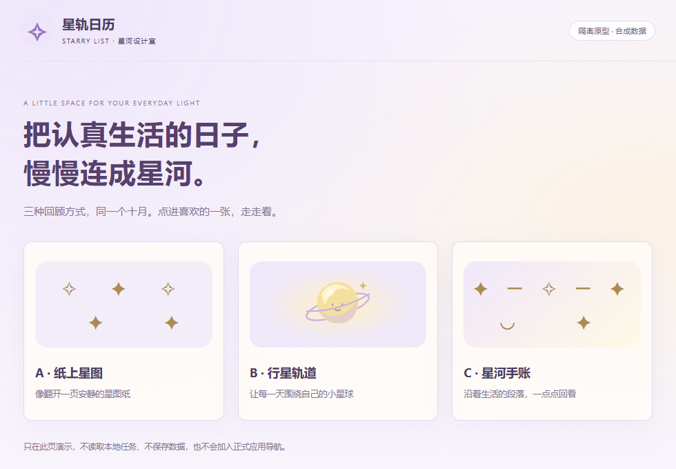

## 同一个十月，三种回顾方式

截图统一2026年10月、日常合成样本、选中14日（1/2完成）、阅读优先、经典顶部。三套使用相同任务和星星，不因数据不同制造优劣；其他月份通过固定合成相位呈现不同轨迹，重开数据一致。截图是独立Edge原型页面，不能冒充正式应用。

### A · 纸上星图

奶油色星图纸、柔紫细网点和大量留白。月度按周一到周日真实日历排列，每格数字下方有星；无计划只留日期，部分完成空心，全部完成淡金。点击后右侧卡片呈现原日期、任务与完成数量。年度微点也用空心/实心区分状态，不只依赖颜色；十二张小星图，固定1–12月顺序，点月份返回月度。装饰星印很轻，不让中心形象抢过日期。

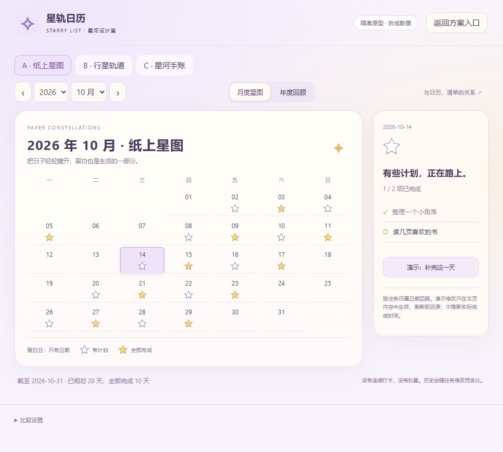
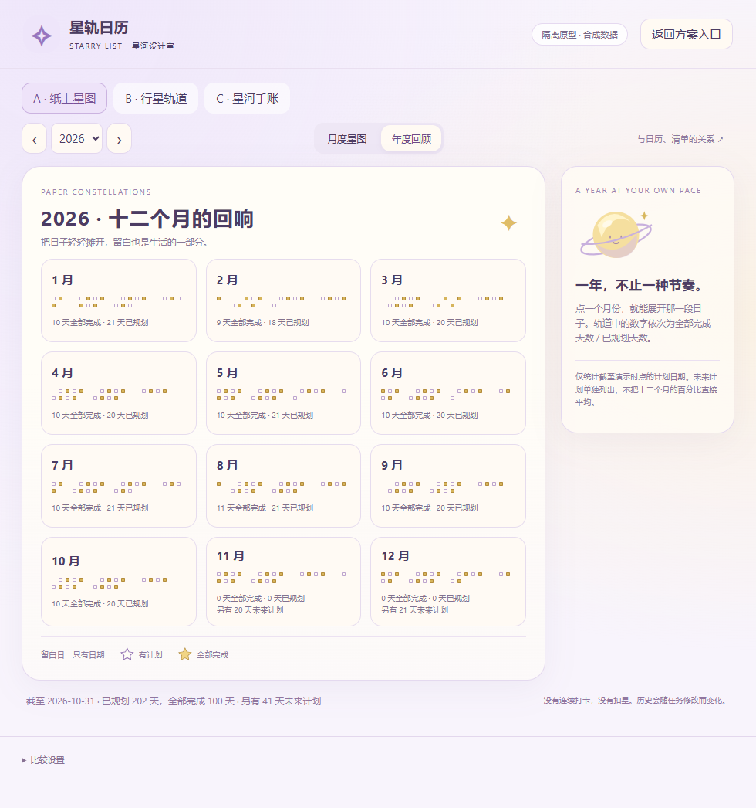

适合长期阅读，最接近现有月历；品牌差异稍弱，但认知和维护成本最低。

### B · 行星轨道

原创奶油小星球、两条椭圆轨道，每天标精确日期；奇数/偶数日分布外/内轨，日期顺序沿顺时针前进。空白日只有数字，星球不会承载必须升级或饥饿等状态。月度点击44px日期目标打开相同详情，星球与轨道仅装饰，不能遮住点击。年度十二个月围绕年度星球，按钮含月份和截至演示时点的完成/规划数量，未来计划另列；窄处改为月份网格。

初稿较矮的椭圆使少量日期点击区交叠；加高到440px并检测目标矩形后消除交叠。这个代价也说明B需要更多空间，不能只看第一眼吸引力。

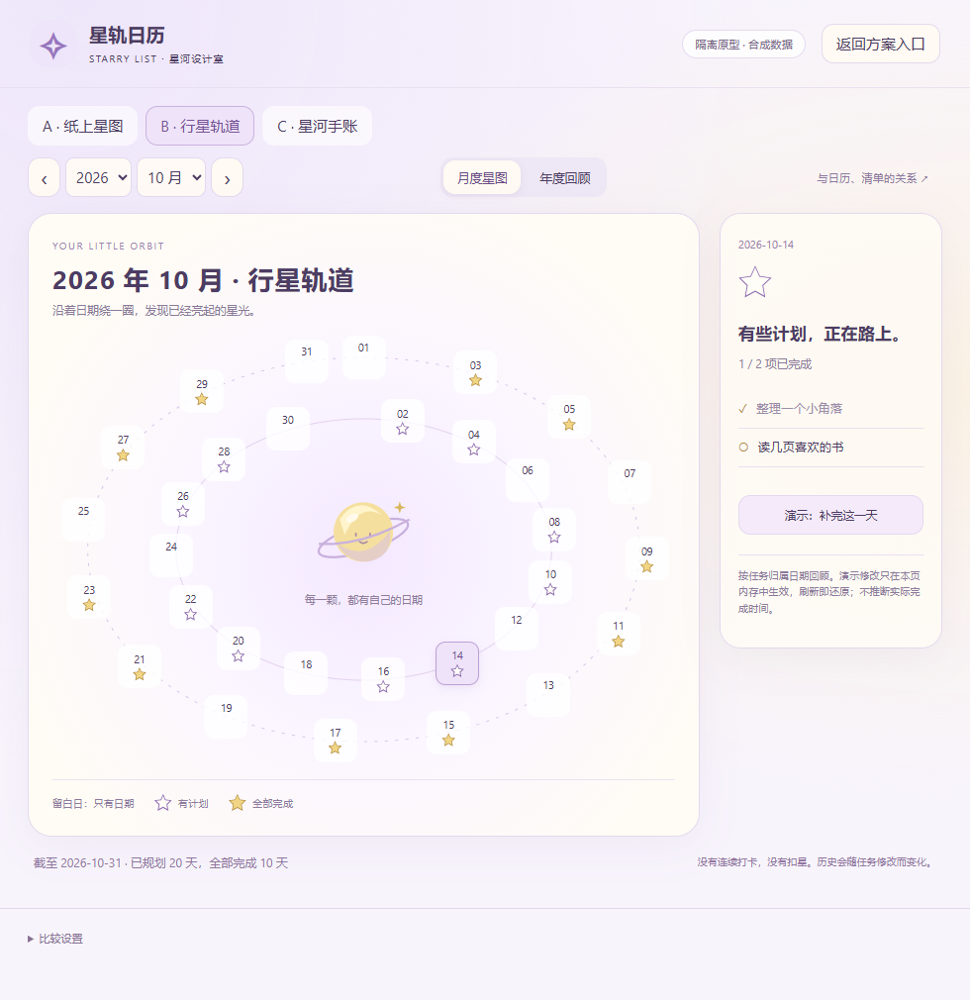
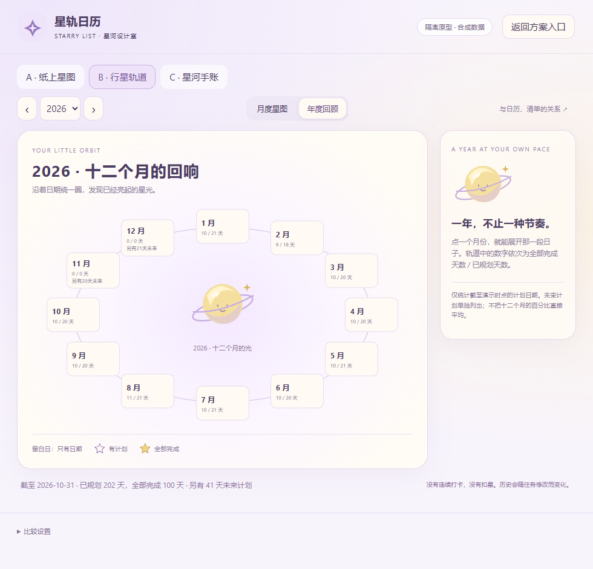

星球和曲线均本轮原创SVG，无商业角色、素材提取或持续旋转。视觉识别最强，但读日期要在两轨之间寻找；窄屏必须放弃环形以保易点。

### C · 星河手账（推荐候选）

按01–07、08–14等日期段落组织横向星轨，上方独立小星球和安静鼓励语。日期与星星清楚对齐，留白不变成“缺口”；年度以十二张段落卡片连接成回顾手账。它与A的星期月历不同，强调一段段日子的回看；星球保留品牌气质，但不挡日期、不把信息硬塞进圆环。

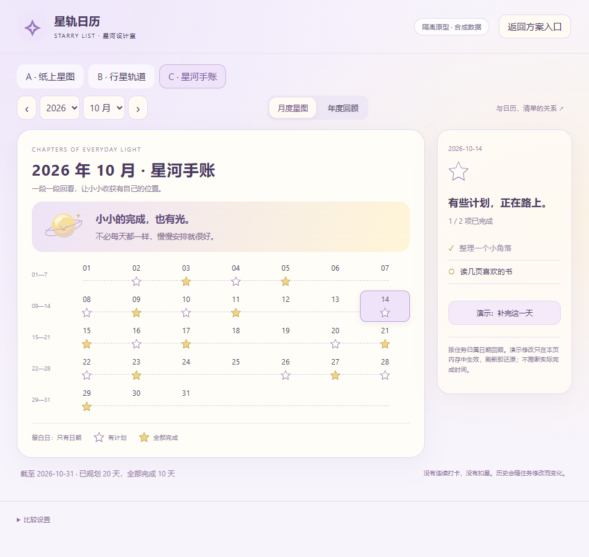
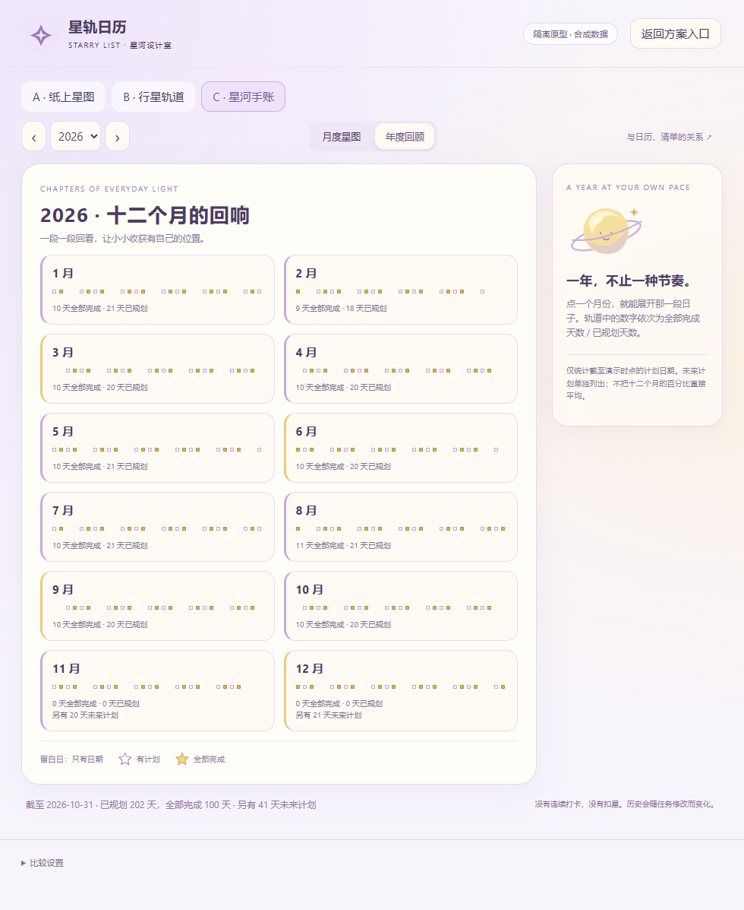

推荐C作为下一轮讨论起点：兼顾可爱、可读、清单信息的对应与维护成本。推荐不是用户已批准，也不自动进入正式实现。A可作为更安静的备选；B适合保留为可选仪式感方向。

## 响应式与访问

- 980×680：主要画面与日期详情分栏。超过首屏内容采用文档滚动，不藏日期。
- 760×620大字号：详情移到星图下方；不压缩文字、不缩放整页。B保留足够大的轨道，页面会更长。
- 500px窄窗：A保留七列日历；B将星球放在上方，展开为精确日期网格；C按日期段落排列；年度变2列或单列卡片。B年度容器≤620px降级，月度≤540px降级。
- 三档比较使用14/15/18px根字号并按角色比例排布；这是原型探索，不修改正式字号设置。经典顶部保留品牌副标，紧凑收短品牌和外围留白。
- 网页三材质只展示柔色/阅读衬底关系，**不代表Windows原生桌面模糊**。当前原型无持续动画，prefers-reduced-motion下也为0动画；仅选日/换方案时更新DOM，最多一年日期点，未使用粒子、canvas渲染循环或在线素材。
- 星形空心/填充和文字说明共同表达状态，键盘焦点明确；日期按钮可用方向键跨月，年/月选择为原生select。2x浏览器像素比已检查，不等同真实混合DPI/读屏认证。

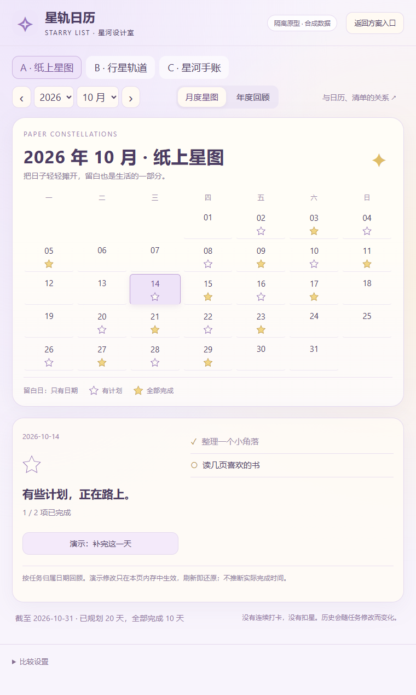
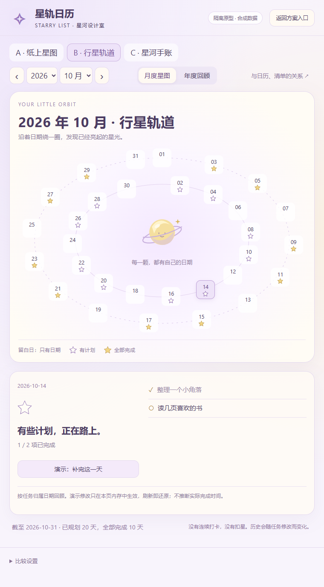
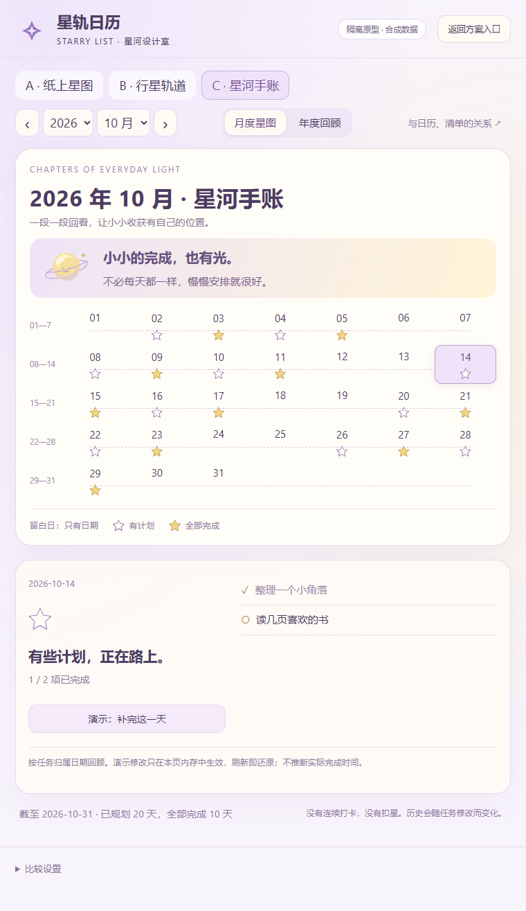


## 信息架构关系

候选入口是总览月历中的轻量“回顾”，进入独立回顾空间，再从选中日期回到专注清单；本轮只在原型入口/说明弹窗展示这层关系。正式应用仍只有总览和专注。星河不承担任务编辑主流程，避免装饰增加新增计划的成本。补水维持独立记录，使用一致柔紫/奶油/浅金语汇，但不计入任务星星或成为成长条件。

## 十三个维度比较

以下是原型观察与工程判断，不是用户最终选择，也不是量化用户研究得分。

| 维度 | A纸上星图 | B行星轨道 | C星河手账 |
| --- | --- | --- | --- |
| 第一眼吸引力 | 细腻安静，冲击适中 | 最高，中心形象明确 | 较高，星球与轨迹有层次 |
| 品牌一致性 | 紫/金一致，独特性适中 | 最高，直接回应星轨 | 高，品牌装饰与信息分工 |
| 可爱程度 | 克制 | 高，原创小星球为主角 | 中高，小星球陪伴但不抢内容 |
| 信息可读性 | 最高，熟悉日历位置 | 中，需追踪双轨日期 | 高，顺序段落容易扫读 |
| 月度清晰度 | 高，有星期对应 | 中高，日期准确但顺序跳内外轨 | 高，段落连续；星期需另看详情 |
| 年度清晰度 | 高，12小图可比较 | 中，小窗口必须退网格 | 高，按月份段落阅读 |
| 操作便利 | 高，日期和信息关系直接 | 中，日期目标须留足空间 | 高，线性阅读和选日 |
| 窄窗口适配 | 最简单，原布局基本保留 | 风险最高，放弃环形后差异减弱 | 高，详情下移/段落堆叠 |
| 大字号适配 | 较高，垂直变长 | 中，轨道高度增加明显 | 高，按段落扩展 |
| 动画/性能 | 最低，可完全静态 | 当前静态低；未来动画成本高 | 低，静态矢量与分段DOM |
| 工程难度 | 低中，日期网格成熟 | 高，命中/碰撞/年轨/降级 | 中，分段与详情可共用 |
| 维护成本 | 最低 | 最高，字号与日期密度组合多 | 中，装饰与信息布局可独立维护 |
| 长期舒适度 | 高，安静耐看 | 取决于克制程度，可能占空间 | 推荐，高可读性并保留品牌识别 |

## 规则演算：候选，不写入正式产品

原型只按合成任务的日期归组和completed展示：0条无星，至少1条未全完成为空心，全完成实心。正式dailyStarState完全未修改。用户补完/取消只在本页内存；不产生完成时间、余额或永久成就。

建议先显示“已规划P天、全部完成C天”，不把比例或领奖作为主角。P只包括回顾范围中有任务的日期，不把未规划日算未完成。若日后允许展开比例，候选C/P；P=0显示自然留白，不显示失败0%。

- 同样的合成十月：截至15日P=10、C=5，未来另有10天计划；截至31日P=20、C=10。月中不能用31天作为完成分母，也不能把未来计划当当天欠账。
- 在15日回顾时，把14日的部分完成补完，C从5到6，P仍10；取消某全完成日的一项则C下降。删光某全完成日唯一任务，C/P从5/10到4/9，该日无星，不解释为扣奖。
- 年度按日期累计，不能把各月比例直接平均。例如一月1/1、二月1/9，年度合计2/10而不是55.6%。闰年按真实日历日期；未来计划在计数中另列。
- 月末不会自动冻结历史。永久纪念可以研究“用户主动保存一张回顾图”，但与动态数据库事实分开；不自动回填旧月份奖励。
- 不建议先设月度半数/四分之三门槛或中心星球等级：它们可能诱导拆小任务或制造压力，且需额外历史/导入/隐私规则。中心星球当前只是原创装饰，并不要求用户天天喂养/升级。
- 真正完成时间只有明确需要“实际完成日”回顾时才另评审；旧updated_at不能回填completed_at。原型不构造任何此类记录。

## 正式补水维护：为什么原来挤占空间

旧代码根据宽度/字号用126/164/195/218px固定估值，只给任务约70px余量；真实杯子换行、2×2按钮和其他文字可能超过估值。因此在窄而高窗口也会保留过高的完整卡片。

新判断先扣除实际专注标题、七天条、任务标题、固定新增和边距，再实测相同宽度/字号下完整WaterCard。完整高度通过短暂离屏inert DOM探针取得：不挂载第二份React/数据组件，去除ID与URL引用，测完立即移除；不可见、不可交互，也不保存数据。ResizeObserver/内容变化合并到一帧，改变字号/目标/记录会重新测量。

预算规则：大字期望给任务160px，其他128px；卡片客户宽度<740px时，完整补水最多占剩余水/任务共用区域42%。两者取更严格值；从摘要恢复完整需要额外20px余量。每次测的是完整布局，而不是刚收起后的变小高度，避免反复跳动。极矮窗口无法保证160px，但保留原至少一行60px并完整显示新增；实际限制在下表如实记录。

摘要直接复用现有今日补水/日期/累计目标/展开入口和完整记录Dialog，没有重画水杯、不改总览、不增加设置或存储字段。输入、长任务、拖动与数据写入不因布局切换重新挂载。

### 前后量化（单位：CSS逻辑px）

同样2500mL目标、750mL合成记录、经典顶部与同样任务。高窗可能被本机工作区/窗口约束回到852px，以下900/1200采用明确的CDP逻辑视口模拟保证前后尺寸相同；原生实窗记录同时保留，不能把模拟称为独立大显示器验证。

| 场景 | 补水高度前→后 | 任务高度前→后 | 日期条 | 新增纵向位置前后 |
| --- | --- | --- | --- | --- |
| 760×680 大 | 168→81 | 92.31→179.31（+87） | 52.59 | 556.91–632.50，未变 |
| 760×900 大（视口模拟） | 176→89 | 201.81→288.81（+87） | 89.09 | 776.91–852.50，未变 |
| 760×1200 大（视口模拟） | 176→176，保留完整 | 501.81→501.81 | 89.09 | 1076.91–1152.50，未变 |
| 500×620 大 | 81→81，原已摘要 | 141.81→141.81 | 52.59 | 499.91–575.50，未变 |
| 380×480 大 | 81→81，原已摘要 | 61.01→61.01 | 35.40 | 384.91–435.50，未变 |
| 980×480 大 | 81→81，原已摘要 | 62.01→62.01 | 35.40 | 381.91–432.50，未变 |
| 980×680 小 | 96→96，完整 | 185.20→185.20 | 49.00 | 563.20–634.00，未变 |
| 980×680 标准 | 103→103，完整 | 172.41→172.41 | 50.20 | 561.60–634.00，未变 |
| 980×680 大 | 168→81 | 92.31→179.31（+87） | 52.59 | 556.91–632.50，未变 |

另做380×900的“完整布局参考”：在隔离测试DOM中短暂展示完整卡片，重现5杯换行与2×2按钮，卡片311px、任务95.81px；自动摘要为89px、任务317.81px，增加222px。这个参考是同一布局的受控对照，不冒充重新运行旧二进制；旧算法在该余量下的固定估值会选择完整，因而正是本次要修复的情况。380×1200的模拟中依然摘要，但任务617.81px；760×1200保持完整，证明并非按窄宽一刀切。

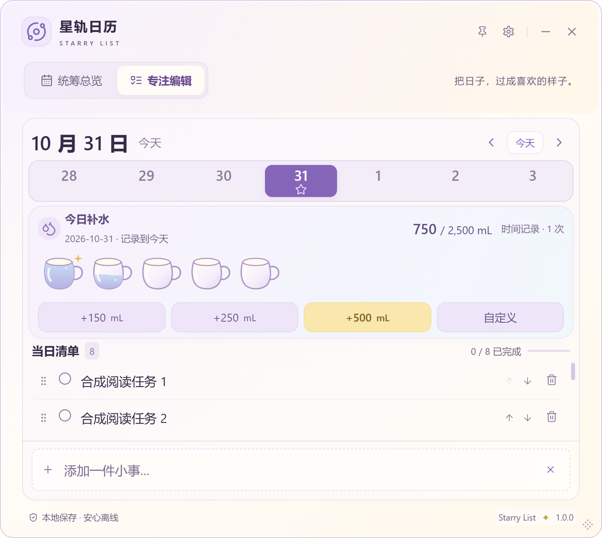

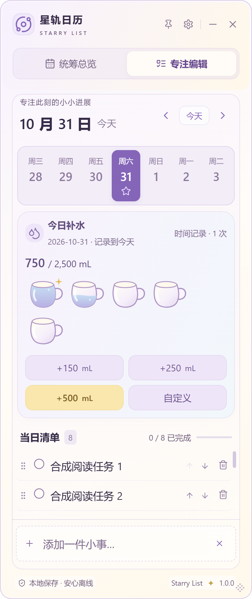

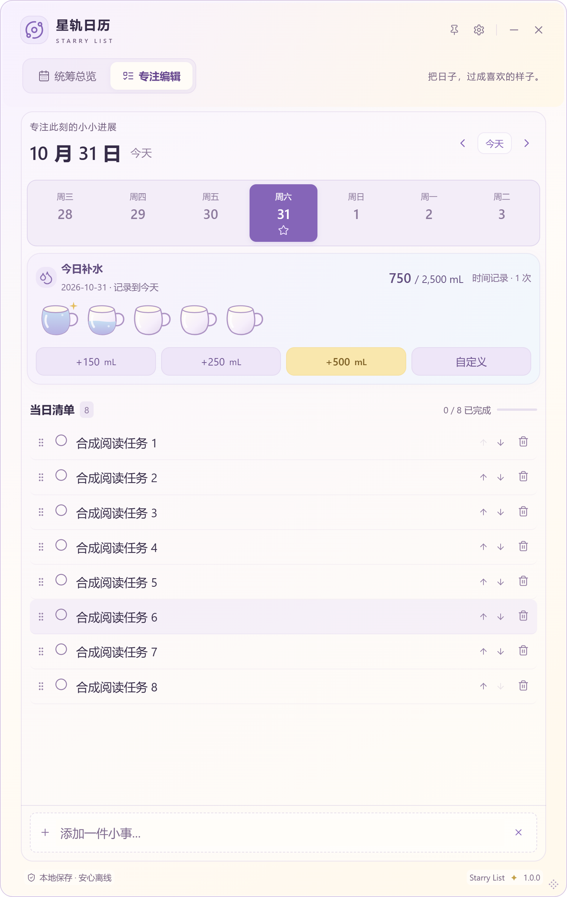

## 状态复核、验证与下一步

SL-022-B的无圈/专注同步获此次用户正面评价，结合原逐项验证，A原功能与B视觉唯一已知缺口闭合，A/B/父项Done（未发布），不关闭其他历史缺口。SL-024-E水杯主体获正面反馈，但本轮空间维护待安装确认，E及父项继续In Review；A/B/C/D Done。SL-023-A Design/In Review等方向选择，父项Idea/Design不Done；SL-006 Research。

原型与正式应用验证分开记录，最终前端/Rust/Windows回归、包与SHA256、Commit/CI见 [验证记录](../VALIDATION.md#sl-023-a--专注补水维护)。初稿自动化的入口名称/innerText调用错误已修正，轨道碰撞检查发现问题后调整；失败不计通过。无外部请求、无持久化、2x像素比、三态/补完/方向键/年月边界已检查。实际硬件GPU/混合DPI/读屏、Win10、安装升级/卸载仍未认证，原型CSS材质不等于原生模糊。

建议下一轮先由用户选择C/A/B、确认回顾入口与日期信息结构，再做所选方案的少量真实可用性评审；**目前不建议直接开发完整奖励/成长系统**。永久纪念、门槛、星球成长、真实完成时间与未来日统计均需单独确认。没有用户选定与正式授权，不进入正式星河开发。
